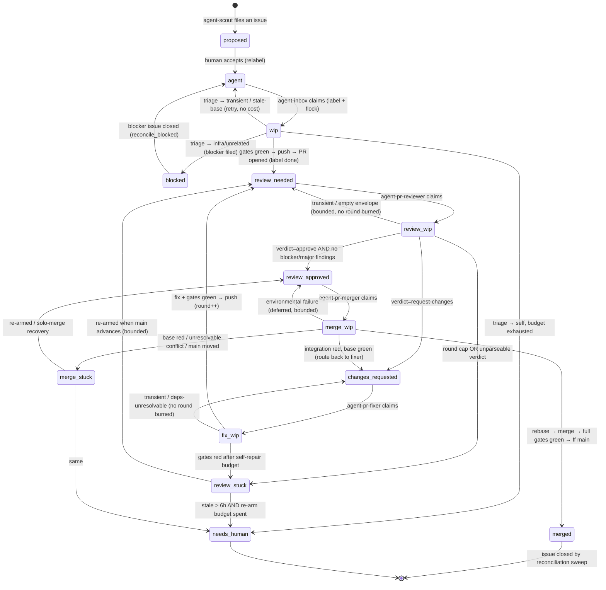
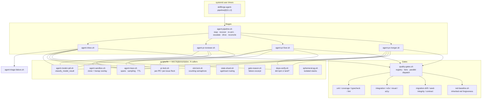
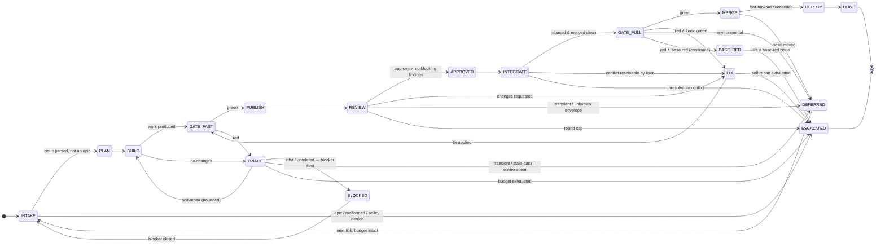
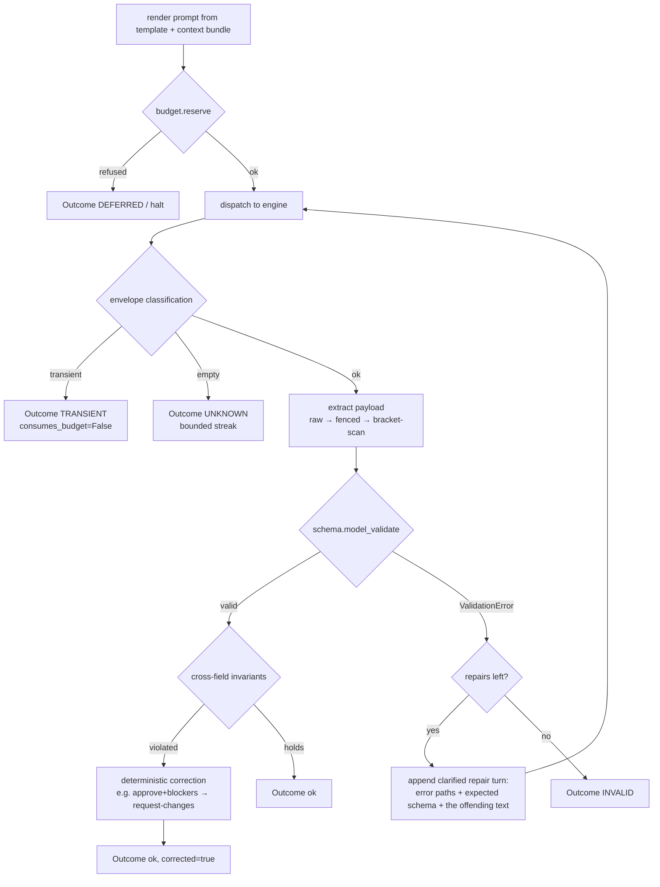
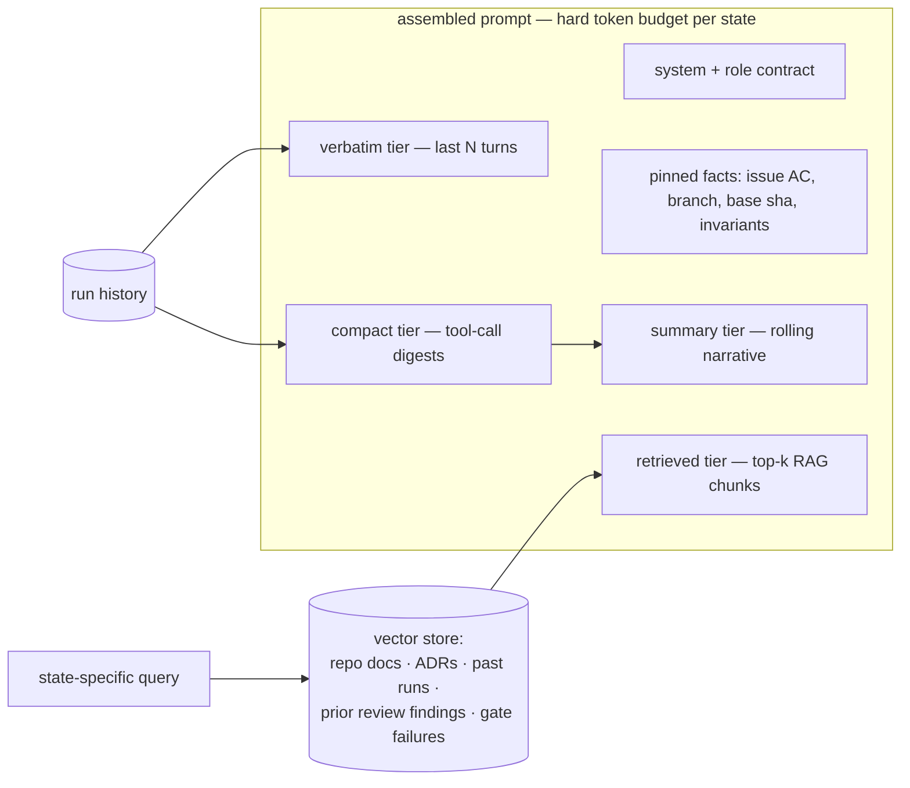
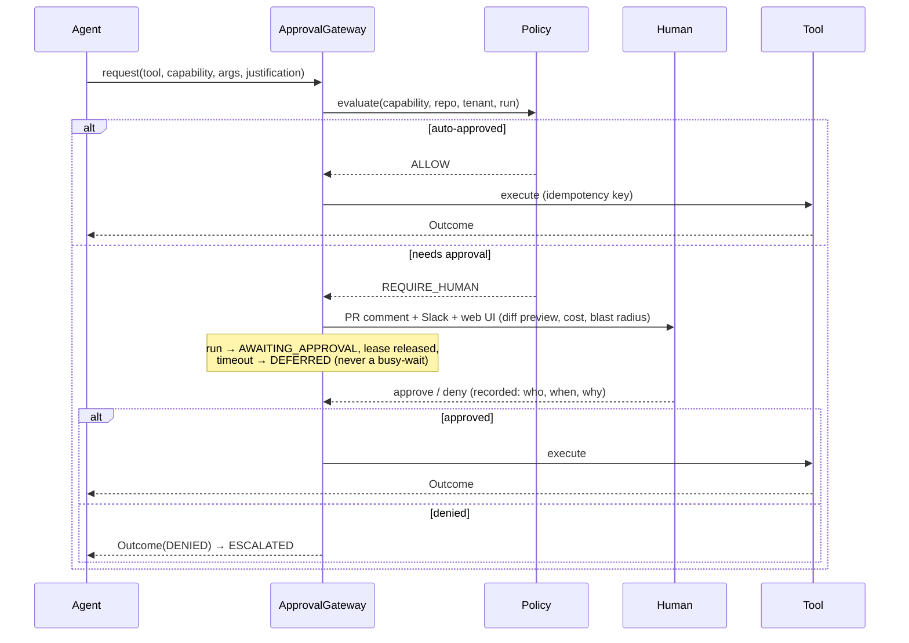
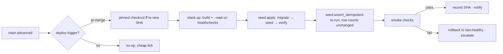
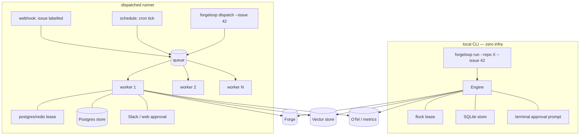

# AI App-Builder Harness — Code Analysis & Python Agent Design

**Part I** analyses the existing `scripts/` Bash harness (~25.6k lines, 90 scripts + 10 libs).
**Part II** proposes `forgeloop`, a Python re-implementation: an FSM-routed multi-agent worker that
takes an issue on any GitHub/GitLab repository, builds it in a clean worktree, reviews it, fixes it,
gates it, and merges it — runnable from a local CLI or dispatched to a remote runner.

---

# Part I — Analysis of the existing Bash harness

## 1. Inventory

| Layer | Scripts | LOC | Role |
|---|---|---|---|
| **Orchestrator** | `agent-pipeline.sh` | 526 | Single-issue serial driver; reaping, re-arming, escalation, reconciliation |
| **Producer** | `agent-scout.sh` | 901 | Scans the product, files `proposed` issues (6 engines + critic + dedup + ledger) |
| **Pipeline stages** | `agent-inbox.sh`, `agent-pr-reviewer.sh`, `agent-pr-fixer.sh`, `agent-pr-merger.sh` | 2,835 | build → review → fix → merge |
| **Router** | `agent-triage-failure.sh`, `route-failure.sh` | 929 | Classify a red gate into the right next action / owning skill |
| **Gates** | `quality-gates.sh` + 22 gate impls (`unit`, `e2e`, `coverage`, `migration-check`, `seed-integrity`, `i18n`, `visual`, …) | ~5,000 | The merge-blocking contract |
| **Loops** | `verify-loop.sh`, `adversarial-loop.sh`, `release-train.sh` | 1,934 | test→route→fix; loop-until-dry; weekly cut |
| **Deploy** | `local-deploy.sh`, `canary-deploy.sh`, `compose-deploy`, `db-backup*`, `db-restore-drill.sh` | ~1,200 | Local CD, Cloud Run canary + rollback, backup drills |
| **Libraries** | `lib/{agent-model-call,agent-trace,agent-sandbox,pr-lock,slot-lock,state-shard,gate-reason,deps-verify,ephemeral-pg,test-env}.sh` | 1,500 | The shared primitives |
| **Tests** | 40 × `*.test.sh` | ~8,000 | Hermetic suites — `gh`/`claude`/`git` stubbed, zero network, zero LLM cost |

## 2. The pipeline as it actually runs



Two things stand out. First, **the label set _is_ the state machine** — there is no separate state
store for pipeline position. Second, **every terminal state has a re-entry path**: `review-stuck`
and `merge-stuck` are re-armed when `main` advances, `blocked` is re-queued when its blocker closes,
and stale `*-wip` claims are reaped. The machine is designed to be un-wedgeable.

## 3. Layered architecture



## 4. What this harness gets right — the patterns worth porting

These are hard-won; nearly every one carries a comment naming the incident that produced it.

### 4.1 A label is a claim, a lock is a mutex

`lib/pr-lock.sh:1-33` states the invariant precisely: labels are written *after* the eligibility
read, over the network, with no compare-and-set, so two stages can both read "unclaimed" and both
write the claim. A local `flock` closes the window. Crucially the fd is held open and released by the
kernel on process exit — **a crashed stage cannot strand a PR**.

The complement is `agent-pipeline.sh:370-414` (`reap_stale_claims`): a label *outlives* its process,
a lock does not, so "labelled `wip` but unlocked **and** untouched for 20 min" is a decidable,
reapable state. That two-condition test is the whole design — the grace period exists because the
lock is taken just *after* the label is written.

### 4.2 Model-result classification with an explicit "unknown" class

`lib/agent-model-call.sh:62-96` classifies a CLI envelope into `transient | empty | hard | ok`.
The `empty` class is the subtle one: a zero-byte envelope means *we learned nothing*, which is the
opposite of "the model produced a bad answer". Treating it as `hard` discarded a complete $2.29 opus
review on PR #2407. Every consumer bounds its `empty` retries (`agent-pr-reviewer.sh:288-302`,
counter resets on any classifiable result) so a permanently-silent CLI still reaches a human.

### 4.3 A transient never consumes a budget

Reviewer round, fixer round, fixer self-repair attempt, merger deferral, triage attempt — every
counter distinguishes *the model ran and was wrong* from *the model never ran*. See
`agent-pr-fixer.sh:339-343` and its comment on ordering: the transient check **must** precede the
"no code changes" check, or a rate-limited run reads as "nothing to fix" and burns a round.

### 4.4 Never trust the model's own verdict field

`agent-pr-reviewer.sh:353-367`: an `approve` that also carries `blocker`/`major` findings is
deterministically downgraded to `request-changes`. The prompt already says not to do this; the code
enforces it anyway, because the merger ships on the label alone. **Cross-field invariants are
validated in code, not delegated to the prompt.**

### 4.5 Isolation is structural, not advisory

`lib/agent-sandbox.sh:1-39` is the best comment in the tree. A `bypassPermissions` model handed a
linked worktree simply `cd`'d to the primary checkout and ran `git checkout` there, switching the
repo the timers were executing from off `main`. The fix is two-part and both parts are required:
a self-contained local clone (a linked worktree's `.git` is a *pointer* into the primary, so hiding
the primary breaks it) **plus** a bubblewrap tmpfs overlay that makes the primary an empty directory
for the model's process. The header's own verdict: *"a comment is not an enforcement mechanism."*

### 4.6 Failure taxonomy before failure routing

`agent-triage-failure.sh` classifies a red gate into six classes before acting:

| Class | Test | Action |
|---|---|---|
| `transient` | rate limit / docker down / OOM / DNS | retry, file nothing, no cost |
| `deps` | bare specifier unresolvable, ≥5 whole test files died at load, diff owns neither manifest nor importer | retry on fresh install, fingerprinted **by package** |
| `self` | failing area ∩ agent's changed files ≠ ∅ | self-repair with the log fed back (bounded) |
| `infra` | alembic/boot/DB signatures | file a deduped blocker, mark `blocked` |
| `unrelated` | failure in untouched files | file a deduped flaky issue, mark `blocked` |
| `stale-base` | same as `unrelated` **but branch is behind base** | retry — the fix is probably already on `main` |

`stale-base` is the most interesting: "this failure is pre-existing on main" is a claim about `main`
that a behind-base tree cannot support. Filing it produced the #2212→#2217 unfalsifiable-blocker
chain, where closing a blocker re-queued the parent onto the same stale tree.

### 4.7 Fingerprints, ledgers, and caps against self-filing storms

Any loop that files its own work items needs three guardrails, and this one has all three
(`agent-triage-failure.sh:33-36`): a **stable fingerprint** (paths, line numbers, hex, timestamps
stripped) checked against open issues; a **per-fingerprint attempt ledger** persisted across ticks;
and a **global cap** on open auto-filed blockers.

The fingerprint itself is layered — pytest nodeid → Playwright spec+title → vitest spec+title →
**cluster signature** (sorted file set + hash) when the failure spans ≥2 test files → lossy slug
tagged `-unclassified`. The cluster tier exists because pytest-xdist shards by worker, so the
"first failure" is a coin toss and one breakage was being filed as an endless stream of new issues.
There is even a sanity guard (`sig_names_a_failing_file`) that *demotes* a signature naming a file
that is not in the failing set — a confident pointer at an innocent test is worse than an honest
low-confidence one.

### 4.8 Judge a branch by the failures it *adds*

`red-baseline.sh` records which tests are already red at a base SHA, so a branch that inherits
breakage goes green and merges. It is fail-closed by construction: the baseline is consulted only
when recorded for the **exact** base commit, and a run *on* the base records rather than consults
(a red base must never forgive itself). This generalises `mypy-baseline` to every suite gate.

### 4.9 Environmental failure is a third outcome, not a red base

`agent-pr-merger.sh:713-800`. The merger originally knew two outcomes — PRs at fault, or `main` at
fault. Under Docker resource starvation the base run failed too, so the batch was parked at
`merge-stuck` with "a human must fix main" — an accusation that was simply false and that no retry
could clear. Now: transient signature → **defer the batch** (bounded at 3, then escalate with the
*correct* remedy text); unresolved-but-declared workspace deps → defer; unresolved-and-undeclared →
that's a code defect, fall through.

The deps check is deliberately **not** a log pattern match — a genuinely deleted import also says
"Cannot find module". It re-measures the tree (`lib/deps-verify.sh`) at the moment the gates went
red. Behaviour derived from state, not from prose.

### 4.10 Skip is not pass

`quality-gates.sh:104-137`. Gates return `0 | 77 (skip) | other`. A `77` on a **tier-required** gate
is promoted to FAIL — you cannot be green on a gate you never ran. Three more doors into the same
hole are closed explicitly: an unknown `--tier` fails closed rather than falling back to a weaker
set; a required gate removed via `--skip` (deny-list) fails, while one merely absent from `--only`
(allow-list) is an honest skip; and a gate in the registry with no implementing function fails
loudly instead of vanishing.

### 4.11 Bounded everything, with a kill-tree

`_exec_gate` (`quality-gates.sh:279-310`) enforces a hard per-gate wall-clock and recursively
SIGKILLs the whole process tree — a bare `kill` orphans the vitest worker pool and the compose
children, which are exactly the processes that wedge a gate. Every loop has a cap: `PIPELINE_MAX_ROUNDS`,
`REARM_MAX`, `MAX_OPEN_PRS`, `PR_MAX_ROUNDS`, `FIXER_MAX_SELF_REPAIR`, `TRIAGE_MAX_ATTEMPTS`,
`TRIAGE_MAX_OPEN`, `TRIAGE_MAX_TRANSIENT`, `MERGER_MAX_ENV_DEFER`, resolver retries, and a rebase
runaway backstop at 1000 iterations.

### 4.12 Telemetry that survives being useless

`lib/agent-trace.sh` emits one JSONL span per model call — tokens, cost, duration, session id,
stage, round *vs* attempt (two deliberately distinct axes), and a **privacy-safe prompt fingerprint**
(`template_id`, `sha256`, byte count — never the text). Retention is conditional: errors and
expensive calls are kept 14 days, a deterministic ~8% content-hash sample 3 days, the rest swept at
end of tick. The contract is explicit — *it never fails the caller*; a missing `jq`, an unparseable
envelope, an unwritable dir all degrade to a no-op.

### 4.13 Work-stealing beats partitioning

`AGENT_SLOT` originally selected the *k*-th eligible issue. Collision-free, but with one eligible
issue only lane 0 could ever claim it — observed 2026-07-25, three lanes idle. Now the slot is only a
**starting offset** into a rotated candidate list and any lane may steal any unlocked issue
(`pr-lock.sh:184-205`).

### 4.14 Hermetic, injectable, testable

Every external command and path is env-overridable (`AGENT_GH`, `PR_CLAUDE`, `AGENT_ROOT`,
`PIPELINE_*`), so 40 test suites run the real scripts against stubbed `gh`/`claude` and a real bare
git origin — zero network, zero LLM cost. `agent-triage-failure.sh` goes further: every *mutating*
`gh` call funnels through `do_gh`, which `--dry-run` turns into a printed `WOULD:` line, so the
router can be dry-run against live issues. `lib/test-env.sh` scrubs inherited lane config, after
`AGENT_SLOT=1` from a systemd unit made a suite red on lanes 1–2 and green on lane 0.

## 5. Where the Bash implementation hits its limits

None of these are criticisms of the design — they are the reasons to port it.

1. **State lives in three places that can disagree.** GitHub labels (pipeline position), `/tmp`
   flocks (exclusion), and `/tmp/*.count` / ledger JSONL files (budgets). The `/tmp` half is lost on
   reboot, so a dependency retry counter or an empty-envelope streak silently resets. There is no
   single durable run record.

2. **Budgets are counted by scraping comments.** Round number comes from
   `capture("pr-loop-round: (?<r>[0-9]+)")` over PR comments; re-arm count from counting
   `<!-- rearm: -->` markers; merger deferrals from counting marker comments. Each is an API call,
   each is fail-closed-on-parse-failure, and each conflates "the record" with "the notification".

3. **No token or cost circuit breaker.** Spans *record* cost after the fact; nothing *refuses* a
   call. A stuck loop is bounded by iteration count, not by dollars.

4. **No context management.** Every model call is a fresh `claude -p` with a hand-built prompt; the
   diff is truncated with `head -c 60000`. There is no summarisation tier, no retrieval, and no way
   to resume a session with accumulated understanding.

5. **No output schema enforcement.** The reviewer prompt asks for JSON and the parser has a
   three-rung salvage ladder (raw → fenced → bare-object). PR #2419 went `review-stuck` because a
   `sed` range with `q` returned the single character `{` — non-empty, so the raw fallback never ran.
   Fixed, but the class of bug is structural: there is no schema, no validation, and no repair
   round-trip.

6. **GitHub-only.** `gh` is threaded through everything. GitLab would mean a parallel tree.

7. **The parsing surface is enormous.** ~40 regexes classify test-runner output across pytest,
   vitest, Playwright, alembic, npm and Docker. Every runner upgrade is a potential silent
   mis-classification — and mis-classification here means burning the fix budget on an innocent test.

8. **Concurrency is process-level.** `flock`, subshells, `$(…)` return channels. Half the sharpest
   comments in the tree are about `printf -v` name collisions, `continue` inside `( … )`, `exec`
   without a command applying redirections permanently, and `grep -q` SIGPIPE-ing a pipeline under
   `pipefail`. This is the tax on the language, not on the design.

---

# Part II — `forgeloop`: the Python design

## 6. Goals

| # | Goal | Mechanism |
|---|---|---|
| G1 | Issue → worktree → branch → build → review → fix → gate → merge | FSM-routed multi-agent pipeline |
| G2 | Local CLI **and** dispatched runner, same code | One `Engine`, three drivers (CLI, worker, webhook) |
| G3 | Forge-agnostic (GitHub / GitLab) | `Forge` protocol + adapters |
| G4 | Never crash; degrade and communicate | Typed outcomes, no exception escapes the state handler |
| G5 | Deterministic LLM I/O | Pydantic schemas + bounded repair loop |
| G6 | Bounded cost, time, iterations | Circuit breakers checked *before* every spend |
| G7 | Human approval for destructive actions | Capability-tagged tools + approval gateway |
| G8 | Cheap context | Tiered memory + RAG retrieval |
| G9 | No duplicated logic | Shared kernel; every stage is configuration over the same primitives |

**Non-goals.** Replacing the quality gates themselves (they stay as repo-owned executables — the
harness *runs* them, it does not *own* them). Replacing the model CLI (the `claude` CLI stays one
supported engine adapter alongside the SDK).

## 7. Package layout

```
forgeloop/
├── kernel/
│   ├── fsm.py             # State, Transition, Machine, Router
│   ├── outcome.py         # Outcome[T] — the universal return type
│   ├── budget.py          # CircuitBreaker, BudgetLedger, CostTracker
│   ├── retry.py           # @resilient — backoff, jitter, classification-aware
│   ├── lease.py           # distributed lease (the flock generalisation)
│   ├── classify.py        # ModelOutcome + FailureClass taxonomy
│   ├── fingerprint.py     # stable failure signatures + clustering
│   └── telemetry.py       # spans, sampling, TTL, OTel export
├── llm/
│   ├── client.py          # provider-agnostic, budget-aware
│   ├── structured.py      # call_structured[T: BaseModel] + repair loop
│   ├── schemas.py         # every LLM contract in the system
│   └── engines/           # anthropic_sdk.py, claude_cli.py, litellm.py
├── context/
│   ├── tiers.py           # verbatim → compact → summary → archive
│   ├── summarizer.py
│   ├── retrieval.py       # RAG: embed, upsert, top-k
│   └── stores/            # pinecone.py, pgvector.py, qdrant.py, null.py
├── forge/
│   ├── protocol.py        # Forge, Issue, PullRequest, Comment, Label
│   ├── github.py          # PyGithub / httpx
│   ├── gitlab.py          # python-gitlab
│   └── labels.py          # canonical state-label vocabulary
├── workspace/
│   ├── repo.py            # clone, fetch, rebase, generated-file conflict policy
│   ├── worktree.py        # WorktreeSession — acquire/build/release
│   ├── sandbox.py         # bubblewrap / container / none, capability-probed
│   └── deps.py            # provisioning + *verification* (deps-verify port)
├── gates/
│   ├── registry.py        # gate registry, tiers, skip→fail promotion
│   ├── runner.py          # parallel dispatch, resource classes, kill-tree
│   ├── baseline.py        # inherited-red forgiveness
│   ├── reason.py          # diagnostic excerpt extraction
│   └── adapters/          # shell.py (runs repo scripts), pytest.py, vitest.py…
├── agents/
│   ├── base.py            # Agent — one prompt + one schema + one policy
│   ├── builder.py  reviewer.py  fixer.py  merger.py
│   ├── triager.py  scout.py     resolver.py
├── states/                # one module per FSM state, each ~80 lines
├── deploy/
│   ├── stack.py           # ephemeral compose/k8s stack (ephemeral-pg port)
│   ├── seed.py            # seed manifest, idempotency assertion
│   └── canary.py          # deploy → smoke → promote | rollback
├── drivers/
│   ├── cli.py             # `forgeloop run --issue 42`
│   ├── worker.py          # queue consumer (Celery/ARQ/SQS)
│   └── webhook.py         # FastAPI receiver → enqueue
└── config.py              # pydantic-settings, layered, fully overridable
```

**Reuse rule (G9), enforced by a lint gate:** a module may import *down* the stack
(`agents → llm → kernel`) but never sideways between peers. Anything two stages need lives in
`kernel/` or `llm/` — the same rule that produced `lib/deps-verify.sh` after the third copy of
`npm ci` trust appeared.

## 8. The kernel

### 8.1 `Outcome[T]` — the universal return type

Nothing in the pipeline raises across a state boundary. Every operation returns an `Outcome`, and
the FSM routes on its class. This is `classify_model_result` generalised to the whole system.

```python
class FailureClass(StrEnum):
    TRANSIENT   = "transient"    # self-healing: rate limit, 5xx, docker down, OOM
    UNKNOWN     = "unknown"      # the `empty` class — we learned NOTHING. Retry bounded.
    INVALID     = "invalid"      # ran, produced unusable output → schema repair
    ENVIRONMENT = "environment"  # the tooling could not run → defer, blame nobody
    DEFECT      = "defect"       # genuine code failure → route to a fixer
    DENIED      = "denied"       # policy/approval refused → escalate to human
    FATAL       = "fatal"        # misconfiguration → stop the run loudly

class Outcome[T](BaseModel, frozen=True):
    ok: bool
    value: T | None = None
    failure: FailureClass | None = None
    reason: str = ""
    detail: str = ""            # the diagnostic excerpt, not a blind tail
    cost_usd: float = 0.0
    tokens: TokenUsage = TokenUsage()
    duration_ms: int = 0
    consumes_budget: bool = True   # TRANSIENT/UNKNOWN/ENVIRONMENT set this False
```

`consumes_budget` is §4.3 made structural: a transient can never burn a round because the field that
decides it lives on the outcome, not in each caller's `if`.

### 8.2 The FSM

```python
class Machine:
    def __init__(self, states: dict[StateName, StateHandler], breaker: CircuitBreaker): ...

    async def step(self, ctx: RunContext) -> StateName:
        handler = self.states[ctx.state]
        if verdict := self.breaker.check(ctx):        # BEFORE any spend
            return await self._halt(ctx, verdict)
        async with ctx.lease.renewed():                # heartbeat while working
            outcome = await handler.run(ctx)           # never raises
        nxt = handler.route(outcome)
        await ctx.store.transition(ctx.run_id, ctx.state, nxt, outcome)
        return nxt
```

Handlers are pure-ish: `run()` performs the work and returns an `Outcome`; `route()` maps
`Outcome → StateName` with **no I/O**, which makes routing unit-testable as a table. Every handler is
wrapped so that an unexpected exception becomes `Outcome(failure=FATAL)` — G4 holds by construction.



`DEFERRED` is a first-class state, not an error path. It is the single place that encodes "come back
later, having spent nothing" — the generalisation of the transient/empty/environmental deferrals that
are currently spread across four scripts.

### 8.3 Durable state (fixing limit #1 and #2)

One `Run` row is the source of truth. Labels become a **projection** pushed to the forge for human
visibility, not the state itself.

```python
class Run(SQLModel, table=True):
    run_id: UUID; tenant: str; user: str
    forge: str; repo: str; issue: int; pr: int | None
    state: StateName; prev_state: StateName | None
    round: int = 0; self_repair: int = 0; defer_count: int = 0
    unknown_streak: int = 0; rearm_count: int = 0
    tokens_in: int = 0; tokens_out: int = 0; cost_usd: float = 0.0
    started_at: datetime; deadline_at: datetime
    lease_holder: str | None; lease_expires_at: datetime | None
    payload: dict          # branch, worktree, base_sha, fingerprints…
```

Every counter that is currently scraped from comments becomes a column. Comments remain, but as
*notification*, generated from the row. Consequences: budgets survive reboots; "why is this PR
stuck?" is one query; and the run is resumable from any state because the row carries everything the
handler needs.

### 8.4 Leases (the flock generalisation)

`flock` is correct for one host and useless across a fleet. `Lease` is the same contract with a
pluggable backend:

```python
class Lease(Protocol):
    async def acquire(self, key: str, ttl: timedelta) -> bool: ...
    async def renew(self) -> bool: ...
    async def release(self) -> None: ...
```

- **local** — `fcntl.flock`, byte-identical semantics to today, zero infra for CLI use.
- **postgres** — `SELECT … FOR UPDATE SKIP LOCKED` on the `Run` row.
- **redis** — Redlock for a multi-region fleet.

The key preserves today's namespacing: `{forge}:{repo_key}:{kind}:{id}` where `repo_key` is the
sha1 of the git common dir (`pr-lock.sh:58-65`), so two checkouts of different repos never contend.

**Reaping** is now trivial and reliable: a lease has an expiry column, so "claimed but expired" is a
`WHERE` clause, not a two-condition heuristic over label mtimes. Work-stealing (§4.13) is
`ORDER BY priority, created_at … SKIP LOCKED` — the database does the rotation.

### 8.5 Circuit breakers (G6)

Checked **before** every spend, not after — the gap that makes today's telemetry advisory.

```python
class CircuitBreaker:
    max_iterations: int = 40         # FSM steps per run
    max_state_reentries: int = 4     # per state — the round cap, generalised
    max_tokens: int = 2_000_000
    max_cost_usd: float = 25.0
    max_wall_clock: timedelta = timedelta(hours=3)
    max_tool_calls: int = 500
    max_consecutive_unknown: int = 2

    def check(self, ctx) -> HaltVerdict | None: ...
    def reserve(self, estimate: TokenEstimate) -> Reservation: ...   # refuses if it would breach
```

`reserve()` is the piece missing today: the estimated cost of a call is checked against the remaining
budget *before* dispatch, so a run cannot overshoot by one expensive opus turn. Budgets nest —
per-run ⊂ per-repo/day ⊂ per-user/month ⊂ per-tenant — and a breach at any level halts with an
explicit `HaltVerdict` that names the limit, the consumption, and the override knob.

Cost is tracked per `(tenant, user, repo, run, state, agent, model)` so "which stage is expensive"
and "who spent this" are both one aggregation.

### 8.6 Resilient tool calls (G4)

```python
@resilient(
    attempts=5, base_delay=1.0, max_delay=60.0, jitter=True,
    retry_on={FailureClass.TRANSIENT},
    fallback=lambda exc: Outcome.failed(ENVIRONMENT, "forge unreachable"),
)
async def add_label(forge: Forge, pr: int, label: str) -> Outcome[None]: ...
```

The decorator is classification-aware: it retries `TRANSIENT`, never retries `DEFECT` or `DENIED`,
and honours `Retry-After`. Idempotency keys are attached to every mutating forge call so a retry
after a lost response never double-posts. A per-dependency breaker (forge, model provider, vector
DB) opens after N consecutive failures and short-circuits to the fallback, so an outage degrades the
run to `DEFERRED` instead of hammering a dead endpoint.

## 9. Deterministic LLM I/O (G5)

Every model call in the system goes through one function. There is no second path.

```python
async def call_structured[T: BaseModel](
    *, agent: str, template: PromptTemplate, schema: type[T],
    ctx: RunContext, model: str, max_repairs: int = 2,
) -> Outcome[T]:
```



Three properties worth naming:

1. **Extraction is a ladder where each rung must *parse*, not merely be non-empty.** That is the
   exact fix for the PR #2419 `{`-character bug (§5.5), promoted from a patch to an invariant.
2. **The repair turn is a clarification, not a re-ask.** It carries the Pydantic error paths, the
   JSON Schema, and the offending output — the same "feed the failure back" principle the fixer's
   self-repair loop already uses for gates.
3. **Cross-field invariants live in the schema**, as `@model_validator`, so §4.4's approve/blocker
   reconciliation cannot be forgotten by a new caller:

```python
class ReviewVerdict(BaseModel):
    verdict: Literal["approve", "request-changes"]
    summary: str = Field(min_length=20, max_length=2000)
    findings: list[Finding] = []

    @model_validator(mode="after")
    def approve_implies_no_blockers(self):
        if self.verdict == "approve" and any(
            f.severity in (Severity.BLOCKER, Severity.MAJOR) for f in self.findings
        ):
            raise SelfContradiction(downgrade_to="request-changes")  # caught → deterministic fix
        return self
```

Every contract in the system is one of these: `BuildPlan`, `ReviewVerdict`, `FixReport`,
`TriageDecision`, `ConflictResolution`, `ScoutCandidate`, `CriticVerdict`, `DeployVerdict`. They live
in one module, are versioned (`template_id = "reviewer-v2"`), and are the only thing an agent may
return.

## 10. Context optimization (G8)



**Tiering.** Turns age through four tiers under a per-state token budget. Recent turns stay verbatim;
older tool calls collapse to digests (`ran gates → 2 failed: unit, contract`); older still are folded
into a rolling summary produced by a cheap model. Pinned facts — the acceptance criterion, the base
SHA, the branch — never age out, because losing the acceptance criterion is how a fixer starts
drifting.

**Retrieval.** A `VectorStore` protocol with Pinecone / pgvector / Qdrant adapters and a `null`
adapter so the CLI works with zero infra. Indexed: repo docs and ADRs, prior review findings on the
same files, historical gate failures with their fingerprints, and past run summaries. Queries are
state-specific — the reviewer retrieves *"prior findings on the files in this diff"*, the triager
retrieves *"past failures with this fingerprint and what fixed them"*. That second one is the payoff:
today's ledger only counts attempts; a retrieval index makes the *resolution* reusable.

**Diff handling.** Instead of `head -c 60000`, diffs are chunked per-file, ranked by relevance to the
acceptance criterion, and truncated per-file with an explicit `… N lines elided …` marker — so the
model knows what it cannot see.

## 11. Guardrails (G7)

Every tool declares a capability; capabilities map to a policy.

```python
class Capability(StrEnum):
    READ            = "read"              # auto
    WRITE_WORKSPACE = "write:workspace"   # auto — sandboxed worktree only
    WRITE_BRANCH    = "write:branch"      # auto — agent/* branches only
    COMMENT         = "comment"           # auto
    LABEL           = "label"             # auto
    MERGE_DEFAULT   = "merge:default"     # ← approval unless policy.auto_merge
    FORCE_PUSH      = "push:force"        # ← always approval
    DELETE_BRANCH   = "delete:branch"     # ← approval
    DELETE_DATA     = "delete:data"       # ← always approval, always audited
    DEPLOY_PROD     = "deploy:prod"       # ← always approval
    EXTERNAL_SEND   = "send:external"     # ← always approval
    SPEND           = "spend"             # ← always approval
```



`AWAITING_APPROVAL` releases the lease and persists — the worker is free, and a runner can be
recycled without losing the run. Approvals are scoped (this run, this capability, this argument
hash) and never blanket.

**Sandboxing** ports §4.5 faithfully: `sandbox.py` probes for bubblewrap/user-namespaces (or a
container runtime), hides the primary checkout behind a tmpfs, re-binds only what genuinely resolves
underneath it, and **loudly reports** when isolation is unavailable rather than silently proceeding.
The model always works in a self-contained clone, never a linked worktree.

## 12. Forge abstraction (G3)

```python
class Forge(Protocol):
    async def list_issues(self, *, labels, state, limit) -> list[Issue]: ...
    async def open_pr(self, *, head, base, title, body) -> PullRequest: ...
    async def set_labels(self, number: int, *, add, remove) -> Outcome[None]: ...
    async def comment(self, number: int, body: str, *, idem_key: str) -> Outcome[None]: ...
    async def diff(self, pr: int) -> Diff: ...
    async def merge(self, pr: int, *, strategy: MergeStrategy) -> Outcome[MergeResult]: ...
    def capabilities(self) -> ForgeCapabilities: ...
```

`capabilities()` is what makes one FSM serve both forges: GitHub has no atomic label CAS, GitLab has
merge trains and approval rules. The machine queries capabilities and picks an equivalent strategy
rather than branching on `if forge == "gitlab"` in twelve places. The canonical label vocabulary
lives in `forge/labels.py` and is mapped per-forge, so GitLab's scoped labels
(`agent::review-needed`) work without touching a state handler.

Two behaviours ported directly: mutating label operations go through the REST endpoint that avoids
GitHub's deprecated `projectCards` GraphQL path (`agent-inbox.sh:69-76`), and issue listing filters
labels **client-side** because `gh`'s server-side `--label` uses the search index, which lags label
churn by hours and hides freshly-labelled PRs (`agent-pr-reviewer.sh:136-140`).

## 13. Workspace lifecycle

```python
async with WorktreeSession(repo, issue=42, base="main") as ws:
    #   fetch base · resume-or-reset policy · rebase onto live base
    #   generated-file conflict auto-resolution + regeneration
    #   dependency provisioning + VERIFICATION
    #   env-file provisioning (symlinked after commit, never committed)
    ...
# always: commit, early-push (work survives a kill), cleanup, lease release
```

Ported wholesale from `agent-inbox.sh:233-368`:

- **Resume, don't discard.** A killed build's work is on the remote (early push) and the next attempt
  builds on it — guarded by three conditions (not already merged, rebased onto the live base, and an
  `AGENT_RESUME=0`-equivalent escape hatch).
- **Generated-file conflict policy is declarative**, not a hardcoded path list:
  `GeneratedFile(path=..., regenerate=[cmd])`. A conflict confined to generated paths takes the base
  side and re-derives; a product-file conflict discards and starts clean. This is what saved 1,703
  lines of finished work on #2138.
- **Provisioning is verified, not exit-code-trusted.** `deps.py` re-implements `deps-verify.sh`: walk
  up for `node_modules/<pkg>` exactly as node resolution does, over *this repo's own workspaces only*
  (a depth glob reaches into `node_modules/<pkg>/` and reports nonsense). The declared-vs-undeclared
  split decides environment-defer versus code-defect.

## 14. Quality gates (existing + new)

The gate system is **not** rewritten in Python. Repos own their gates; `forgeloop` runs them.

```python
class Gate(BaseModel):
    name: str
    kind: Literal["shell", "pytest", "vitest", "http", "python"]
    command: list[str] | None          # e.g. ["scripts/quality-gates.sh", "--only", "unit"]
    resource: Literal["cpu", "stack"] = "cpu"
    timeout_s: int = 3600
    after: list[str] = []              # unit → coverage handoff
    required_from_tier: Tier | None    # skip → FAIL promotion above this tier
    baseline: bool = False             # participates in inherited-red forgiveness
```

Discovery is layered so **existing gates work unchanged**:

1. `.forgeloop/gates.yaml` if present (explicit, versioned);
2. else auto-detect `scripts/quality-gates.sh` and shell out to it with `--only`/`--json`, consuming
   its existing scorecard (`{gate, status, reason, duration_s}`);
3. else infer from `pyproject.toml` / `package.json` scripts.

New gates are added as YAML entries or plugin entry points — no core change.

The runner ports the properties that matter:

| Property | Implementation |
|---|---|
| Skip ≠ pass | exit 77 on a tier-required gate → FAIL; unknown tier → fail closed; registry entry with no impl → FAIL |
| Hard timeout | `asyncio.wait_for` + process-group SIGKILL (`os.killpg`) — the kill-tree, correctly |
| Resource classes | separate semaphores for `cpu` and `stack`; a stack slot hands out a private compose project and a 1000-wide port band (offset, not probed — TOCTOU) |
| Ordering | `after` edges (unit → coverage) with a shared-artifact handoff |
| Inherited red | `baseline.py`: record on the base tree, forgive only for the exact base SHA, fail closed when absent |
| Reason extraction | `reason.py`: strong patterns → broad patterns → tail, with structured-log noise filtering. Never `tail -n1` |
| Fail-fast without orphans | in-flight PIDs tracked; the halt path reaps every process group |

Fast set (`typecheck, lint, unit`) runs at build and fix time; the full set runs at integration time.
`GATE_FAST` and `GATE_FULL` are the same handler with a different profile — one implementation.

## 15. Dev deployment & seed data



- **`stack.py`** generalises `ephemeral-pg.sh`: a named, isolated stack with its own project name,
  volumes, port band and lease. Every action is name-scoped — never an unscoped prune that could
  reach a dev stack or another repo's volumes.
- **`seed.py`** carries a `SeedManifest` (Pydantic): boot command, per-table `min_rows`, an
  idempotency assertion (re-run the seed, row counts must be unchanged), and fixture provenance.
  This is `seed-integrity.sh` promoted from a gate script to a reusable module — the *same* code
  serves the `seed-integrity` gate, ephemeral gate stacks, and dev deploy. One implementation.
- **`canary.py`** ports the Cloud Run flow: deploy with `--no-traffic --tag=canary`, smoke the
  **canary URL** (not the live one), then promote or pin traffic back to the recorded last-healthy
  revision. `pin-healthy` runs pre-deploy so rollback works from a separate process.
- Deploy is `DEPLOY_PROD`-capability gated (§11) for anything beyond a local stack.

## 16. Dispatch: local CLI and remote runner (G2)

The same `Engine` runs in three drivers; only the lease backend, the store, and the approval
transport differ.



```bash
forgeloop run      --repo owner/name --issue 42          # local, end-to-end, interactive approvals
forgeloop run      --issue 42 --until review --dry-run   # stop at a state; no mutations
forgeloop resume   --run <uuid>                          # continue from the persisted state
forgeloop dispatch --issue 42 --runner gpu-pool          # enqueue for a remote worker
forgeloop tick     --repo owner/name                     # one scheduler pass (reap, re-arm, drive)
forgeloop status   --repo owner/name                     # every in-flight run + budget consumption
forgeloop replay   --run <uuid> --from GATE_FULL         # deterministic re-run from a checkpoint
```

Because state is durable and leases are heartbeated, a run started locally can be **handed off** to
a runner mid-flight and vice-versa: the lease expires, another executor picks the row up, and the
FSM resumes at the persisted state. `--dry-run` is the `do_gh` discipline generalised — every
mutating call routes through the gateway, which in dry-run mode logs the intended effect and returns
a synthetic success.

**Scheduling.** The `tick` command is idempotent and safe to run on a timer/cron/k8s CronJob. It
performs the same phases as `agent-pipeline.sh`: reap expired leases → recover deferred runs whose
condition has cleared → re-arm escalated runs when the base advances (bounded) → escalate stale ones
→ admit new work under the in-flight cap → reconcile (close issues whose PR merged) — the last as a
**stateless sweep**, so it self-heals index races and out-of-band merges.

## 17. Observability

Every model call and tool call emits an OpenTelemetry span carrying: `run_id`, `state`, `agent`,
`round` **and** `attempt` (the two distinct axes, kept distinct), `template_id`, `prompt_sha256`,
`prompt_bytes`, token counts, `cost_usd`, `outcome`, `failure_class`, `consumed_budget`.

Prompt **content** is never stored by default — only the digest, which still exposes verbatim
re-sends and lets a stuck-run investigation reconstruct the flow. Full transcripts follow the
existing conditional-sampling policy: always retained on error or above a cost/duration threshold,
otherwise a deterministic content-hash sample, with TTLs (14 days / 3 days). Retention is a policy
object, not scattered constants.

Derived metrics: cost per merged PR, review round distribution, fix-success rate by
`FailureClass`, gate flake rate by fingerprint, deferral causes, approval latency, and
`escalations / runs` — the number that says whether the loop is actually autonomous.

## 18. Testing strategy

The Bash harness's best property is that 40 hermetic suites run the *real* scripts against stubs.
That is preserved and strengthened:

| Level | What | How |
|---|---|---|
| Schema | Every Pydantic contract | Round-trip + `hypothesis` on malformed payloads; the repair loop is tested against recorded bad outputs |
| Routing | `route()` for every state | Pure table tests — `Outcome → StateName`, no I/O, exhaustive over `FailureClass` |
| Classification | Failure taxonomy & fingerprints | Golden corpus of real pytest/vitest/Playwright/alembic/npm/Docker logs (the existing regexes' test cases, imported) |
| Integration | Full FSM | `FakeForge` (in-memory), a real bare git origin in tmp, `ScriptedLLM` replaying recorded envelopes — zero network, zero LLM cost |
| Property | Budgets & idempotency | No path spends past a breaker; every mutating call is safe to retry; a killed run resumes to the same terminal state |
| Chaos | Degradation | Injected forge 500s, model timeouts, empty envelopes, lease loss mid-state, worker SIGKILL — assert `DEFERRED`/`ESCALATED`, never a crash and never a lost budget counter |
| Contract | Real forges | Nightly against a scratch GitHub **and** GitLab repo — the only tests that touch a network |

`ScriptedLLM` is the direct descendant of the `claude` stub: a fixture that returns recorded
envelopes keyed by `template_id`, including the pathological ones (empty envelope, fenced JSON,
pretty-printed bare object, self-contradicting verdict).

## 19. Migration path

The Bash harness is running production work; it is replaced strangler-style, not big-bang.

| Phase | Deliverable | Risk |
|---|---|---|
| **0** | `kernel/` + `llm/` + `gates/adapters/shell.py`. `forgeloop gate run --tier launch` shells out to the existing `quality-gates.sh` and parses its JSON scorecard. Nothing else changes. | None — read-only |
| **1** | `forge/` + `workspace/`. Port `agent-pr-reviewer.sh` first: it is the most self-contained stage, has the clearest schema (`ReviewVerdict`), and its two known bugs (verdict extraction, self-contradiction) are exactly what the schema layer fixes. Run in shadow mode — post to a `forgeloop-review` label, compare against the Bash reviewer's verdict for a week. | Low — shadow |
| **2** | Port fixer + triager. `TriageDecision` schema; import the existing regex corpus as the golden test set. Cut over per-repo behind a flag. | Medium |
| **3** | Port builder + merger + FSM driver. Retire `agent-pipeline.sh`. Durable state replaces label-scraping; labels become a projection. | High — merge path |
| **4** | Add the runner driver, remote leases, RAG, approval gateway, GitLab adapter. | Additive |
| **5** | Port scout (producer) with its ledger/critic/dedup into `agents/scout.py`. | Additive |

Throughout, `gates/adapters/shell.py` keeps the repo's existing gate scripts authoritative — the port
is of the **orchestration**, not of the checks. That is what keeps each phase reversible.

---

## Appendix A — Bash primitive → Python module

| Bash | Python | Notes |
|---|---|---|
| `lib/pr-lock.sh` | `kernel/lease.py` | flock → pluggable; expiry column replaces the stale-claim heuristic |
| `lib/slot-lock.sh` | `gates/runner.py` semaphores | slot index → private compose project + port band |
| `lib/agent-model-call.sh` | `kernel/classify.py` | `transient/empty/hard/ok` → `FailureClass`, on the `Outcome` |
| `lib/agent-trace.sh` | `kernel/telemetry.py` | spans → OTel; sampling + TTL policy preserved |
| `lib/agent-sandbox.sh` | `workspace/sandbox.py` | clone + overlay; capability-probed, loud on unavailable |
| `lib/deps-verify.sh` | `workspace/deps.py` | verified provisioning; declared-vs-undeclared split |
| `lib/gate-reason.sh` | `gates/reason.py` | strong → broad → tail, noise-filtered |
| `lib/state-shard.sh` | `Run` table + `payload` | sharding was a workaround for a JSON monolith |
| `lib/ephemeral-pg.sh` | `deploy/stack.py` | shared by gates and dev deploy — one implementation |
| `red-baseline.sh` | `gates/baseline.py` | unchanged semantics, incl. fail-closed rules |
| `agent-triage-failure.sh` | `agents/triager.py` + `kernel/fingerprint.py` | schema'd decision; ledger → DB; regexes → tested corpus |
| `agent-pipeline.sh` | `kernel/fsm.py` + `drivers/*` | phases become scheduler passes |
| `route-failure.sh` | `gates/registry.py` owner map | data, not code |

## Appendix B — Invariants (each traceable to a production incident)

1. A model call that never ran must not consume a budget. *(rate-limit runs burning review rounds)*
2. "No output" is `UNKNOWN`, not `INVALID`; retry it, bounded. *(#2407 — a $2.29 review discarded)*
3. Unknown state fails closed. *(unknown `--tier` silently running a weaker gate set)*
4. A schema-valid answer that violates a cross-field invariant is corrected in code. *(approve + blocker findings)*
5. Isolation is enforced by the runtime, never by prompt instruction. *(the primary checkout switched off `main` mid-review)*
6. A claim needs both a durable record and a live lease; either alone strands work. *(#2086 deadlock)*
7. Every self-filing loop needs fingerprint + ledger + global cap. *(#2381→#2385 blocker chain)*
8. Judge a branch by failures it **adds**. *(a red base cascading into five auto-filed issues)*
9. "The tooling could not run" is a third outcome, distinct from "the code is broken". *(the merge queue wedged accusing an innocent `main`)*
10. A skipped required check is a failure. *(silently green because nothing was wired)*
11. Every terminal state needs a re-entry path or the queue rots. *(stuck PRs whose blocker had already been fixed)*
12. Reconciliation must be a stateless sweep. *(post-merge index races leaving issues open)*
