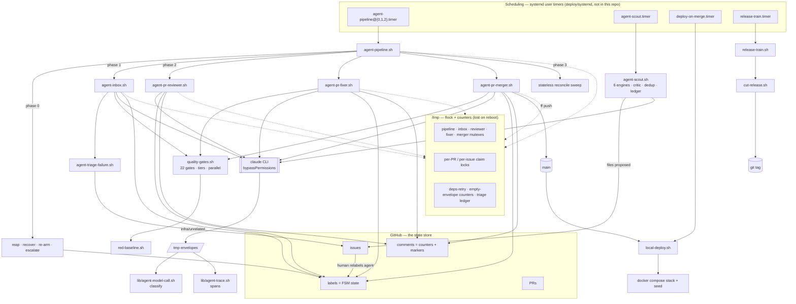
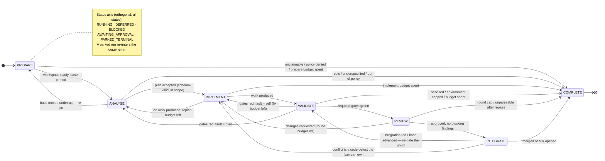
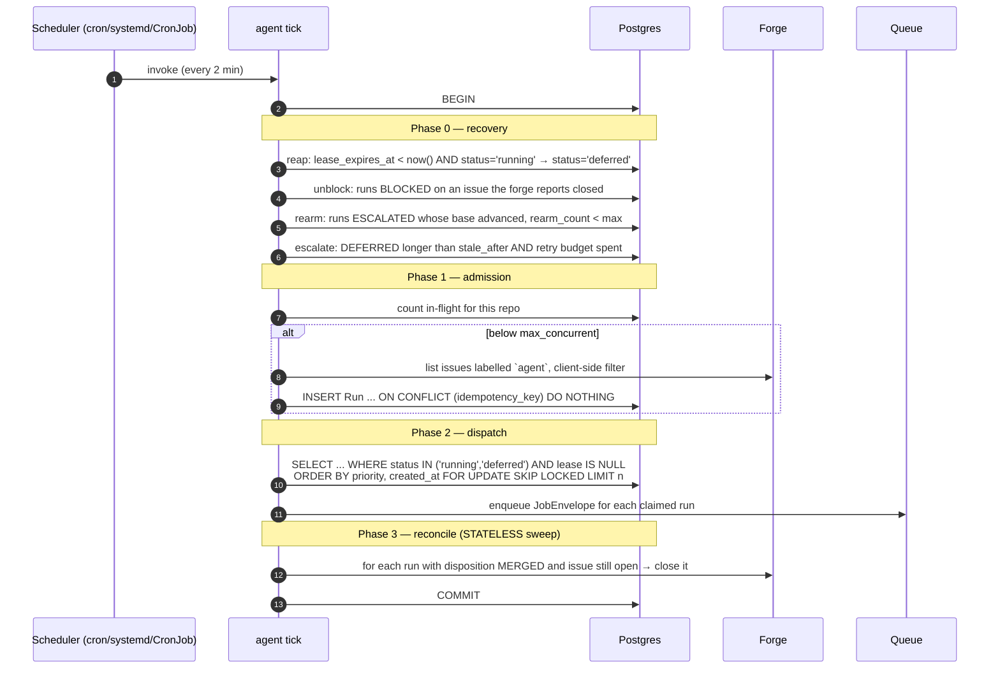
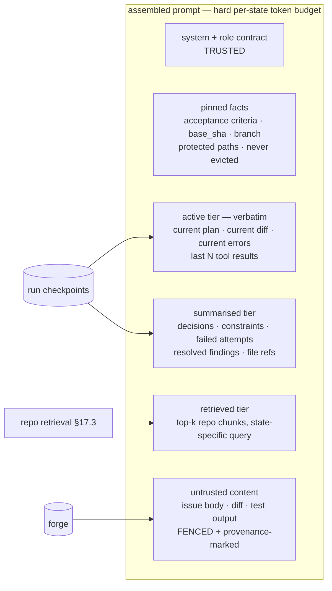
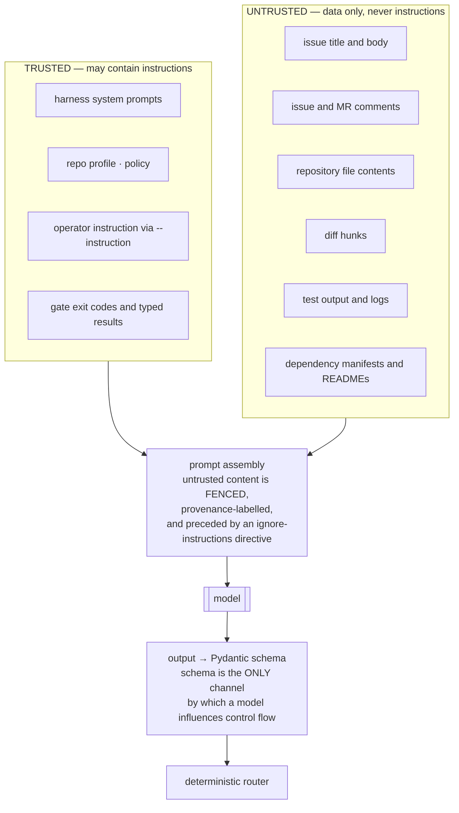
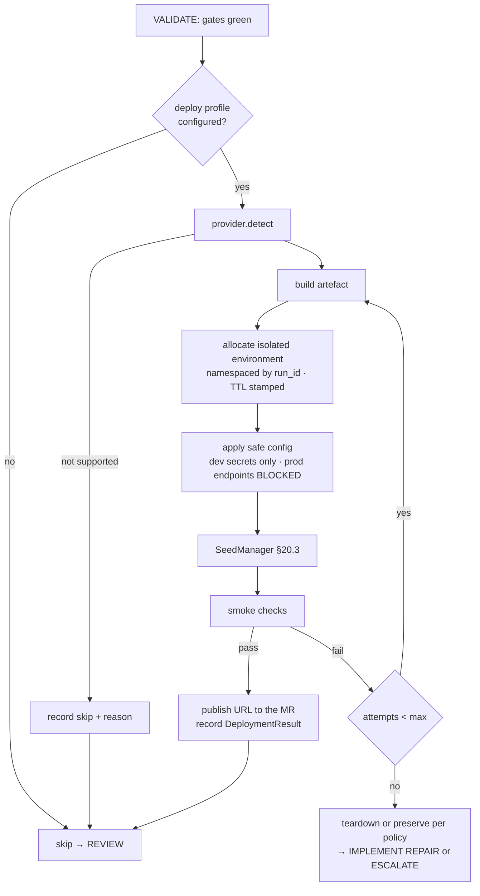
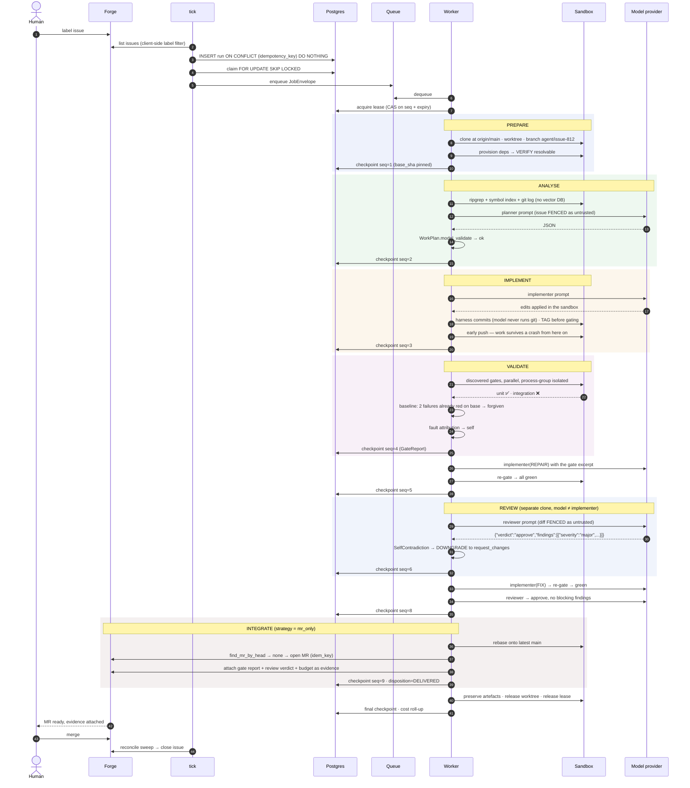

# AI Harness — Python Architecture

**Analysis of the `scripts/` Bash harness and a proposed Python replacement**

Document status: design proposal
Basis: direct inspection of 90 shell scripts + 10 libraries (~25,600 lines) under `scripts/`
Target: `ai_harness` — an FSM-routed, multi-agent software-engineering worker

---

## 1. Executive summary

The `scripts/` tree is a production-grade autonomous software delivery harness built around the
`claude` CLI. It takes a GitHub issue, builds it in an isolated worktree, reviews it with a second
model, fixes it with a third, runs a tiered quality-gate suite, integrates it, and fast-forwards
`main` — unattended, on systemd timers, with no human in the loop after the issue is labelled.

**It works, and its design is unusually good.** Roughly forty distinct failure modes are handled
explicitly, each documented with the incident that produced it. The valuable content of this
repository is not the shell code; it is the *operational knowledge encoded in it*: that a label is
a claim and not a mutex, that "no output" is not "bad output", that a transient must never consume a
retry budget, that a gate that was skipped is not a gate that passed, and that isolation asserted in
a prompt is not isolation.

**It is also at the end of what shell can carry.** State is split across three stores that can
disagree (GitHub labels, `/tmp` flocks, `/tmp` counter files); budgets are reconstructed by
regex-scraping PR comments; there is no cost circuit breaker, no context management, and no schema
on any model output; ~40 regexes parse test-runner output, and a misparse burns the fix budget on an
innocent test; and everything is GitHub-only and single-host by construction.

**The proposal** is `ai_harness`: a Python package with a **seven-state top-level FSM**, a
**two-level** orchestration model (supervisor → subgraphs, no deeper), **deterministic transitions**
(no LLM in the router), **Pydantic contracts on every boundary**, **Postgres as the durable source
of truth** with immutable checkpoints, and **lease-based claims** that make resume-after-crash and
multi-worker dispatch correct rather than best-effort.

Three deliberate departures from the current harness:

1. **PR/MR-only is the default merge strategy.** The current harness fast-forwards `main` itself.
   That is a policy an operator should opt into per-repository, not a default a tool ships with.
2. **No vector database.** Source code retrieval is served by `ripgrep` + a Tree-sitter symbol index
   + git history. A vector store is justified only at multi-repo scale, and is proposed as an
   optional adapter, not a dependency.
3. **Repository content is untrusted input.** The current harness runs every model call with
   `--permission-mode bypassPermissions` (nine call sites) and interpolates issue bodies directly
   into prompts. The proposed design separates trusted instructions from untrusted content and
   sandboxes execution by default.

Migration is incremental and reversible: Phase 0 wraps the existing gate runner without changing
anything, and the shell gate scripts remain authoritative throughout. The port is of the
**orchestration**, not of the checks.

---

## 2. Scope and assumptions

### In scope

The issue-to-merge lifecycle for a **single target repository per run**: issue intake, worktree
preparation, implementation, independent review, fix, quality gates, optional development
deployment with seed data, integration, cleanup, and recovery. Three execution modes (local CLI,
scheduled, dispatched worker) over one orchestration core. GitHub and GitLab.

### Out of scope by default

Production deployment (§18.4 — allowed only behind an explicit approval gate and disabled in the
default policy). Multi-repository atomic changes. Autonomous dependency upgrades. Anything that
spends money.

### Assumptions, and how to falsify them

| # | Assumption | Confidence | Falsify by |
|---|---|---|---|
| A1 | Target repos have a runnable gate entry point (a script, `make`, or a package manifest) | High | §19.2 discovery ladder falls back to inference; if all rungs fail the run escalates rather than merging ungated |
| A2 | The model CLI/SDK returns a parseable envelope with usage and cost | Medium | The `claude` CLI does; other providers report tokens only. §21.3 defines a price table fallback |
| A3 | One run at a time per issue is sufficient throughput | High | Observed in `agent-pipeline.sh:457-480` — the harness deliberately serialised after parallel stages proved to fan out over their own backlogs |
| A4 | Postgres is available in the dispatched deployment | Medium | Local CLI uses SQLite via the same `CheckpointStore` protocol |

### Uncertainties in the source material — stated, not invented

Three sets of paths are referenced by `scripts/` but **absent from this repository**, so their
contents are inferred from their call sites rather than read:

- **`deploy/systemd/*.service|*.timer`** — installed by `agent-inbox-setup.sh:22`,
  `agent-scout-setup.sh:32`, `local-deploy-setup.sh:12`, `agent-pr-loop-setup.sh`, and
  `release-train-setup.sh:27`. The unit names, the `@`-template instancing
  (`skillforge-agent-pipeline@{0,1,2}`), the `EnvironmentFile=-` pattern, and `loginctl
  enable-linger` are all visible from the setup scripts; the timer cadences are not. **Recommended
  default for the port:** a `tick` command safe to call every 2 minutes, with all cadence expressed
  in the scheduler, not the agent (§14).
- **`docs/AGENT-HARNESS.md`, `docs/35-*`, `docs/26-*`, `docs/33-*`, `CLAUDE.md`** — cited
  throughout as binding convention. `docs-script-refs.sh` exists specifically to assert these
  resolve, which means in the origin repository they do.
- **The application under test** (`backend/`, `frontend/`, `mobile/`, `docker-compose*.yml`,
  `alembic/`). The gates assume a Python/FastAPI + Vite/React + Expo monorepo.

This tells us something useful: **`scripts/` was extracted from its host project**, and the
harness is coupled to that host in ways the port must break. Roughly a dozen SkillForge-specific
assumptions are hardcoded — `docs/06-iteration-log.md` and `state/state.json` as
auto-resolvable conflict paths (`agent-pipeline.sh:286`), `backend/`/`frontend/`/`mobile/` workspace
names (`agent-pr-fixer.sh:446-453`), `skillforge-*` compose project names, and the `iterate` skill
name interpolated into the build prompt (`agent-inbox.sh:494-507`). Every one becomes configuration
in the port (§12.4).

---

## 3. Existing shell-harness analysis

### 3.1 Inventory by responsibility

| Script | LOC | Responsibility |
|---|---|---|
| `agent-pipeline.sh` | 526 | **Top-level driver.** One issue end-to-end per tick. Reap → recover → re-arm → escalate → build → drive → reconcile |
| `agent-scout.sh` | 901 | **Producer.** Six scan engines → critic → evidence re-verify → dedup → rank → file `proposed` issues |
| `agent-inbox.sh` | 658 | **Builder.** Claim issue → worktree → deps → model build → gates → push → PR |
| `agent-pr-reviewer.sh` | 398 | **Reviewer.** Model R reviews the diff against the issue's acceptance criterion → approve / request-changes |
| `agent-pr-fixer.sh` | 568 | **Fixer.** Model F (≠ R) addresses findings → re-gate → push, with an inline self-repair loop |
| `agent-pr-merger.sh` | 1211 | **Integrator.** Rebase → merge → full gates → fast-forward `main`. Conflict resolution via model M |
| `agent-triage-failure.sh` | 764 | **Router.** Classifies a red gate into six classes and routes each |
| `quality-gates.sh` | 1492 | **Gate spine.** 22-gate registry, tier-required promotion, parallel dispatch, timeouts |
| `verify-loop.sh` | 236 | Gate → route → fix → re-gate, bounded, resumable |
| `adversarial-loop.sh` | 168 | Loop-until-dry adversarial testing |
| `release-train.sh` | 1530 | Weekly staging cut: web then iOS, with a bounded fix-and-retry loop |
| `red-baseline.sh` | 223 | "Which tests are already red on the base?" — inherited-red forgiveness |
| `local-deploy.sh` | 278 | Poll `origin/main`; on advance, rebuild the local compose stack + seed |
| `canary-deploy.sh` | 194 | Cloud Run canary: deploy `--no-traffic` → smoke the canary URL → promote or rollback |
| `route-failure.sh` | 165 | Gate name + area → owning skill (a lookup table) |
| `*-setup.sh` (5) | ~400 | One-time idempotent activation: create labels, install systemd units, enable linger |
| `lib/*.sh` (10) | 1500 | Shared primitives (§3.3) |
| `*.test.sh` (40) | ~8000 | Hermetic suites — `gh`/`claude`/`git` stubbed, real bare git origin, zero network, zero LLM cost |

### 3.2 Entry points and execution paths

There are exactly **three** ways into the system, and only the first is used in steady state.

```
systemd --user timer ──► skillforge-agent-pipeline@{0,1,2}.timer
                          └─► agent-pipeline.sh          (the driver; calls the 4 stages)
                     ──► skillforge-agent-scout.timer
                          └─► agent-scout.sh             (the producer; independent)
                     ──► skillforge-deploy-on-merge.timer
                          └─► local-deploy.sh            (poll main, redeploy)
                     ──► skillforge-release-train.timer
                          └─► release-train.sh           (weekly cut)

human ──► bash scripts/<any-stage>.sh                    (every stage is standalone-runnable)
     ──► bash scripts/agent-triage-failure.sh --dry-run   (side-effect-free routing preview)

nested ──► agent-pipeline.sh ──► run_stage() ──► bash "$STAGE" (child process, inherits env)
```

`run_stage()` (`agent-pipeline.sh:149-152`) is the whole dispatch mechanism: a `bash` child with
`AGENT_GH` forwarded and output appended to a per-stage log. It tolerates non-zero exit
(`|| log "stage '$2' exited non-zero (continuing)"`) — the driver is designed so a crashed stage
costs one tick, not the run.

**Scheduling is deliberately outside the agent.** No script contains a sleep-loop or a cron
expression; each is single-pass and idempotent, and the timer re-invokes it. `agent-inbox.sh:15`
states this explicitly: *"Single-pass by design (the timer re-invokes it)."* This is the single most
portable decision in the harness and the port preserves it exactly (§14).

### 3.3 The shared library layer

Ten libraries, each extracted after the same logic appeared in a third caller. All ten carry an
identical, deliberate note:

> **NOTE ON `set -`**: this file is a LIBRARY and deliberately sets NO shell options. A sourced lib
> runs in the CALLER's shell, so a `set -e` here would silently abort every "collector" script at
> its first *tolerated* failure. Signal failure with return codes only. This is a deliberate design
> choice, not an oversight: do not "fix" it by adding `set -e`.

| Library | Provides | Extracted because |
|---|---|---|
| `agent-model-call.sh` | `classify_model_result` → `transient\|empty\|hard\|ok` | Four stages each had their own classifier; they disagreed |
| `agent-trace.sh` | `agent_trace_span`, sampling, TTL prune | The whole PR loop was emitting no telemetry |
| `agent-sandbox.sh` | `sandbox_clone`, `sandbox_run` (bwrap) | A `bypassPermissions` model `cd`'d out of its worktree into the primary checkout |
| `pr-lock.sh` | per-PR / per-issue `flock`, work-stealing | Two fixer runs produced divergent commits on one PR (#2152) |
| `slot-lock.sh` | counting semaphore over `flock` | "one at a time" needed to become "at most N" |
| `state-shard.sh` | `sget`/`sset` routed by jq key prefix | An 83 KB `state.json` monolith mixing four concerns |
| `gate-reason.sh` | diagnostic excerpt extraction | Three implementations; one was `tail -n1` and reported *passing* lines as failure reasons |
| `deps-verify.sh` | "did `npm ci` actually land?" | `npm ci` exits 0 on an install that left a workspace unresolvable; three callers trusted it |
| `ephemeral-pg.sh` | isolated Postgres/stack bring-up + scoped teardown | Copy-drift across four gates |
| `test-env.sh` | scrub inherited lane config from test env | `AGENT_SLOT=1` from a systemd unit made a suite red on lanes 1–2, green on lane 0 |

### 3.4 Git and worktree lifecycle

Three different isolation strategies, each chosen for a specific reason:

| Stage | Mechanism | Why this one |
|---|---|---|
| Builder (`agent-inbox.sh:266`) | `git worktree add -f -B "$branch" "$wt" "$start_ref"` | Needs the branch ref to persist after cleanup for the PR |
| Fixer (`agent-pr-fixer.sh:184`) | `git worktree add -f --detach "$wt" "$REMOTE/$head"` | `-B` fails with *"Cannot force update the current branch"* when the PR branch is checked out in the primary copy; detached never touches the ref |
| Reviewer (`agent-pr-reviewer.sh:244`) | `sandbox_clone` — a full local `git clone` + bwrap tmpfs over `$ROOT` | A linked worktree's `.git` is a *pointer file* into the primary, so hiding the primary breaks git inside it. Only a self-contained clone can be isolated |

Worktree creation is serialised repo-wide (`git_worktree_locked`, `agent-pr-reviewer.sh:92-95`)
because parallel `git worktree add` races on the shared `.git/worktrees` admin area.

Cleanup is an `EXIT` trap in every stage. **This is a documented data-loss vector**: the trap
removes the worktree, orphaning any detached-HEAD commit. Three incidents (#1764, #2152, #2196) led
to the mitigation at `agent-pr-fixer.sh:398-401` — tag the work *before* the gates run, delete the
tag only after a successful push.

**Resume-instead-of-discard** (`agent-inbox.sh:233-368`) is the most sophisticated part. A killed
build's work survives because the branch is pushed *before* gating (`agent-inbox.sh:578-589`, "Early
push: make the work survivable BEFORE gating"). The next attempt resumes from it, guarded by three
conditions: not already merged into base; rebased onto the *live* base (the converse check that was
missing and caused #2138); and an `AGENT_RESUME=0` escape hatch.

### 3.5 Issue-to-branch mapping and naming

Purely conventional and bidirectional, with no stored mapping:

```
issue #N  ──►  branch  agent/issue-N        (agent-inbox.sh:221)
          ──►  worktree /tmp/agent-inbox-<repo-ns>/worktrees/issue-N
branch    ──►  issue    sed -nE 's#.*issue[-/]([0-9]+).*#\1#p'   (agent-pr-reviewer.sh:185)
PR        ──►  issue    gh pr list --head "agent/issue-N" --state all   (agent-pipeline.sh:517)
```

`<repo-ns>` is `sha1(realpath(git rev-parse --git-common-dir))[0:12]`, computed identically in five
places (`agent_repo_ns`, `pr_repo_ns`, `scout_repo_ns`, `_pr_lock_ns`, `ns`). It exists so two
checkouts on one host never share a lock, a log directory, or a worktree base.

The convention is load-bearing: the head-ref match at `agent-pipeline.sh:517` is what closes issues
after merge, and it works *even after the branch is deleted* because GitHub retains the head ref
string. Notably it does **not** rely on a `Closes #N` keyword — the merger rebases and
fast-forwards, so GitHub reports the PR as `CLOSED` with a null merge commit, and the `merged` label
is the only reliable signal (`agent-pipeline.sh:509-519`).

### 3.6 Agent invocation and prompt construction

Nine `claude -p` call sites, all with the same shape:

```bash
"$CLAUDE" -p "$prompt" \
  --permission-mode bypassPermissions \
  --model "$MODEL" \
  --output-format json \
  >"$LOGDIR/agent-N.json" 2>"$LOGDIR/agent-N.stderr" || true
cls="$(classify_model_result "$LOGDIR/agent-N.json")"
agent_trace_span "$LOGDIR/agent-N.json" <stage> pr=N round=R model=M outcome="$cls" \
                 template=<id> prompt="$prompt"
```

Prompts are heredocs with shell interpolation. The reviewer's (`agent-pr-reviewer.sh:193-222`) is
representative and instructive — role, adversarial framing, explicit non-goals ("Do NOT raise
style/formatting nits"), falsifiability requirement ("MUST cite a file:line"), round context, the
linked issue, the diff bounded at `head -c 60000`, and a hand-written JSON schema with a decision
rule.

The fixer's prompt (`agent-pr-fixer.sh:304-323`) carries a *harness contract* worth preserving
verbatim in the port:

> LEAVE YOUR EDITS UNCOMMITTED in the working tree. The harness stages, commits, re-runs the gates
> and pushes for you. Do NOT run git commit / git branch / git checkout / git reset / git stash /
> git push: a clean tree is one of the signals the harness reads as "the model declined to change
> anything", and anything you commit yourself is not what gets reviewed.

The model ignores this often enough that `agent-pr-fixer.sh:345-376` handles it: measure work as
"HEAD moved **OR** tree is dirty", verify the commit is a descendant of the remote tip, and refuse
to push if it swept in `node_modules`/`.env`.

**Model separation of duties** is enforced fail-fast at both ends
(`agent-pr-reviewer.sh:104-107`, `agent-pr-fixer.sh:89-92`):

```bash
if [ "$REVIEWER_MODEL" = "$FIXER_MODEL" ]; then
  log "REFUSING: PR_REVIEWER_MODEL must DIFFER from PR_FIXER_MODEL — independent review needs a different model."
  exit 2
fi
```

### 3.7 Review and fix loops

```
review-needed ─(reviewer)─► approve ────────► review-approved ─► merger
                          └► request-changes ► changes-requested ─(fixer)─► review-needed (round+1)
                                                                          └► review-stuck
```

Round number is scraped from PR comments:

```bash
round="$("$GH" pr view "$n" --json comments \
  --jq '[.comments[].body | capture("pr-loop-round: (?<r>[0-9]+)").r | tonumber] | max // 0')"
```

The fixer additionally runs an **inline self-repair loop** (`agent-pr-fixer.sh:440-568`): gates red →
feed the failure back to the same model → re-commit → re-gate, up to `FIXER_MAX_SELF_REPAIR=3`,
without consuming a PR-loop round. Rounds 2+ use **differential gating** — scope the gate set to what
the diff touched — with a guard that the scoping may only *subtract* from the configured `--only`
list, never substitute a hardcoded one (`fixer_gates_drop`, `agent-pr-fixer.sh:425-438`), after a
substitution silently re-added `integration` to a fix-time run.

### 3.8 Quality-gate execution

22 gates in dependency order (`quality-gates.sh:74`), each returning `0 | 77 (skip) | other`.
Requiredness is per-tier:

```bash
declare -A REQUIRED_BY_TIER=(
  [toy]="typecheck lint"
  [preview]="typecheck lint docs-refs iteration-immutable unit"
  [launch]="typecheck lint docs-refs iteration-immutable migration-drift unit coverage integration contract visual mobile-e2e"
  [scale]="… + e2e"
)
```

A `77` on a tier-required gate is promoted to **FAIL** — you cannot be green on a gate you never ran.
Three sibling holes are closed explicitly: an unknown `--tier` is fatal rather than falling back to
the weaker `preview` set (`quality-gates.sh:130-134`); a required gate removed via `--skip`
(deny-list) fails while one merely absent from `--only` (allow-list) is an honest skip
(`run_gate`, `:358-388`); and a gate present in the registry with no implementing function fails
loudly instead of vanishing (`_dispatch_parallel`, `:1380-1390`).

Execution is bounded and parallel. `_exec_gate` (`:279-310`) backgrounds the gate, emits a throttled
heartbeat, enforces `QG_GATE_TIMEOUT` (default 3600s), and on timeout calls `_kill_tree` — a
recursive `pgrep -P` walk, because a bare `kill` orphans the vitest worker pool and the compose
children, which are exactly the processes that wedge a gate. The dispatcher runs two resource
classes with separate budgets (`QG_CPU_JOBS=3`, `QG_STACK_JOBS=2`), honours `after` edges
(`coverage` waits for `unit`, and reuses its coverage report rather than re-running 3,489 tests),
and gives each stack slot a private compose project and a 1000-wide port band — *offset*, not
probed, because two runs probing from a shared base can select the same "free" port before either
binds it.

### 3.9 Merge behaviour

The merger is deliberately **serial** — one integration per run under a single global flock — because
two independently-green PRs can conflict with each other or break when combined.

```
select ONE review-approved PR (PR_MERGER_MAX_PRS=1)
  → integration worktree off latest origin/main
  → REBASE the PR onto the integration base       ← resolves branch-vs-main staleness HERE
      conflict → invoke_resolver (model M, 3 escalating attempts, snapshot/restore between)
  → git merge --no-ff (clean by construction after the rebase)
  → regenerate generated files
  → provision deps (verified) + env symlinks
  → FULL quality gates on the union
      green         → git push origin HEAD:main   (NO force — if main moved, bail)
      red, base green    → route back to the fixer (changes-requested)
      red, base red      → merge-stuck + file a base-red `agent` issue
      environmental      → defer the batch, blame nobody (bounded at 3)
  → force-update each PR head to its rebased tip so the commit is reachable
```

Four safety properties are stated as non-negotiable (`agent-pr-merger.sh:31-40`): isolation; gates
gate the merge; conflicts that leave markers go to `merge-stuck`, never a forced commit; and
fast-forward only.

The last line of defence (`:1164-1183`) re-scans the integration tree for conflict markers
immediately before the push — because the resolver's verdict travels on stdout via `$(…)`, and three
`log` calls missing their `1>&2` once corrupted that verdict into a multi-line string that matched
no `case` arm, fell through to the success branch, and fast-forwarded `main` onto a tree full of
markers while logging "MERGED".

### 3.10 Deployment and seed data

| Concern | Script | Behaviour |
|---|---|---|
| Local CD | `local-deploy.sh` | Poll `origin/main`; on advance, fast-forward a **pinned checkout** (never the working copy), `docker compose up -d --build --force-recreate --wait`, seed, smoke, record SHA. Shares the inbox's flock so a deploy and a build never run two `--build`s at once |
| Gate stacks | `lib/ephemeral-pg.sh` | Per-purpose compose project + high port band + per-project lock + name-scoped volume reaping. Never an unscoped prune |
| e2e seed | `run-e2e.sh:233-237` | `seed_courses.py` then **`verify_seed.py`** — seeding and asserting the seed landed are separate steps |
| Seed gate | `seed-integrity.sh` | Boots an isolated PG, runs the manifest's `boot_command`, asserts per-table `min_rows`, **re-runs the seed and asserts row counts are unchanged** (idempotency) |
| Release | `cut-release.sh` | Gate → tag `staging-vX.Y.Z` → push. The **tag** triggers the deploy workflow; never pushes commits to main |
| Cloud canary | `canary-deploy.sh` | `--no-traffic --tag=canary` → smoke the **canary URL** → promote or pin traffic back to the recorded last-healthy revision |

The e2e database has **no named volume at all** — Postgres runs on tmpfs — after three incidents
(#98/#140/#171) where a volume surviving from a prior branch carried a stale alembic revision and
made `alembic upgrade head` fail on boot, which compose reports as the generic "dependency failed to
start".

### 3.11 Retry, recovery, and escalation

Every loop is bounded. The complete set:

| Bound | Default | Guards |
|---|---|---|
| `PIPELINE_MAX_ROUNDS` | 10 | review⇄fix⇄merge rounds per tick |
| `PIPELINE_REARM_MAX` | 3 | re-arms of a stuck PR as main advances |
| `PIPELINE_MAX_OPEN_PRS` | 3 | open agent PRs before refusing new builds |
| `PIPELINE_ESCALATE_STUCK_HOURS` | 6 | before a stuck PR becomes `needs-human` |
| `PR_MAX_ROUNDS` | 4 | reviewer⇄fixer rounds |
| `PR_EMPTY_ENVELOPE_RETRIES` | 2 | consecutive empty envelopes before escalating |
| `PR_FIXER_MAX_SELF_REPAIR` | 3 | inline gate-fix attempts per round |
| `PR_FIXER_DEPS_MAX_RETRY` | 3 | deps-unresolvable ticks before `review-stuck` |
| `PR_MERGER_MAX_ENV_DEFER` | 3 | environmental deferrals before an ENVIRONMENT diagnosis |
| `MERGER_RESOLVER_RETRIES` | 3 | conflict-resolver attempts |
| `TRIAGE_MAX_ATTEMPTS` | 3 | auto-file→still-red cycles per fingerprint |
| `TRIAGE_MAX_OPEN` | 5 | open auto-filed blockers globally |
| `TRIAGE_MAX_SELF_REPAIR` | 2 | self-repair rebuilds |
| `TRIAGE_MAX_TRANSIENT` | 8 | transient retries per fingerprint |
| `QG_GATE_TIMEOUT` | 3600s | per gate, then kill-tree |
| rebase guard | 1000 | runaway backstop in `rebase_onto_base` |

**Recovery is layered.** `agent-pipeline.sh` runs four recovery phases before doing any work:

1. `reap_stale_claims` (`:370-414`) — a `wip`/`review-wip`/`fix-wip`/`merge-wip` label with **no live
   lock** and no update for 20 minutes is released. `merge-wip` matters most: the merger labels a
   whole batch before integrating, so a killed merger can strand up to twenty PRs invisibly.
2. `recover_merge_stuck` (`:160-201`) — promote `merge-stuck` → `review-approved` for a solo retry.
3. `rearm_stuck_prs` (`:211-333`) — when `main` advances past a stuck branch, rebase it and give it
   one fresh attempt, bounded by `REARM_MAX` **and** at most once per main SHA.
4. `escalate_stale_stuck` (`:421-449`) — past 6 hours with the re-arm budget spent, `needs-human`.

Then a **stateless reconciliation sweep** (`:503-524`) closes every open issue whose PR carries the
`merged` label — independent of what this run did, so it self-heals three failure modes: the
post-merge index race, a transient `gh issue close` failure, and a PR merged by a human.

**Escalation** is always a label plus a comment explaining what a human must do. The quality of these
messages is notable — the merger's environmental-cap escalation picks a *different remedy text*
depending on whether the cause was Docker starvation or an unresolved npm workspace, because
"telling a human to chase the wrong one wastes the escalation."

### 3.12 State persistence, locking, observability

**State lives in four places:**

| Store | Holds | Durability |
|---|---|---|
| GitHub labels | Pipeline position (the FSM state) | Durable, but no CAS and no atomicity |
| GitHub comments | Round number, re-arm count, env-defer count, self-repair count, fingerprint markers | Durable; requires an API call + regex to read |
| `/tmp/*.lock` (flock) | Mutual exclusion, per-repo/PR/issue | Process lifetime — released by the kernel on exit |
| `/tmp/*.count`, `ledger.jsonl` | Deps retries, empty-envelope streaks, triage attempts | **Lost on reboot** |
| `state/*.json` (sharded) | Product/testing/findings blackboard | Durable, in-repo, conflict-prone |
| `state/traces/spans-YYYYMM.jsonl` | Telemetry | Durable, append-only |

**Locking** is `flock` throughout, in three shapes: single-instance mutex per stage; counting
semaphore (`slot-lock.sh`) for N-at-a-time; and per-job locks (`pr-lock.sh`) for work-stealing. The
fd is always held open deliberately — the kernel releases on process exit, so a crashed stage cannot
strand a PR and no reaper is required for the *lock* (only for the *label*).

**Observability** is one JSONL span per model call carrying tokens, cost, duration, session id,
stage, `round` **and** `attempt` as deliberately separate axes, and a privacy-safe prompt digest
(`template_id`, `sha256`, byte count — never the text). Retention is conditional: errors and
expensive calls 14 days, a deterministic ~8% content-hash sample 3 days, the rest swept at end of
tick. The contract is explicit — *it never fails the caller*.

### 3.13 Security assumptions (and where they are weak)

| Area | Current posture | Assessment |
|---|---|---|
| Model permissions | `--permission-mode bypassPermissions` at **all nine** call sites | Deliberate (unattended), mitigated only for the reviewer |
| Filesystem isolation | bwrap tmpfs over `$ROOT`, self-contained clone — **reviewer only** | Builder, fixer, merger and scout run unsandboxed in a worktree |
| Network egress | Unrestricted | No allowlist |
| Credentials | `gh` token from `~/.config/gh/hosts.yml`; release creds in a mode-0600 `EnvironmentFile=-` | Long-lived PAT; not short-lived, not least-privilege |
| Untrusted content | Issue title/body interpolated directly into the build prompt (`agent-inbox.sh:494-507`); PR diff into the review prompt | **Prompt-injection vector.** No delimiting, no provenance marking |
| Secrets in logs | Envelopes written to `/tmp`, comments posted to GitHub | Sampling/TTL limits exposure; no redaction pass |
| Push scope | Only `agent/*` branches; `main` only via fast-forward | Good |
| Destructive ops | `git push --force-with-lease` on re-arm; `docker volume rm` name-scoped | Scoped, but no approval gate |

The single largest gap: **an issue body is untrusted input that reaches a model running with
`bypassPermissions` in a tree with push credentials.** The epic guard (`agent-inbox.sh:203-219`) is
the only content-based filter, and it is a heuristic for *shape*, not for *intent*.

### 3.14 Duplicated logic and hidden coupling

| Duplication | Sites | Status |
|---|---|---|
| `<repo-ns>` sha1 derivation | 5 (`agent_repo_ns`, `pr_repo_ns`, `scout_repo_ns`, `_pr_lock_ns`, triage `ns`) | Byte-identical, not extracted |
| Toolchain bootstrap (nvm/conda/pnpm) | 5 stages | Copy-pasted |
| `add_label`/`remove_label` via REST | 4 stages | Copy-pasted |
| Env-file symlink provisioning | 3 sites (fixer twice) | Copy-pasted |
| `node_modules`/`.env` reset list | 4 sites, **drifted** (inbox lists `frontend/node_modules`; fixer lists root + mobile + `packages/*`) | Real divergence |
| Generated-conflict path list | 3 sites, **drifted** (inbox has 4 paths incl. `state/iter-gates.json`; pipeline and merger have 3) | Real divergence |
| Rebase-with-generated-resolution | 3 near-identical implementations | Not extracted |

**Hidden coupling** — undeclared contracts that break silently:

1. `agent-pipeline.sh:478` greps the inbox's **log** for `claiming issue #N` to learn what was built.
   Rewording that log line breaks the driver.
2. The `<!-- pr-loop-round: N -->` comment marker is written by the fixer and read by both the fixer
   and the reviewer. Three parties, no schema.
3. `TRIAGE_SELF_REPAIR_MARKER` "MUST match the string agent-inbox.sh greps for" — stated in a comment
   (`agent-triage-failure.sh:60-61`), enforced nowhere.
4. `PR_LOGDIR` defaults identically in reviewer, fixer and merger so they share logs *intra-repo* —
   an intentional coupling expressed only by a repeated default.
5. `agent-pipeline.sh:179` must independently reconstruct `PR_MERGER_LOCK`'s default path. The
   comment records that it once did so without the `$NS` suffix and the check was a permanent no-op
   *that logged the opposite of the truth*.

### 3.15 Shell-specific semantics the harness depends on

These are correct, subtle, and **do not survive translation** — they are the strongest argument for
the port:

| Semantic | Where | Consequence of getting it wrong |
|---|---|---|
| `exec {fd}>file` without a command applies redirections **permanently** to the current shell | `pr-lock.sh:142` | `2>/dev/null` on that line silently discarded stderr for the entire remainder of every stage that took a lock |
| `continue` inside `( … )` is an error, not a skip | `agent-pipeline.sh:240-248` | Conflicted PRs were escalated to `needs-human` **and** re-armed into the merge loop carrying the label |
| `printf -v` into a caller-named variable collides with callee locals | `pr-lock.sh:101-110` | Caller believes it holds a lock it does not |
| `grep -q` SIGPIPEs upstream under `pipefail` → status 141 | `agent-triage-failure.sh:429-439` | Guard would demote every signature it ever saw |
| Command substitution runs in a subshell, so a lock taken there is released immediately | `slot-lock.sh:15-19` | Every caller "acquires" slot 0 while holding nothing |
| `$(…)` return channels mean any stray stdout corrupts the verdict | `agent-pr-merger.sh:313-320` | Conflict markers fast-forwarded onto `main` while logging "MERGED" |
| Directory-only `.gitignore` does not match a *symlink* named `node_modules` | `agent-inbox.sh:537-542` | Provisioned symlinks committed into the PR |

### 3.16 Disposition: preserve / refactor / replace / remove / wrap

| Disposition | Components | Rationale |
|---|---|---|
| **Preserve (port semantics verbatim)** | Failure taxonomy (`classify_model_result` + triage's six classes); the transient-never-consumes-budget rule; verdict↔findings reconciliation; skip→fail promotion; red-baseline; environmental-vs-defect discrimination; fingerprint + ledger + cap; stateless reconciliation sweep; every numeric bound in §3.11 | These are the encoded incidents. Losing one re-opens a production failure |
| **Preserve (keep as shell, call from Python)** | `quality-gates.sh` and all 22 gate implementations; `run-e2e.sh`; `integration.sh`; `seed-integrity.sh`; `migration-check.sh`; `cut-release.sh` | Repo-owned, tuned, and correct. The port orchestrates them; it does not reimplement them |
| **Refactor into shared modules** | The 7 duplications in §3.14; the 5 `<repo-ns>` copies; the 3 rebase-with-generated-resolution implementations | Drift is already visible in two of them |
| **Replace** | Label-as-state → durable `Run` row; comment-scraping → DB columns; `/tmp` counters → DB; `flock` → `Lease` protocol; hand-rolled JSON extraction → Pydantic + repair loop; ~40 log regexes → typed gate adapters with a tested corpus; `gh` → `Forge` protocol | The eight structural limits (§6) |
| **Remove** | `sget.sh`/`state-set.sh`/`state-decide.sh`/`state-migrate.sh`/`lib/state-shard.sh` (the sharded blackboard); `iteration-count.sh`/`iteration-digest.sh`/`generate-iteration-index.sh`; `docs-script-refs.sh`; `shellcheck-gate.sh` | Blackboard sharding was a workaround for a JSON monolith — a relational store makes it unnecessary. The iteration-log machinery is host-project-specific. The last two lint shell that will no longer exist |
| **Wrap temporarily** | `agent-scout.sh` (producer); `release-train.sh`; `local-deploy.sh`; `canary-deploy.sh`; `adversarial-loop.sh` | Independent of the issue→merge path. Wrap behind a `SubprocessAdapter`, port last |

---

## 4. Current-state architecture



**Architectural character.** The forge is the database. `/tmp` is the lock manager and the
short-term memory. The scheduler is systemd. Every stage is a single-pass, idempotent, standalone
process that reads state from the forge, takes a lock, does one unit of work, writes state back, and
exits. There is no long-lived process and no in-memory state that survives a tick.

That last property is why the harness is as robust as it is — and reproducing it is a hard
requirement on the port (§15, §18.2).

---

## 5. Current-state workflow diagram

```mermaid
flowchart TD
    A([timer tick]) --> B{flock<br/>pipeline mutex}
    B -->|held| Z([exit 0])
    B -->|acquired| C[Phase 0 · recovery]

    C --> C1[reap stale wip claims<br/>label set + lock free + 20min stale]
    C1 --> C2[recover merge-stuck → review-approved]
    C2 --> C3[re-arm stuck PRs when main advanced<br/>rebase first · bounded · once per SHA]
    C3 --> C4[escalate stale stuck → needs-human]

    C4 --> D{open agent PRs<br/>≥ MAX_OPEN_PRS?}
    D -->|yes| G[drain in-flight only]
    D -->|no| E{drivable PR<br/>in flight?}
    E -->|yes| G
    E -->|no| F[Phase 1 · build one issue]

    F --> F1[list open agent issues<br/>sort by createdAt]
    F1 --> F2[reconcile blocked:<br/>blocker closed → unblock]
    F2 --> F3[filter: not wip/done/needs-human/blocked]
    F3 --> F4[work-steal via per-issue flock<br/>rotated by AGENT_SLOT]
    F4 --> F5{epic /<br/>tracking issue?}
    F5 -->|yes| F6[de-queue · drop label] --> Z
    F5 -->|no| F7[label wip · comment starting]

    F7 --> W1{remote branch exists<br/>and not merged?}
    W1 -->|yes| W2[RESUME from it]
    W1 -->|no| W3[start from origin/main]
    W2 --> W4[git worktree add -B agent/issue-N]
    W3 --> W4
    W4 --> W5{resumed branch<br/>behind base?}
    W5 -->|yes| W6[rebase onto base<br/>generated-file conflicts auto-resolve<br/>product conflict → discard, start clean]
    W5 -->|no| W7
    W6 --> W7[provision deps + VERIFY<br/>unresolved → bounded retry / needs-human]

    W7 --> M1[[claude -p · build prompt<br/>issue + prior gate failure context]]
    M1 --> M2{classify envelope}
    M2 -->|transient| M3[relabel agent · retry next tick] --> Z
    M2 -->|ok/hard| M4[git add -A · reset provisioned · commit]
    M4 --> M5{work produced?}
    M5 -->|no commits AND<br/>no diff vs base| M6[needs-human] --> Z
    M5 -->|yes| M7[EARLY PUSH<br/>survivable before gating]

    M7 --> Q1[symlink .env/.gcp · run gates<br/>--only unit --tier launch]
    Q1 --> Q2{green?}
    Q2 -->|no| TR[agent-triage-failure.sh]
    Q2 -->|yes| P1[push with retry+backoff]
    P1 --> P2[gh pr create --fill]
    P2 --> P3[label PR review-needed<br/>label issue done]

    TR --> TR1{classify}
    TR1 -->|transient / deps| TRa[retry · no file · drop wip]
    TR1 -->|self| TRb[self-repair ≤2 · feed log back]
    TR1 -->|infra| TRc[file harness blocker · mark blocked]
    TR1 -->|unrelated| TRd[file flaky blocker · mark blocked]
    TR1 -->|stale-base| TRe[retry on a rebased tree]
    TRb -->|exhausted| TRf[needs-human]

    P3 --> G
    G --> R1[Phase 2 · rounds 1..MAX_ROUNDS]
    R1 --> R2[[reviewer · model R<br/>isolated CLONE + bwrap tmpfs over ROOT]]
    R2 --> R3{verdict}
    R3 -->|transient/empty| R4[restore review-needed<br/>NO round consumed]
    R3 -->|unparseable| R5[review-stuck]
    R3 -->|approve + blocker findings| R6[DOWNGRADE to request-changes]
    R3 -->|approve| R7[review-approved]
    R3 -->|request-changes| R8[changes-requested]

    R8 --> X1[[fixer · model F ≠ R<br/>detached worktree on PR head]]
    X1 --> X2[commit · re-gate<br/>differential scoping round 2+]
    X2 -->|red| X3[self-repair ≤3<br/>feed gate log back]
    X3 -->|exhausted| X4[review-stuck · NOT pushed]
    X2 -->|green| X5[push · round++ · review-needed]

    R7 --> Y1[merger · serial · global flock]
    Y1 --> Y2[integration worktree off latest main]
    Y2 --> Y3[REBASE PR onto base]
    Y3 -->|conflict| Y4[[resolver · model M<br/>3 attempts · snapshot/restore]]
    Y4 -->|markers remain| Y5[merge-stuck]
    Y3 --> Y6[merge --no-ff · regenerate · provision]
    Y6 --> Y7[FULL gates on the union]
    Y7 -->|environmental| Y8[defer batch ≤3 · blame nobody]
    Y7 -->|red, base green| Y9[route to fixer]
    Y7 -->|red, base red confirmed| Y10[merge-stuck + file base-red issue]
    Y7 -->|green| Y11{markers in tree?}
    Y11 -->|yes| Y5
    Y11 -->|no| Y12[push origin HEAD:main<br/>NO force]
    Y12 -->|main moved| Y5
    Y12 -->|ok| Y13[label merged · force-update PR heads]

    Y13 --> RC[Phase 3 · stateless sweep<br/>close every open issue whose PR has merged label]
    RC --> Z2([exit · EXIT traps remove worktrees])
```



---

## 6. Key weaknesses and operational risks

| # | Weakness | Evidence | Impact | Fixed by |
|---|---|---|---|---|
| W1 | **State split across 4 stores that can disagree** | labels + comments + `/tmp` locks + `/tmp` counters | A reboot silently resets deps-retry and empty-envelope counters, re-opening bounded loops | §15 durable `Run` row |
| W2 | **Budgets reconstructed by scraping comments** | `capture("pr-loop-round: …")`, counting `<!-- rearm: -->`, counting `<!-- merger-env-defer -->` | An API call per counter; fail-closed on parse error; the record and the notification are the same object | §15 checkpoint columns |
| W3 | **No cost or token circuit breaker** | Spans record cost *after* the call | A loop is bounded by iterations, not dollars. `PIPELINE_MAX_ROUNDS=10` × opus review has no ceiling | §18.6 `reserve()` before dispatch |
| W4 | **No output schema** | Hand-rolled 3-rung extraction (`agent-pr-reviewer.sh:321-335`) | PR #2419 went `review-stuck` on a `sed` range returning the single char `{` — non-empty, so the raw fallback never ran | §8 Pydantic + repair loop |
| W5 | **No context management** | Every call is a fresh `claude -p`; diff truncated at `head -c 60000` | No summarisation, no retrieval, no session reuse; the model cannot see what it was silently denied | §17 tiered context + repo-native retrieval |
| W6 | **~40 regexes parse test-runner output** | `agent-triage-failure.sh` (pytest/vitest/Playwright/alembic/npm/Docker) | A runner upgrade silently mis-classifies; mis-classification burns the fix budget on an innocent test (#2124 spent every retry on a test passing 15/15 on main) | §19 typed gate adapters + tested corpus |
| W7 | **GitHub-only** | `gh` threaded through every stage | GitLab means a parallel tree | §12 `Forge` protocol |
| W8 | **Shell-semantic fragility** | §3.15 — seven distinct classes, each a real incident | Bugs that are invisible on inspection and fail *silently* | The port itself |
| W9 | **Untrusted content reaches a `bypassPermissions` model** | `agent-inbox.sh:494-507`; 9 unsandboxed-or-partly-sandboxed call sites | Prompt injection via issue body or PR diff, in a tree with push credentials | §18 provenance separation + sandbox-by-default |
| W10 | **Single-host by construction** | `flock` on `/tmp`, worktrees on local disk | No horizontal scale; a host loss loses all in-flight state not on the remote | §15.4 `Lease` protocol + §14 dispatch |
| W11 | **Auto-merge to `main` is the default** | `agent-pr-merger.sh` fast-forwards | Correct for its origin project; unsafe as a shipped default | §3 recommendation: PR-only default |
| W12 | **Host-project coupling** | `docs/06-iteration-log.md`, `state/state.json`, `backend/`/`frontend/`/`mobile/`, `skillforge-*` projects, the `iterate` skill name | The harness cannot target an arbitrary repo | §12.4 `RepoProfile` |
| W13 | **Log-line coupling between driver and stage** | `agent-pipeline.sh:478` greps `claiming issue #N` | Rewording a log message breaks the driver | §11 typed subgraph results |
| W14 | **Config surface is ~180 undocumented env vars** | 27–31 `${VAR:-}` defaults per major script | No validation, no discoverability, no schema | §8 `pydantic-settings` |

---

## 7. Design principles

1. **The FSM is the product.** Everything else is an adapter. Transitions are deterministic and
   table-driven; no LLM call decides a workflow edge.
2. **Nothing raises across a state boundary.** Every operation returns a typed `Outcome`; the router
   dispatches on its class. An unexpected exception is caught at the state boundary and converted
   into `Outcome(FATAL)` — the process does not die, the run parks.
3. **A model call that never ran must not consume a budget.** This is a property of the `Outcome`,
   not of each caller's `if`.
4. **Unknown fails closed.** No baseline for this SHA → gate stays red. Unrecognised resolver verdict
   → stuck. Unknown tier → abort. Unreadable counter → skip this tick.
5. **Skip is not pass.** A required check that did not run is a failure.
6. **A claim needs both a durable record and a live lease.** Either alone strands work.
7. **Isolation is enforced by the runtime, never asserted in a prompt.**
8. **Repository content is untrusted input.** Issue bodies, PR diffs, file contents and test output
   are data, never instructions.
9. **Every terminal state has a re-entry path, or the queue rots.**
10. **Reconciliation is a stateless sweep**, so it self-heals races and out-of-band actions.
11. **One implementation, N callers.** Anything two states need lives in the kernel. Enforced by an
    import-direction lint, not by convention.
12. **Prefer the repo's own tooling.** Discover and run existing gates before generating any.

---

## 8. Proposed FSM — seven top-level states

The parking semantics that would otherwise demand extra states (`DEFERRED`, `BLOCKED`,
`AWAITING_APPROVAL`) are modelled as an **orthogonal status axis** on the run. A parked run *is* in
its state; resuming means re-entering it. This keeps the state count at seven, makes `resume`
trivially defined, and matches how the shell harness already behaves (a `review-needed` PR after a
transient is in exactly the state it was before).

```
Run = (State, Status)
  State  ∈ {PREPARE, ANALYSE, IMPLEMENT, REVIEW, VALIDATE, INTEGRATE, COMPLETE}   -- 7
  Status ∈ {RUNNING, DEFERRED, BLOCKED, AWAITING_APPROVAL, PARKED_TERMINAL}
```



**Why these seven.** They map onto the shell stages without inventing structure: `PREPARE` is the
inbox's claim + worktree + deps block; `ANALYSE` is the triage/plan decision the current harness
makes implicitly inside the build prompt; `IMPLEMENT` unifies build, fix and self-repair (they are
the same operation with different briefs — the current harness has three near-identical
implementations); `VALIDATE` is `quality-gates.sh` plus the optional deploy/seed subgraph; `REVIEW`
is the reviewer; `INTEGRATE` is the merger; `COMPLETE` is terminal with a disposition.

`IMPLEMENT ↔ VALIDATE` is the fixer's inline self-repair loop, and `REVIEW → IMPLEMENT` is the
reviewer⇄fixer round loop. Both are the same edge shape at different budgets — one implementation.

---

## 9. State-transition table

Retry policy notation: `n×(base, cap)` = *n* attempts, exponential backoff from *base* with a cap,
full jitter. "Budget-consuming" means the attempt increments the counter that bounds the state.

### 9.1 `PREPARE`

| Field | Value |
|---|---|
| **Purpose** | Claim the issue, acquire a lease, materialise an isolated worktree at a pinned base, provision and **verify** dependencies |
| **Entry** | `JobRequest` validated; no live lease on `(forge, repo, issue)`; repo policy permits the actor |
| **Input** | `JobRequest` |
| **Output** | `PrepareResult{workspace, base_sha, branch, resumed, deps_report}` |
| **Tools** | `git`(clone/fetch/worktree/rebase), package managers, filesystem within workspace root. **No forge writes except the claim comment.** No model calls |
| **Worker** | `subgraphs.prepare` |
| **Transitions** | deps verified ∧ base pinned → `ANALYSE` · unclaimable (lease held) → `COMPLETE(ABANDONED)` · deps unresolvable ∧ declared → `PREPARE/DEFERRED` (≤3) · deps unresolvable ∧ **undeclared** → `ANALYSE` (a code defect the agent can fix) · epic/policy-denied → `COMPLETE(ESCALATED)` |
| **Retry** | git ops `5×(1s,60s)`; deps `3×(5s,120s)`, non-budget-consuming |
| **Timeout** | 15 min |
| **Failure** | `COMPLETE(ESCALATED)` with the deps report attached |
| **Checkpoint** | After lease acquired; after worktree materialised (records `base_sha`, `branch`, `worktree_path`, `resumed`) |
| **Approval** | Only if `policy.require_approval_to_start` |
| **Idempotency** | Key `prepare:{repo}:{issue}:{base_sha}`. Re-entry reuses an existing branch iff not merged and rebasable; else resets. Worktree creation is `remove --force` then `add` |

*Ported from:* `agent-inbox.sh:110-471` (claim, worktree, resume, deps) — including the
resume-then-rebase policy and the generated-file conflict resolution, and the
declared-vs-undeclared deps split from `lib/deps-verify.sh` + `agent-pr-fixer.sh:264-292`.

### 9.2 `ANALYSE`

| Field | Value |
|---|---|
| **Purpose** | Turn an issue (or a gate failure, or review findings) into a typed, scoped `WorkPlan`. This is the *only* state where an LLM makes a routing-relevant judgement, and it is schema-constrained |
| **Entry** | Workspace ready; `plan_attempts < max` |
| **Input** | `AnalyseInput{issue, repo_profile, retrieval_bundle, prior_failure?, prior_findings?}` |
| **Output** | `WorkPlan` (see §11.3) |
| **Tools** | Read-only repo access (`ripgrep`, symbol index, `git log`, file read), forge read. **No writes, no execution** |
| **Worker** | `subgraphs.analyse` → `agents.planner` (+ `agents.triager` when `prior_failure` is set) |
| **Transitions** | plan valid ∧ in-scope → `IMPLEMENT` · plan says epic/underspecified → `COMPLETE(ESCALATED)` · triage class ∈ {transient, environment, stale-base} → `ANALYSE/DEFERRED` (non-consuming) · triage class ∈ {infra, unrelated} → `COMPLETE(BLOCKED)` + file blocker · base moved → `PREPARE` |
| **Retry** | Schema repair `≤2` (clarified prompt, §8.2). Transient model failure retried `4×(2s,60s)`, non-consuming |
| **Timeout** | 10 min |
| **Failure** | `COMPLETE(ESCALATED)` with the last invalid output captured |
| **Checkpoint** | After a valid plan (stores plan hash, model, tokens, cost) |
| **Approval** | If `plan.risk ≥ policy.approval_threshold` (e.g. touches migrations, CI config, or auth) |
| **Idempotency** | Key `analyse:{run}:{attempt}`. Pure function of input; re-running is safe and cache-hits on identical input hash |

*Ported from:* `agent-triage-failure.sh` (the six-class taxonomy, fingerprinting, the ledger, the
caps) and the implicit planning currently embedded in the inbox's build prompt.

### 9.3 `IMPLEMENT`

| Field | Value |
|---|---|
| **Purpose** | Produce a code change. One state for three briefs: initial build, review-fix, gate self-repair |
| **Entry** | Valid `WorkPlan`; `implement_attempts < max`; workspace clean-or-owned |
| **Input** | `ImplementInput{plan, brief: BUILD\|FIX\|REPAIR, findings?, gate_failure?, context_bundle}` |
| **Output** | `ImplementResult{files_changed, insertions, deletions, commit_sha?, dirty, notes}` |
| **Tools** | Full read/write **inside the sandboxed workspace only**; test execution; package install (policy-gated). **No git write ops by the model** (harness commits); no network egress beyond an allowlist |
| **Worker** | `subgraphs.implement` → `agents.implementer` |
| **Transitions** | work produced (HEAD moved **or** tree dirty) → `VALIDATE` · no work ∧ branch carries unshipped work → `VALIDATE` · no work ∧ nothing on branch → `ANALYSE` (replan) or `COMPLETE(ESCALATED)` at cap · model transient/empty → `IMPLEMENT/DEFERRED` (non-consuming, empty bounded at 2) · diff exceeds `max_files`/`max_lines` → `AWAITING_APPROVAL` |
| **Retry** | Transient `4×(2s,60s)` non-consuming; empty envelope ≤2 non-consuming then consuming |
| **Timeout** | 45 min (configurable per brief) |
| **Failure** | `VALIDATE` if any work exists (let the gates judge); else `COMPLETE(ESCALATED)` |
| **Checkpoint** | Before the model call (records brief + prompt digest); after commit (records sha, diffstat, **tag** `harness/{run}/{state}/{attempt}` so a cleanup cannot orphan it) |
| **Approval** | Diff-size breach; touching `policy.protected_paths` (CI config, migrations, secrets, infra) |
| **Idempotency** | Key `implement:{run}:{plan_hash}:{attempt}`. Commits are tagged before gating and the tag is deleted only after a successful push — the `agent-pr-fixer.sh:398-401` mitigation, generalised |

*Ported from:* `agent-inbox.sh:493-570`, `agent-pr-fixer.sh:303-401` (including the
model-committed-its-own-work handling, the non-descendant refusal and the provisioned-artefact
refusal) and `agent-pr-fixer.sh:495-557` (self-repair).

### 9.4 `VALIDATE`

| Field | Value |
|---|---|
| **Purpose** | Run discovered quality gates; optionally build a dev deployment, apply seed data, and smoke it. Decide *whose fault* a red result is |
| **Entry** | Work exists on the branch |
| **Input** | `ValidateInput{workspace, profile, gate_set: FAST\|FULL, baseline_ref}` |
| **Output** | `GateReport` (see §11.5) + optional `DeploymentResult`, `SeedResult` |
| **Tools** | Gate runner (subprocess, process-group isolated), container runtime, deployment adapters. **No model calls** except optional flake adjudication (schema-constrained, confidence-thresholded) |
| **Worker** | `subgraphs.validate` → `quality.runner`, `deploy.subgraph`, `deploy.seed` |
| **Transitions** | all required green → `REVIEW` · red ∧ fault=self ∧ fix budget → `IMPLEMENT(REPAIR)` · red ∧ fault=plan → `ANALYSE` · red ∧ fault=base (confirmed by re-run) → `COMPLETE(ESCALATED)` + file base-red issue · red ∧ fault=environment → `VALIDATE/DEFERRED` (≤3) · red ∧ inherited-only (baseline forgives) → treat as green |
| **Retry** | Gate re-run **only** for flake confirmation, and only on the gates that failed. Never blanket-retry a red gate |
| **Timeout** | Per gate (default 3600s) + a suite cap; on breach, kill the **process group** |
| **Failure** | Fault attribution as above; unknown fault → `COMPLETE(ESCALATED)` (fail closed) |
| **Checkpoint** | After the gate report; after deployment metadata |
| **Approval** | Bypassing a failed **required** gate (never automatic); deploying anywhere beyond `dev` |
| **Idempotency** | Key `validate:{run}:{commit_sha}:{gate_set}`. A report for the same commit + gate set is reused rather than re-run unless `--force` |

*Ported from:* `quality-gates.sh` (registry, tiers, promotion, parallel dispatch, kill-tree),
`red-baseline.sh`, `agent-pr-merger.sh:713-920` (environmental discrimination, base-red
confirmation, base-red issue filing), `seed-integrity.sh`, `local-deploy.sh`.

### 9.5 `REVIEW`

| Field | Value |
|---|---|
| **Purpose** | Independent adversarial review against the issue's acceptance criterion. **Must** use a model distinct from the implementer |
| **Entry** | Required gates green; `review_rounds < max` |
| **Input** | `ReviewInput{issue, diff_bundle, gate_report, round, prior_findings}` |
| **Output** | `ReviewResult` (see §11.4) |
| **Tools** | Read-only, in a **separate sandboxed clone** at the head commit — never the implementer's workspace. Forge read |
| **Worker** | `subgraphs.review` → `agents.reviewer` |
| **Transitions** | approved ∧ no blocking findings → `INTEGRATE` · changes requested ∧ rounds left → `IMPLEMENT(FIX)` · **approved with blocking findings → deterministically downgraded** to changes-requested · round cap → `COMPLETE(ESCALATED)` · transient/empty → `REVIEW/DEFERRED` (non-consuming; empty ≤2) · unparseable after repairs → `COMPLETE(ESCALATED)` |
| **Retry** | Schema repair ≤2; transient `4×(2s,60s)` non-consuming |
| **Timeout** | 20 min |
| **Failure** | `COMPLETE(ESCALATED)` — with an explicit message distinguishing *"the model produced no verdict"* from *"the CLI never delivered one"* |
| **Checkpoint** | After the verdict (findings, severity histogram, model, cost) |
| **Approval** | None |
| **Idempotency** | Key `review:{run}:{commit_sha}:{round}`. A verdict for an unchanged commit is reused |

*Ported from:* `agent-pr-reviewer.sh` in full — including `FR-075` model separation, the
verdict↔findings reconciliation, the empty-envelope bound, and the distinct escalation messages.

### 9.6 `INTEGRATE`

| Field | Value |
|---|---|
| **Purpose** | Land the change per the configured merge strategy, attach evidence, and clean up |
| **Entry** | Review approved; required gates green **on the head commit** |
| **Input** | `IntegrateInput{branch, head_sha, base_sha, strategy, gate_report, review_result}` |
| **Output** | `IntegrateResult{mr_url, merged, merge_sha?, strategy_used, cleanup}` |
| **Tools** | `git` (rebase/merge/push), forge write (MR create/update/merge/label/comment). Force-push and protected-branch override are **approval-gated** |
| **Worker** | `subgraphs.integrate` → `agents.conflict_resolver` (only on genuine conflict) |
| **Transitions** | MR opened (default strategy) → `COMPLETE(DELIVERED)` · auto-merge enabled ∧ ff succeeded → `COMPLETE(MERGED)` · base advanced → `VALIDATE` (re-gate the union) · conflict resolved → `VALIDATE` · conflict unresolvable → `COMPLETE(ESCALATED)` · conflict is a code defect → `IMPLEMENT(FIX)` |
| **Retry** | Push `3×(2s,30s)`; **never** force. Conflict resolver ≤3 attempts with snapshot/restore between |
| **Timeout** | 30 min |
| **Failure** | `COMPLETE(ESCALATED)`, worktree **preserved** (`policy.preserve_on_failure`) |
| **Checkpoint** | Before push (records `base_sha` + `head_sha` for compare-and-swap); after merge (records `merge_sha`, MR id) |
| **Approval** | Merging to a protected branch; force-push; bypassing a failed gate; any strategy other than the repo's configured default |
| **Idempotency** | Key `integrate:{run}:{head_sha}`. Before acting, query the forge for an existing MR on this head ref — the **provider-side MR id is the idempotency token**. Push is compare-and-swap on `base_sha`; if `main` moved, re-enter `VALIDATE` rather than forcing |

*Ported from:* `agent-pr-merger.sh` in full — pre-merge rebase, resolver with snapshot/restore, the
pre-push marker scan, fast-forward-only, and the post-push head-ref update.

### 9.7 `COMPLETE`

| Field | Value |
|---|---|
| **Purpose** | Terminal. Emit the outcome, attach evidence, release resources, decide what to preserve |
| **Entry** | Any state's terminal edge |
| **Input** | `CompleteInput{disposition, last_outcome, artefacts}` |
| **Output** | `RunSummary` or `EscalationReport` (see §11.7) |
| **Tools** | Forge write (final comment/label), artefact store, notification providers |
| **Worker** | `subgraphs.complete` |
| **Transitions** | terminal |
| **Retry** | Forge/notification `5×(1s,60s)`; failure here never re-opens the run — it is recorded and swept by the reconciler |
| **Timeout** | 10 min |
| **Failure** | Record locally; the reconciliation sweep retries the forge side next tick |
| **Checkpoint** | Final immutable checkpoint with the full cost roll-up |
| **Approval** | Deleting a branch or environment; destructive cleanup when `preserve_on_failure` is set |
| **Idempotency** | Key `complete:{run}`. Comment posting uses an idempotency key so a retry after a lost response never double-posts |

*Disposition ∈* `MERGED | DELIVERED | ESCALATED | BLOCKED | CANCELLED | ABANDONED`.

### 9.8 Global transition invariants

| Invariant | Enforcement |
|---|---|
| No transition without a checkpoint write | `Machine.step` writes the checkpoint inside the same transaction as the state CAS |
| No state change without a live lease | CAS predicate includes `lease_holder = :me AND lease_expires_at > now()` |
| Deferred re-entry never consumes budget | `Outcome.consumes_budget = False` for `TRANSIENT`/`UNKNOWN`/`ENVIRONMENT` |
| Every state has a failure edge to `COMPLETE` | Router table is exhaustive over `FailureClass`; verified by a test |
| No LLM decides an edge | `route()` signature takes `Outcome`, not text; lint forbids importing `llm` into `orchestration.router` |

---

## 10. Specialist agents and subgraphs

Exactly two levels. The supervisor owns the seven-state FSM; each state delegates to one subgraph;
subgraphs may fan out to specialist workers but **return only a typed result to the parent** and
never call another subgraph.

```mermaid
graph TB
    S["Supervisor · orchestration.machine<br/>7-state FSM · deterministic router · budget · lease"]

    S --> SP[subgraphs.prepare]
    S --> SA[subgraphs.analyse]
    S --> SI[subgraphs.implement]
    S --> SV[subgraphs.validate]
    S --> SR[subgraphs.review]
    S --> SN[subgraphs.integrate]
    S --> SC[subgraphs.complete]

    SP --> P1[workspace.WorktreeManager]
    SP --> P2[workspace.DepsProvisioner]
    SP --> P3[providers.git.GitClient]

    SA --> A1["agents.planner (LLM)"]
    SA --> A2["agents.triager (LLM, only on prior failure)"]
    SA --> A3[context.RetrievalService]

    SI --> I1["agents.implementer (LLM)"]
    SI --> I2[tools.ToolBroker]
    SI --> I3[security.Sandbox]

    SV --> V1[quality.GateRunner]
    SV --> V2[quality.BaselineStore]
    SV --> V3[deploy.DeploymentSubgraph]
    SV --> V4[deploy.SeedManager]
    SV --> V5["agents.flake_adjudicator (LLM, optional)"]

    SR --> R1["agents.reviewer (LLM, model ≠ implementer)"]
    SR --> R2[context.DiffBundler]

    SN --> N1[providers.forge.MergeRequestClient]
    SN --> N2["agents.conflict_resolver (LLM, only on conflict)"]
    SN --> N3[workspace.CleanupManager]

    SC --> C1[observability.RunSummary]
    SC --> C2[providers.notify]

    classDef llm fill:#5b3fa8,color:#fff,stroke:#3d2a70
    class A1,A2,I1,V5,R1,N2 llm
```



**Six LLM agents**, each a prompt template + an output schema + a policy:

| Agent | State | Output schema | Default model tier | Notes |
|---|---|---|---|---|
| `planner` | ANALYSE | `WorkPlan` | strong | Sees the issue, the retrieval bundle, and the repo profile |
| `triager` | ANALYSE | `TriageDecision` | mid | Only when a prior `GateReport` exists. Its class drives a deterministic route |
| `implementer` | IMPLEMENT | `ImplementResult` | strong | The only agent with write tools |
| `reviewer` | REVIEW | `ReviewResult` | strong, **≠ implementer** | Enforced fail-fast at construction |
| `conflict_resolver` | INTEGRATE | `ConflictResolution` | strong | Union-preserving; verified by a marker scan afterwards |
| `flake_adjudicator` | VALIDATE | `FlakeVerdict` | cheap | Optional; requires `confidence ≥ 0.8` **and** a confirming re-run |

**Model separation is a construction-time invariant**, not a runtime check:

```python
class AgentRoster(BaseModel):
    implementer: ModelSpec
    reviewer: ModelSpec
    planner: ModelSpec
    triager: ModelSpec
    resolver: ModelSpec

    @model_validator(mode="after")
    def independent_review(self) -> "AgentRoster":
        if (self.reviewer.provider, self.reviewer.model) == (
            self.implementer.provider, self.implementer.model
        ):
            raise ValueError(
                "reviewer must differ from implementer (independent review requires a "
                "different model — see FR-075 / agent-pr-reviewer.sh:104)"
            )
        return self
```

Because the roster is provider-qualified, separation can now span *vendors* — a strictly stronger
break of model monoculture than the shell harness could express with `claude` aliases alone.

---

## 11. Typed Pydantic contracts

Every boundary in the system is a Pydantic model. There are four families: **job/run** (what to do,
what happened), **agent I/O** (what a model is asked and what it must return), **result** (gates,
review, deploy), and **control** (approval, error, checkpoint).

### 11.1 Core enumerations

```python
# ai_harness/schemas/enums.py
from enum import StrEnum

class State(StrEnum):
    PREPARE = "PREPARE"; ANALYSE = "ANALYSE"; IMPLEMENT = "IMPLEMENT"
    REVIEW = "REVIEW"; VALIDATE = "VALIDATE"; INTEGRATE = "INTEGRATE"
    COMPLETE = "COMPLETE"

class RunStatus(StrEnum):
    RUNNING = "running"                      # a worker holds the lease and is executing
    DEFERRED = "deferred"                    # come back later; NO budget consumed
    BLOCKED = "blocked"                      # waiting on an external issue to close
    AWAITING_APPROVAL = "awaiting_approval"  # lease released, persisted, human notified
    PARKED_TERMINAL = "parked_terminal"      # COMPLETE reached

class Disposition(StrEnum):
    MERGED = "merged"; DELIVERED = "delivered"      # MR opened, human merges
    ESCALATED = "escalated"; BLOCKED = "blocked"
    CANCELLED = "cancelled"; ABANDONED = "abandoned"

class ErrorCategory(StrEnum):
    """The routing taxonomy. Ported from classify_model_result + agent-triage-failure.sh."""
    TRANSIENT       = "transient"        # rate limit, 5xx, docker down, OOM, DNS  → retry free
    RATE_LIMITED    = "rate_limited"     # a transient with a Retry-After          → retry free
    UNKNOWN         = "unknown"          # the `empty` class: we learned NOTHING   → bounded retry
    AUTH            = "auth"             # 401/403, expired token                  → escalate now
    REPO_CONFLICT   = "repo_conflict"    # non-ff, concurrent write, base moved     → re-gate
    VALIDATION      = "validation"       # schema parse failure                     → repair prompt
    MODEL_FAILURE   = "model_failure"    # ran, produced unusable output            → bounded retry
    TOOL_FAILURE    = "tool_failure"     # a tool errored deterministically         → route to fixer
    ENVIRONMENT     = "environment"      # the tooling could not RUN                → defer, blame nobody
    POLICY          = "policy"           # denied by policy                         → escalate
    NEEDS_HUMAN     = "needs_human"      # explicit escalation                      → park
    PERMANENT       = "permanent"        # unrecoverable                            → terminate

RETRYABLE = {ErrorCategory.TRANSIENT, ErrorCategory.RATE_LIMITED,
             ErrorCategory.UNKNOWN, ErrorCategory.ENVIRONMENT}
NON_BUDGET_CONSUMING = RETRYABLE          # §7 principle 3, made structural
```

`UNKNOWN` is deliberately distinct from `MODEL_FAILURE`. A zero-byte envelope means the harness
learned nothing, which is the opposite of a verdict of "genuine failure" — collapsing them threw
away a completed $2.29 review (`lib/agent-model-call.sh:44-61`).

### 11.2 Job, run, and outcome

```python
# ai_harness/schemas/job.py
class RepoRef(BaseModel, frozen=True):
    provider: Literal["github", "gitlab"]
    host: str = "github.com"
    namespace: str                       # owner or group/subgroup
    name: str
    default_branch: str = "main"

    @property
    def slug(self) -> str: return f"{self.namespace}/{self.name}"
    @property
    def key(self) -> str:                # the <repo-ns> equivalent; stable, collision-free
        return hashlib.sha1(f"{self.provider}:{self.host}:{self.slug}".encode()).hexdigest()[:12]

class IssueRef(BaseModel, frozen=True):
    number: int
    title: str
    body: str = ""
    labels: list[str] = []
    author: str = ""
    url: str = ""
    provenance: Literal["untrusted"] = "untrusted"   # §18.3 — never rendered as instructions

class JobRequest(BaseModel):
    job_id: UUID = Field(default_factory=uuid4)
    idempotency_key: str                             # UNIQUE in the DB (§15.2)
    repo: RepoRef
    issue: IssueRef | None = None
    instruction: str | None = None                   # manual dispatch, TRUSTED
    profile: str = "default"
    policy: str = "default"
    roster: AgentRoster
    budget: BudgetSpec
    merge_strategy: MergeStrategy = MergeStrategy.MR_ONLY
    requested_by: str
    tenant: str = "default"
    priority: int = 50
    trace_id: str = Field(default_factory=lambda: uuid4().hex)

    @model_validator(mode="after")
    def one_source_of_work(self):
        if bool(self.issue) == bool(self.instruction):
            raise ValueError("exactly one of issue / instruction must be set")
        return self

class TokenUsage(BaseModel):
    input: int = 0; output: int = 0
    cache_read: int = 0; cache_write: int = 0

class Outcome[T](BaseModel):
    """The universal return type. Nothing raises across a state boundary."""
    ok: bool
    value: T | None = None
    error: ErrorCategory | None = None
    reason: str = ""                 # one line, human-facing
    detail: str = ""                 # the DIAGNOSTIC excerpt — never a blind tail
    evidence: dict[str, str] = {}    # log paths, artefact ids
    usage: TokenUsage = TokenUsage()
    cost_usd: Decimal = Decimal(0)
    duration_ms: int = 0
    retry_after_s: float | None = None

    @property
    def consumes_budget(self) -> bool:
        return self.error not in NON_BUDGET_CONSUMING
```

### 11.3 Agent input/output

```python
class PlanStep(BaseModel):
    order: int
    intent: str = Field(min_length=10, max_length=500)
    files: list[str] = Field(default_factory=list, max_length=50)
    rationale: str = ""

class WorkPlan(BaseModel):
    summary: str = Field(min_length=20, max_length=2000)
    acceptance_criteria: list[str] = Field(min_length=1, max_length=20)
    steps: list[PlanStep] = Field(min_length=1, max_length=30)
    files_to_change: list[str] = Field(max_length=100)
    tests_to_add: list[str] = []
    risk: Literal["low", "medium", "high"] = "medium"
    out_of_scope: list[str] = []
    blocked_reason: str | None = None       # set ⇒ route to COMPLETE(ESCALATED)
    confidence: float = Field(ge=0.0, le=1.0)

    @model_validator(mode="after")
    def blocked_plans_carry_no_steps(self):
        if self.blocked_reason and self.steps:
            raise ValueError("a blocked plan must not also propose steps")
        return self

class TriageDecision(BaseModel):
    """The six-class taxonomy from agent-triage-failure.sh, schema'd."""
    fault: Literal["self", "plan", "base", "environment", "infra", "unrelated", "stale-base"]
    fingerprint: str = Field(pattern=r"^[a-z0-9:_.\-]{3,120}$")
    failing_area: list[str] = Field(max_length=50)
    root_cause: str = Field(min_length=20)
    remedy: str = Field(min_length=20)
    confidence: float = Field(ge=0.0, le=1.0)
    blocker_title: str | None = None        # required iff fault ∈ {infra, unrelated}

    @model_validator(mode="after")
    def blocker_required_for_filing_classes(self):
        if self.fault in ("infra", "unrelated") and not self.blocker_title:
            raise ValueError(f"fault={self.fault} must supply blocker_title")
        return self
```

### 11.4 Review result (the §17 requirement, in full)

```python
class Severity(StrEnum):
    BLOCKER = "blocker"; MAJOR = "major"; MINOR = "minor"; INFO = "info"

class FindingCategory(StrEnum):
    CORRECTNESS = "correctness"; REQUIREMENT_COVERAGE = "requirement_coverage"
    SECURITY = "security"; RELIABILITY = "reliability"; TEST_COVERAGE = "test_coverage"
    PERFORMANCE = "performance"; MAINTAINABILITY = "maintainability"
    BACKWARD_COMPAT = "backward_compat"; DATA_MIGRATION = "data_migration"
    DEPLOYMENT_RISK = "deployment_risk"; COMPLEXITY = "complexity"; SCOPE_CREEP = "scope_creep"

class ReviewFinding(BaseModel):
    finding_id: str = Field(pattern=r"^F-\d{3}$")
    severity: Severity
    category: FindingCategory
    file: str = Field(min_length=1)
    line_start: int = Field(ge=1)
    line_end: int = Field(ge=1)
    evidence: str = Field(min_length=10)        # the actual code or the acceptance clause
    explanation: str = Field(min_length=20)
    required_action: str = Field(min_length=10)
    blocking: bool
    confidence: float = Field(ge=0.0, le=1.0)

    @model_validator(mode="after")
    def line_range_ordered(self):
        if self.line_end < self.line_start:
            raise ValueError("line_end must be >= line_start")
        return self

    @model_validator(mode="after")
    def severity_matches_blocking(self):
        if self.severity in (Severity.BLOCKER, Severity.MAJOR) and not self.blocking:
            raise ValueError(f"severity={self.severity} must be blocking")
        if self.severity == Severity.INFO and self.blocking:
            raise ValueError("info findings cannot be blocking")
        return self

class ReviewResult(BaseModel):
    verdict: Literal["approve", "request_changes"]
    summary: str = Field(min_length=20, max_length=4000)
    acceptance_met: bool
    findings: list[ReviewFinding] = Field(max_length=100)
    reviewer_model: str
    round: int = Field(ge=0)

    @property
    def blocking_findings(self) -> list[ReviewFinding]:
        return [f for f in self.findings if f.blocking]

    @model_validator(mode="after")
    def approve_implies_no_blockers(self):
        """agent-pr-reviewer.sh:353-367 — the single highest-impact false-approve.
        The orchestrator DOWNGRADES rather than trusting the verdict string."""
        if self.verdict == "approve":
            if self.blocking_findings:
                raise SelfContradiction(downgrade_to="request_changes",
                                        n=len(self.blocking_findings))
            if not self.acceptance_met:
                raise SelfContradiction(downgrade_to="request_changes", n=0)
        return self
```

`SelfContradiction` is caught by `call_structured` and converted into a *deterministic correction*
(not a repair round-trip): the verdict is rewritten, the summary is prefixed with an auto-downgrade
note, and `corrected=True` is recorded on the outcome. The model is never asked to reconsider,
because the rule is not a matter of judgement.

### 11.5 Gate results

```python
class GateStatus(StrEnum):
    PASS = "pass"; FAIL = "fail"; SKIP = "skip"; TIMEOUT = "timeout"; ERROR = "error"

class GateResult(BaseModel):
    gate: str
    status: GateStatus
    required: bool
    exit_code: int | None = None
    duration_s: float = 0.0
    reason: str = ""                          # from gate-reason.sh's extractor, never tail -n1
    failing_tests: list[str] = []             # normalised ids, for baseline comparison
    log_path: str | None = None
    baseline_forgave: bool = False
    flake_confirmed: bool = False

    @model_validator(mode="after")
    def required_skip_is_failure(self):
        """quality-gates.sh:104 — you cannot be green on a gate you never ran."""
        if self.status == GateStatus.SKIP and self.required:
            raise ValueError(f"required gate '{self.gate}' skipped — must be recorded as FAIL")
        return self

class GateReport(BaseModel):
    commit_sha: str
    gate_set: Literal["fast", "full"]
    tier: str
    results: list[GateResult]
    started_at: datetime; finished_at: datetime
    wall_clock_s: float; gate_time_s: float    # the two differ ⇒ parallel speedup is self-evident

    @property
    def green(self) -> bool:
        return not any(r.status in (GateStatus.FAIL, GateStatus.TIMEOUT, GateStatus.ERROR)
                       for r in self.results if r.required)
    @property
    def failed_required(self) -> list[str]:
        return [r.gate for r in self.results
                if r.required and r.status != GateStatus.PASS]
```

### 11.6 Checkpoint

```python
class Checkpoint(BaseModel, frozen=True):
    """Immutable. One row per transition boundary. Never updated, only appended."""
    checkpoint_id: UUID
    run_id: UUID; job_id: UUID
    seq: int                                   # monotonic per run; the optimistic-concurrency token
    repo: RepoRef; issue_number: int | None
    state: State; previous_state: State | None; status: RunStatus
    state_version: int                         # bumped when a state's contract changes
    base_sha: str | None; head_sha: str | None
    branch: str | None; worktree_path: str | None
    model_calls: list[ModelCallSummary] = []
    tool_calls: list[ToolCallSummary] = []
    artefacts: list[ArtefactRef] = []
    gate_report: GateReport | None = None
    review_result: ReviewResult | None = None
    deployment: DeploymentResult | None = None
    seed: SeedResult | None = None
    usage: TokenUsage; cost_usd: Decimal
    retries: dict[str, int] = {}               # per-state attempt counters
    error: ErrorRecord | None = None
    approval: ApprovalRecord | None = None
    created_at: datetime
    lease_holder: str | None; lease_expires_at: datetime | None
```

### 11.7 Control contracts

```python
class ApprovalRequest(BaseModel):
    approval_id: UUID; run_id: UUID
    capability: Capability
    action: str                                # human-readable, imperative
    justification: str
    blast_radius: Literal["workspace", "branch", "repo", "environment", "production"]
    diff_preview: str | None = None
    estimated_cost_usd: Decimal = Decimal(0)
    reversible: bool
    expires_at: datetime
    argument_hash: str                         # approval is scoped to THESE arguments

class ErrorRecord(BaseModel):
    category: ErrorCategory
    message: str; detail: str = ""
    state: State; attempt: int
    retryable: bool
    occurred_at: datetime
    stack_digest: str | None = None            # sha256, never the trace (may carry paths/secrets)

class EscalationReport(BaseModel):
    run_id: UUID; repo: RepoRef; issue_number: int | None
    disposition: Disposition
    terminal_state: State
    reason: str                                # what stopped, in one sentence
    what_a_human_must_do: str                  # imperative, specific
    evidence: list[ArtefactRef]
    budget_consumed: BudgetSnapshot
    timeline: list[TransitionSummary]
    preserved_worktree: str | None
    branch: str | None
    can_resume_from: State | None
```

**Example escalation report** (rendered to the MR and to the notification channel):

```json
{
  "run_id": "0193f2a1-8c44-7b31-9e02-5f7d1c3a9b60",
  "repo": {"provider": "github", "namespace": "acme", "name": "billing"},
  "issue_number": 812,
  "disposition": "escalated",
  "terminal_state": "VALIDATE",
  "reason": "The `integration` gate failed to RUN 3 times in a row (container startup timeout), so no verdict about the code was ever produced.",
  "what_a_human_must_do": "This is an environment failure, not a defect in this change and not `main` being red. Nine integration modules each boot their own Postgres container; the usual cause is Docker resource starvation. Lower ITEST_XDIST_MAX or free memory, then re-run: `agent retry --run-id 0193f2a1 --from-state VALIDATE`.",
  "evidence": [
    {"kind": "gate_log", "gate": "integration", "uri": "s3://harness-artefacts/0193f2a1/integration.log"},
    {"kind": "gate_report", "uri": "s3://harness-artefacts/0193f2a1/gates.json"}
  ],
  "budget_consumed": {
    "iterations": 11, "of_max": 40,
    "tokens": {"input": 412903, "output": 38221},
    "cost_usd": "3.87", "of_max_usd": "25.00",
    "wall_clock_s": 4820, "of_max_s": 10800
  },
  "timeline": [
    {"seq": 1, "state": "PREPARE",   "status": "running",  "outcome": "ok",          "cost_usd": "0.00"},
    {"seq": 2, "state": "ANALYSE",   "status": "running",  "outcome": "ok",          "cost_usd": "0.91"},
    {"seq": 3, "state": "IMPLEMENT", "status": "running",  "outcome": "ok",          "cost_usd": "2.44"},
    {"seq": 4, "state": "VALIDATE",  "status": "deferred", "outcome": "environment", "cost_usd": "0.00"},
    {"seq": 5, "state": "VALIDATE",  "status": "deferred", "outcome": "environment", "cost_usd": "0.00"},
    {"seq": 6, "state": "VALIDATE",  "status": "parked_terminal", "outcome": "environment", "cost_usd": "0.00"}
  ],
  "preserved_worktree": "/var/lib/harness/wt/acme-billing-a1b2c3/issue-812",
  "branch": "agent/issue-812",
  "can_resume_from": "VALIDATE"
}
```

Note the three deferrals cost `0.00` and did not advance the iteration budget past the cap — the
transient-never-consumes rule, visible in the audit trail.

---

## 12. Repository and provider abstractions

### 12.1 The `Forge` protocol

```python
# ai_harness/providers/forge/protocol.py
class ForgeCapabilities(BaseModel):
    scoped_labels: bool            # GitLab `agent::state`
    merge_trains: bool             # GitLab
    draft_mrs: bool
    required_approvals: bool
    atomic_label_cas: bool         # neither, today — drives the lease design
    protected_branch_api: bool
    squash_on_merge: bool
    rebase_on_merge: bool

class Forge(Protocol):
    caps: ForgeCapabilities

    async def get_issue(self, ref: RepoRef, number: int) -> Outcome[IssueRef]: ...
    async def list_issues(self, ref: RepoRef, *, labels: Sequence[str],
                          state: str = "open", limit: int = 50) -> Outcome[list[IssueRef]]: ...
    async def comment(self, ref: RepoRef, number: int, body: str, *,
                      idem_key: str) -> Outcome[CommentRef]: ...
    async def set_labels(self, ref: RepoRef, number: int, *,
                         add: Sequence[str] = (), remove: Sequence[str] = ()) -> Outcome[None]: ...
    async def open_mr(self, ref: RepoRef, *, head: str, base: str, title: str,
                      body: str, draft: bool = False, idem_key: str) -> Outcome[MergeRequest]: ...
    async def find_mr_by_head(self, ref: RepoRef, head: str) -> Outcome[MergeRequest | None]: ...
    async def get_diff(self, ref: RepoRef, mr: int) -> Outcome[Diff]: ...
    async def merge(self, ref: RepoRef, mr: int, *,
                    strategy: MergeStrategy, expected_head: str) -> Outcome[MergeResult]: ...
    async def close_issue(self, ref: RepoRef, number: int, comment: str) -> Outcome[None]: ...
```

Two behaviours ported directly from the shell, because both were bugs before they were features:

- **Label writes go through the REST issues/labels endpoint**, not the convenience API.
  `gh pr edit --add-label` hits the deprecated classic-Projects `projectCards` GraphQL field and
  flakily drops the label — the bug that left PRs un-enrolled from the review loop
  (`agent-inbox.sh:69-76`).
- **Label filtering is client-side.** Server-side label filters are implemented via the search API,
  whose index can lag label churn by hours and hide a freshly-labelled MR
  (`agent-pr-reviewer.sh:136-140`). Fetch by state, filter in memory.

`find_mr_by_head` exists to make `INTEGRATE` idempotent: the provider-side MR id, keyed on the
immutable head ref, is the idempotency token (§15.4).

### 12.2 Git operations

```python
class GitClient(Protocol):
    async def clone(self, url: str, dest: Path, *, ref: str) -> Outcome[str]: ...
    async def fetch(self, repo: Path, remote: str, *refs: str) -> Outcome[None]: ...
    async def rev_parse(self, repo: Path, rev: str) -> Outcome[str]: ...
    async def worktree_add(self, repo: Path, path: Path, *,
                           ref: str, branch: str | None, detach: bool) -> Outcome[None]: ...
    async def worktree_remove(self, repo: Path, path: Path, *, force: bool) -> Outcome[None]: ...
    async def rebase(self, repo: Path, onto: str, *,
                     conflict_policy: ConflictPolicy) -> Outcome[RebaseResult]: ...
    async def push(self, repo: Path, remote: str, refspec: str, *,
                   force_with_lease: str | None = None) -> Outcome[None]: ...
    async def commit_all(self, repo: Path, message: str, *,
                         exclude: Sequence[str]) -> Outcome[str | None]: ...
```

`worktree_add` is serialised behind a repo-wide lock (parallel `git worktree add` races on the shared
`.git/worktrees` admin area — `agent-pr-reviewer.sh:92-95`). `commit_all`'s `exclude` list is the
single source of truth for the provisioned-artefact reset that currently exists in four drifted
copies (§3.14).

`ConflictPolicy` makes the generated-file rule declarative rather than a hardcoded path list in three
places:

```python
class GeneratedFile(BaseModel):
    path: str
    take: Literal["base", "head"] = "base"
    regenerate: list[str] = []          # commands run after resolution

class ConflictPolicy(BaseModel):
    generated: list[GeneratedFile] = []
    on_product_conflict: Literal["escalate", "resolve_with_model", "discard_and_restart"] = "escalate"
    max_resolver_attempts: int = 3
```

### 12.3 Merge strategy — options, trade-offs, recommendation

```python
class MergeStrategy(StrEnum):
    MR_ONLY        = "mr_only"          # open the MR, attach evidence, stop
    FF_ONLY        = "ff_only"          # rebase then fast-forward; refuse if base moved
    SQUASH         = "squash"
    REBASE_MERGE   = "rebase_merge"     # rebase then --no-ff merge commit
    PROTECTED_CI   = "protected_ci"     # hand to the forge; forge CI + rules decide
```

| Strategy | Pros | Cons | Use when |
|---|---|---|---|
| `MR_ONLY` | Zero blast radius. Human sees gate evidence + review before anything lands. Works on any protected-branch setup | Throughput bounded by human availability; MRs accumulate | **Default.** Any new target repo; any repo with human reviewers |
| `FF_ONLY` | Linear history; refusing on a moved base is a free correctness check; no merge commits to bisect through | Requires the harness to rebase, which means resolving conflicts — the most model-dependent step in the system | A repo the operator explicitly opts in, with a green full-gate run at merge time (what the shell harness does) |
| `SQUASH` | One commit per issue; trivially revertible; hides agent churn | Loses the review⇄fix history that makes agent work auditable | Repos that already squash |
| `REBASE_MERGE` | Keeps individual commits; merge commit marks the integration | Non-linear; the merge commit's gate evidence is what matters and it is easy to lose | Repos with a merge-commit convention |
| `PROTECTED_CI` | The forge's own CI and approval rules are authoritative; the harness cannot bypass them | Duplicates gate execution (local + CI); slower feedback | Regulated environments; anywhere the harness is not trusted to gate |

**Recommendation: `MR_ONLY` as the shipped default, `FF_ONLY` as the documented opt-in.**

The reasoning is a direct disagreement with the current harness, and it is about *defaults*, not
about capability. `agent-pr-merger.sh` fast-forwards `main` and is correct to — it re-runs the full
gate suite on the integrated union, confirms a red base with a second targeted run, scans for
conflict markers immediately before the push, and refuses to force. That is a genuinely safe
auto-merge. But it is safe *because of a large amount of project-specific tuning*: a gate suite that
takes 30–40 minutes and is trusted, a base that is known-green, and an operator watching. A tool
that ships auto-merge-to-default-branch as its default is asserting all of that about a repository
it has never seen.

So: open the MR, attach the gate report and the review verdict as evidence, and let the human merge.
Repos that want the full loop set `merge_strategy: ff_only` in their profile, at which point the
entire `INTEGRATE` implementation — rebase, resolver, union re-gate, marker scan, compare-and-swap
push — is exactly what the shell harness does today.

Independent of strategy, three rules always hold:

1. **Never force-push a shared branch.** `--force-with-lease` on an `agent/*` branch the harness
   solely owns is permitted; anything else is approval-gated.
2. **The push is compare-and-swap on `base_sha`.** If the base moved, re-enter `VALIDATE`; do not
   re-resolve and retry blindly.
3. **A failed required gate is never bypassed without an approval record**, and the approval is
   attached to the MR.

### 12.4 `RepoProfile` — breaking the host-project coupling

Every SkillForge-specific assumption in §3 (W12) becomes a field here. This is the file that lets the
harness target an arbitrary repository.

```python
class RepoProfile(BaseModel):
    name: str = "default"
    branch_prefix: str = "agent/"
    branch_template: str = "{prefix}issue-{issue}"
    default_branch: str = "main"

    gates: GateProfile                       # §19
    conflict_policy: ConflictPolicy
    deps: DepsProfile                        # workspace globs, install cmds, verify strategy
    env_files: list[str] = []                # provisioned as symlinks AFTER commit, never committed
    protected_paths: list[str] = [           # touching these requires approval
        ".github/**", ".gitlab-ci.yml", "**/migrations/**", "**/alembic/versions/**",
        "Dockerfile*", "docker-compose*.yml", "**/*.tf", ".env*",
    ]
    deploy: DeployProfile | None = None      # §20
    seed: SeedProfile | None = None          # §20
    implementer_brief: str = ""              # replaces the hardcoded `iterate` skill invocation
    max_files_changed: int = 60
    max_lines_changed: int = 3000
```

Discovery is layered so a repo with no profile still works: explicit `.harness/profile.yaml` →
inferred from the repo (detected package managers, test runners, CI config, compose files) →
built-in defaults. Inference is written to the run's checkpoint so the operator can see what was
assumed and promote it to an explicit file.

---

## 13. Local CLI design

```bash
# ── run ───────────────────────────────────────────────────────────────────────
agent run --repo acme/billing --issue 812
agent run --repo acme/billing --issue 812 --until REVIEW      # stop after a state
agent run --repo acme/billing --instruction "Add retry to the webhook sender"
agent run --repo acme/billing --issue 812 --dry-run           # no forge writes, no push
agent run --repo acme/billing --issue 812 --strategy ff_only --yes

# ── lifecycle ─────────────────────────────────────────────────────────────────
agent resume  --run-id 0193f2a1
agent inspect --run-id 0193f2a1                      # state, budget, timeline, artefacts
agent inspect --run-id 0193f2a1 --checkpoint 4 --json
agent cancel  --run-id 0193f2a1 --reason "superseded by #815"
agent retry   --run-id 0193f2a1 --from-state VALIDATE
agent retry   --run-id 0193f2a1 --from-state IMPLEMENT --reset-budget

# ── fleet ─────────────────────────────────────────────────────────────────────
agent ls --repo acme/billing --status running,deferred
agent tick --repo acme/billing                       # one scheduler pass (§14)
agent approve --approval-id 8f21 --decision approve --note "reviewed the migration"

# ── introspection ─────────────────────────────────────────────────────────────
agent gates discover --repo acme/billing             # what would run, and why
agent gates run --repo acme/billing --set fast
agent profile show --repo acme/billing               # explicit vs inferred fields
agent policy explain --repo acme/billing --capability merge:default
agent cost report --tenant acme --since 30d --group-by repo,state
agent replay --run-id 0193f2a1 --from VALIDATE --model-cache   # deterministic re-run
```

Design notes:

- **`run` is `dispatch` + `work` in one process.** It writes the same `Run` row, takes the same lease,
  and writes the same checkpoints — so a locally-started run is indistinguishable from a dispatched
  one and can be resumed by a worker (§14.4).
- **`--until <STATE>`** is how a human uses the harness interactively: build and review, then stop
  and look. It sets `Disposition.DELIVERED` at that boundary rather than escalating.
- **`--dry-run`** routes every mutating call through the approval gateway in narrate-mode, printing
  `WOULD: …` lines — the `do_gh` discipline from `agent-triage-failure.sh:91-94` generalised to
  every provider, so the whole pipeline is safely runnable against live issues.
- **`retry --from-state`** re-enters from the *last checkpoint at or before* that state, restoring
  `base_sha`, `branch` and counters. `--reset-budget` is the explicit, audited override.
- **`replay --model-cache`** re-runs with recorded model envelopes, making a failure reproducible
  without spend — the debugging tool the shell harness lacks.

Exit codes are typed: `0` merged/delivered · `10` escalated · `11` blocked · `12` awaiting approval ·
`13` cancelled · `20` budget exhausted · `30` configuration error · `40` infrastructure unavailable.

---

## 14. Scheduler and worker-dispatch design

### 14.1 The principle, preserved

The shell harness's most portable decision: **no script contains a scheduling loop.** Each is
single-pass and idempotent; the timer re-invokes it (`agent-inbox.sh:15`). The port keeps this
exactly. `ai_harness` exposes two idempotent entry points and no scheduler of its own:

```
agent tick   --repo <r>    # one scheduler pass: reconcile, admit, dispatch. Safe every 2 min.
agent work   --queue <q>   # claim one job, execute to a checkpoint boundary, exit.
```

Anything can drive them — cron, systemd timers, a Kubernetes CronJob, Cloud Scheduler, Celery Beat,
or a Temporal schedule. The only requirement on the driver is *at-least-once* invocation; `tick` is
safe to run concurrently with itself because every claim is leased.

### 14.2 What `tick` does

Ported phase-for-phase from `agent-pipeline.sh`, but reading from the database rather than from
labels and `/tmp`:



Phase 3 is deliberately stateless and independent of what this tick did, so it self-heals the three
failure modes documented at `agent-pipeline.sh:496-502`: the post-merge index race, a transient
close failure, and a merge performed by a human.

### 14.3 Worker dispatch and the job contract

```python
class JobEnvelope(BaseModel):
    envelope_id: UUID
    run_id: UUID
    job: JobRequest
    resume_from: State | None = None
    checkpoint_seq: int | None = None
    lease_ttl_s: int = 900
    attempt: int = 1
    max_attempts: int = 3
    enqueued_at: datetime
    deadline_at: datetime
    trace_context: dict[str, str] = {}      # W3C traceparent for §21
    requirements: JobRequirements           # docker? gpu? egress? disk_gb? runner_labels
```

**Example payload:**

```json
{
  "envelope_id": "b7f1c2d0-9a33-4e51-8c77-2d9e4f1a0b62",
  "run_id": "0193f2a1-8c44-7b31-9e02-5f7d1c3a9b60",
  "job": {
    "job_id": "3c1a77e2-5b90-4f18-a0d3-6e2b9c47f118",
    "idempotency_key": "github:acme/billing:issue:812:v1",
    "repo": {"provider": "github", "host": "github.com",
             "namespace": "acme", "name": "billing", "default_branch": "main"},
    "issue": {"number": 812, "title": "Webhook sender drops events on 5xx",
              "labels": ["agent", "bug"], "provenance": "untrusted"},
    "profile": "python-fastapi", "policy": "standard",
    "roster": {
      "implementer": {"provider": "anthropic", "model": "claude-opus-5"},
      "reviewer":    {"provider": "anthropic", "model": "claude-sonnet-5"},
      "planner":     {"provider": "anthropic", "model": "claude-opus-5"},
      "triager":     {"provider": "anthropic", "model": "claude-haiku-4-5-20251001"},
      "resolver":    {"provider": "anthropic", "model": "claude-opus-5"}
    },
    "budget": {"max_iterations": 40, "max_cost_usd": "25.00",
               "max_tokens": 2000000, "max_wall_clock_s": 10800,
               "max_files_changed": 60, "max_lines_changed": 3000},
    "merge_strategy": "mr_only",
    "requested_by": "scheduler",
    "tenant": "acme",
    "trace_id": "4bf92f3577b34da6a3ce929d0e0e4736"
  },
  "resume_from": "VALIDATE",
  "checkpoint_seq": 6,
  "lease_ttl_s": 900,
  "attempt": 2,
  "max_attempts": 3,
  "enqueued_at": "2026-08-01T09:14:22Z",
  "deadline_at": "2026-08-01T12:14:22Z",
  "trace_context": {"traceparent": "00-4bf92f3577b34da6a3ce929d0e0e4736-00f067aa0ba902b7-01"},
  "requirements": {"docker": true, "gpu": false, "disk_gb": 20,
                   "egress": "allowlist", "runner_labels": ["linux-x64", "docker"]}
}
```

### 14.4 Backend options

| Backend | Infra cost | Resume story | Verdict |
|---|---|---|---|
| **Local subprocess + Postgres `SKIP LOCKED`** | None beyond the DB already required for checkpoints | Native — the lease *is* the claim | **Recommended lightweight start** |
| Redis Queue (RQ) | Redis | Needs a separate lease; RQ's own job state duplicates `Run` | Only if Redis is already present |
| Dramatiq | Redis/RabbitMQ | Same duplication | Marginal gain over RQ |
| Celery | Redis/RabbitMQ + Beat | Mature, but Beat's schedule and `Run` state can diverge | Reasonable if the org already runs Celery |
| **Kubernetes Jobs** | A cluster | Pod loss → lease expiry → next `tick` re-dispatches. Per-job resource limits, network policies and sandboxing come free | **Recommended production scale** |
| Cloud Run Jobs | Managed | Same shape as K8s Jobs; simpler, less control over egress | Good if already on GCP |
| Temporal | A Temporal cluster | Subsumes checkpointing and retries entirely | See below |

**Lightweight: Postgres-backed queue + local subprocess workers.** Postgres is already the
checkpoint store, so this adds *zero* new infrastructure. The claim is
`SELECT … FOR UPDATE SKIP LOCKED`, which is also exactly the work-stealing primitive
`pr_lock_first_free` implements by hand (`pr-lock.sh:184-205`) — the database does the rotation and
the starvation problem that forced the shell harness away from index-partitioning cannot recur.

**Production: Kubernetes Jobs dispatched from the same Postgres queue.** One pod per run gives
per-run resource limits, a network policy for egress control (§18.2), and a fresh filesystem — which
means the sandbox requirement (§18.2) is satisfied by the platform rather than by bubblewrap. Pod
eviction is indistinguishable from any other worker loss: the lease expires and the next `tick`
re-dispatches from the last checkpoint.

**On Temporal.** It is the best fit *if you are willing to delete your own state machine*. Temporal
would own durability, retries, timers and heartbeats, and the seven states would become activities.
The reason not to start there: the FSM, its transition table and its budget accounting are the
asset being ported from the shell harness, and expressing them as Temporal workflows couples the
system's core to a specific runtime before its semantics have stabilised. Recommended posture:
build against the `Queue` and `CheckpointStore` protocols, and treat Temporal as a Phase 5 adapter
that replaces both — a decision worth revisiting once the transition table stops changing.

### 14.5 Scheduling configuration (not code)

```ini
# systemd — the shape the current harness already uses (deploy/systemd, inferred §2)
[Unit]
Description=ai-harness tick for acme/billing
[Service]
Type=oneshot
EnvironmentFile=-%h/.config/ai-harness/env
ExecStart=/usr/local/bin/agent tick --repo acme/billing
TimeoutStartSec=600
```

```yaml
# Kubernetes
apiVersion: batch/v1
kind: CronJob
metadata: {name: harness-tick-acme-billing}
spec:
  schedule: "*/2 * * * *"
  concurrencyPolicy: Forbid          # tick is safe concurrently, but there is no reason to
  jobTemplate:
    spec:
      template:
        spec:
          restartPolicy: Never
          containers:
            - name: tick
              image: ghcr.io/acme/ai-harness:1.4.2
              args: ["tick", "--repo", "acme/billing"]
              envFrom: [{secretRef: {name: harness-secrets}}]
```

---

## 15. Checkpoint and persistence design

### 15.1 Storage split

| Store | Holds | Why |
|---|---|---|
| **Postgres** (source of truth) | `runs`, `checkpoints`, `approvals`, `gate_baselines`, `fingerprint_ledger`, `cost_events`, `audit_log` | Transactional CAS, unique constraints, durable across reboots — the three properties `/tmp` counters lack |
| **Redis** (optional, ephemeral) | Lease heartbeats, queue coordination, provider rate-limit tokens, retrieval cache | Everything here is reconstructible; losing Redis degrades throughput, never correctness |
| **Object store / filesystem** | Gate logs, model envelopes, diffs, preserved worktrees | Large, sampled, TTL'd (§21.4) |
| **SQLite** (local CLI) | Same schema as Postgres via the same `CheckpointStore` protocol | Zero infra for `agent run` |

Nothing in the design *requires* Redis. The lease works on Postgres alone
(`FOR UPDATE SKIP LOCKED` + an expiry column); Redis only makes heartbeats cheaper at fleet scale.

### 15.2 Schema

```sql
CREATE TABLE runs (
  run_id            UUID PRIMARY KEY,
  job_id            UUID NOT NULL,
  idempotency_key   TEXT NOT NULL,
  tenant            TEXT NOT NULL,
  requested_by      TEXT NOT NULL,
  provider          TEXT NOT NULL,
  repo_slug         TEXT NOT NULL,
  repo_key          CHAR(12) NOT NULL,
  issue_number      INT,
  state             TEXT NOT NULL,
  status            TEXT NOT NULL,
  seq               INT  NOT NULL DEFAULT 0,      -- optimistic concurrency token
  disposition       TEXT,
  base_sha          CHAR(40),
  head_sha          CHAR(40),
  branch            TEXT,
  worktree_path     TEXT,
  mr_number         INT,
  -- budget counters: every one of these is a /tmp file or a scraped comment today
  iterations        INT NOT NULL DEFAULT 0,
  review_rounds     INT NOT NULL DEFAULT 0,
  implement_attempts INT NOT NULL DEFAULT 0,
  repair_attempts   INT NOT NULL DEFAULT 0,
  defer_count       INT NOT NULL DEFAULT 0,
  unknown_streak    INT NOT NULL DEFAULT 0,
  rearm_count       INT NOT NULL DEFAULT 0,
  tokens_in         BIGINT NOT NULL DEFAULT 0,
  tokens_out        BIGINT NOT NULL DEFAULT 0,
  cost_usd          NUMERIC(12,4) NOT NULL DEFAULT 0,
  -- lease
  lease_holder      TEXT,
  lease_expires_at  TIMESTAMPTZ,
  -- lifecycle
  created_at        TIMESTAMPTZ NOT NULL DEFAULT now(),
  updated_at        TIMESTAMPTZ NOT NULL DEFAULT now(),
  deadline_at       TIMESTAMPTZ NOT NULL,
  defer_until       TIMESTAMPTZ,
  CONSTRAINT uq_idem UNIQUE (idempotency_key)
);

-- At most ONE live run per (repo, issue). The duplicate-dispatch guarantee, in the schema.
CREATE UNIQUE INDEX uq_active_issue ON runs (provider, repo_slug, issue_number)
  WHERE status <> 'parked_terminal' AND issue_number IS NOT NULL;

CREATE INDEX ix_dispatchable ON runs (status, defer_until, priority, created_at)
  WHERE lease_holder IS NULL AND status IN ('running','deferred');

CREATE TABLE checkpoints (
  checkpoint_id UUID PRIMARY KEY,
  run_id        UUID NOT NULL REFERENCES runs(run_id),
  seq           INT  NOT NULL,
  state         TEXT NOT NULL,
  previous_state TEXT,
  status        TEXT NOT NULL,
  state_version INT  NOT NULL,
  payload       JSONB NOT NULL,          -- the full Checkpoint model (§11.6)
  created_at    TIMESTAMPTZ NOT NULL DEFAULT now(),
  CONSTRAINT uq_run_seq UNIQUE (run_id, seq)   -- immutability + CAS in one constraint
);
```

`checkpoints` is **append-only**. There is no `UPDATE`. `UNIQUE (run_id, seq)` is simultaneously the
immutability guarantee and the optimistic-concurrency check: two workers that both believe they hold
the run will collide on the sequence number and exactly one will win.

### 15.3 The transition, in one transaction

```python
async def commit_transition(store, run_id, expected_seq, new_state, status, outcome, payload):
    async with store.transaction() as tx:
        updated = await tx.execute("""
            UPDATE runs SET
              state = :new_state, status = :status, seq = seq + 1,
              iterations = iterations + 1,
              review_rounds      = review_rounds      + :d_rounds,
              implement_attempts = implement_attempts + :d_impl,
              defer_count        = defer_count        + :d_defer,
              unknown_streak     = CASE WHEN :is_unknown THEN unknown_streak + 1 ELSE 0 END,
              tokens_in  = tokens_in  + :tin,
              tokens_out = tokens_out + :tout,
              cost_usd   = cost_usd   + :cost,
              head_sha   = COALESCE(:head_sha, head_sha),
              defer_until = :defer_until,
              updated_at = now()
            WHERE run_id = :run_id
              AND seq = :expected_seq                       -- optimistic concurrency
              AND lease_holder = :me                        -- we still hold the lease
              AND lease_expires_at > now()                  -- and it has not expired
        """, ...)
        if updated.rowcount != 1:
            raise LeaseLost(run_id)                         # another worker owns it now
        await tx.execute("INSERT INTO checkpoints (...) VALUES (...)", ...)
```

Three properties fall out of this being one statement:

- A transition **cannot** occur without a checkpoint (same transaction).
- A transition **cannot** occur without a live lease (predicate in the `WHERE`).
- A budget counter **cannot** drift from the state it bounds (incremented in the same `UPDATE`).

The `unknown_streak` `CASE` is the port of `agent-pr-reviewer.sh:299-302` — *"any classifiable result
clears the streak; the cap counts CONSECUTIVE empties only."*

### 15.4 What checkpoints buy

| Capability | Mechanism |
|---|---|
| **Resume** | `agent resume` reads the latest checkpoint, restores `base_sha`/`branch`/counters, re-acquires a lease, re-enters the recorded state. A `DEFERRED` run resumes into the *same* state — the parking model (§8) makes this trivially defined |
| **Retry from a state** | `agent retry --from-state VALIDATE` selects the last checkpoint at or before that state and forks the run from it. Counters are restored, not reset, unless `--reset-budget` (audited) |
| **Rollback** | Checkpoints record `base_sha` and `head_sha`, so `git reset --hard <head_sha>` restores the tree at any boundary. Forge side-effects are not rolled back — they are *reconciled* (§14.2 phase 3), because un-commenting is neither possible nor desirable |
| **Audit** | The immutable sequence is the audit trail: who requested, which model produced which diff at what cost, who approved what, what the gate verdict was. Sensitive actions additionally write `audit_log` (§21.5) |
| **Human intervention** | `AWAITING_APPROVAL` **releases the lease** and persists. The worker exits; the run waits in the database; any worker can pick it up when the approval lands. No busy-wait, no held slot |
| **Worker failover** | The lease expires; the next `tick` sets `status='deferred'` and re-dispatches from the last checkpoint. Because states are idempotent (§9), replaying the interrupted state is safe |
| **Duplicate prevention** | `uq_idem` on the request; `uq_active_issue` on the issue. Two schedulers racing to admit the same issue produce one row and one no-op |

### 15.5 Example checkpoint record

```json
{
  "checkpoint_id": "9d2f1a80-3c77-4b52-b8e1-0a6c5d3f2e14",
  "run_id": "0193f2a1-8c44-7b31-9e02-5f7d1c3a9b60",
  "job_id": "3c1a77e2-5b90-4f18-a0d3-6e2b9c47f118",
  "seq": 4,
  "state": "VALIDATE",
  "previous_state": "IMPLEMENT",
  "status": "running",
  "state_version": 3,
  "repo": {"provider": "github", "namespace": "acme", "name": "billing"},
  "issue_number": 812,
  "base_sha": "e3b0c44298fc1c149afbf4c8996fb924",
  "head_sha": "a7f5c19b2e8d3401f6b9c02d7e4a1583",
  "branch": "agent/issue-812",
  "worktree_path": "/var/lib/harness/wt/acme-billing-a1b2c3/issue-812",
  "model_calls": [
    {"agent": "planner", "provider": "anthropic", "model": "claude-opus-5",
     "template_id": "planner-v3", "prompt_sha256": "1f0a…", "prompt_bytes": 8241,
     "usage": {"input": 41203, "output": 2891, "cache_read": 38000},
     "cost_usd": "0.91", "duration_ms": 18422, "outcome": "ok", "repairs": 0},
    {"agent": "implementer", "provider": "anthropic", "model": "claude-opus-5",
     "template_id": "implementer-build-v4", "prompt_sha256": "8c31…", "prompt_bytes": 19877,
     "usage": {"input": 187442, "output": 14203, "cache_read": 160000},
     "cost_usd": "2.44", "duration_ms": 412088, "outcome": "ok", "repairs": 0}
  ],
  "tool_calls": [
    {"tool": "git.commit_all", "ok": true, "duration_ms": 210,
     "idem_key": "implement:0193f2a1:plan-7f2a:1"},
    {"tool": "git.push",       "ok": true, "duration_ms": 1844, "attempts": 1}
  ],
  "artefacts": [
    {"kind": "diff",  "uri": "s3://harness-artefacts/0193f2a1/seq-4.diff",
     "sha256": "b2c9…", "bytes": 24118},
    {"kind": "plan",  "uri": "s3://harness-artefacts/0193f2a1/plan.json", "sha256": "5d71…"}
  ],
  "gate_report": null,
  "review_result": null,
  "usage": {"input": 228645, "output": 17094, "cache_read": 198000, "cache_write": 12400},
  "cost_usd": "3.35",
  "retries": {"PREPARE": 0, "ANALYSE": 0, "IMPLEMENT": 1},
  "error": null,
  "approval": null,
  "created_at": "2026-08-01T09:21:44Z",
  "lease_holder": "worker-7@runner-eu-3",
  "lease_expires_at": "2026-08-01T09:36:44Z"
}
```

---

## 16. Retry, fallback, and recovery strategy

### 16.1 The retry policy is data

```python
class RetryPolicy(BaseModel):
    attempts: int = 3
    base_delay_s: float = 1.0
    max_delay_s: float = 60.0
    jitter: Literal["none", "full", "equal"] = "full"
    retry_on: set[ErrorCategory] = Field(default_factory=lambda: set(RETRYABLE))
    honour_retry_after: bool = True
    budget_consuming: bool = False
    fallback: Literal["defer", "escalate", "degrade", "none"] = "defer"

    def delay(self, attempt: int) -> float:
        d = min(self.base_delay_s * (2 ** (attempt - 1)), self.max_delay_s)
        return random.uniform(0, d) if self.jitter == "full" else d
```

`attempts` is always finite. There is no policy that expresses "retry forever" — the type does not
permit it (§ "no unlimited retries").

### 16.2 Category → action

| Category | Retryable | Backoff | Budget | Fallback |
|---|---|---|---|---|
| `TRANSIENT` | yes, ≤4 | 2s→60s, full jitter | **no** | `DEFERRED`, retry next tick |
| `RATE_LIMITED` | yes, ≤6 | honour `Retry-After`, else 5s→300s | **no** | `DEFERRED` with `defer_until` set from the header |
| `UNKNOWN` (empty envelope) | yes, ≤2 **consecutive** | 5s→30s | **no** (streak counted separately) | after the cap → `ESCALATED`, with a message that distinguishes *"no verdict produced"* from *"the CLI never delivered one"* |
| `ENVIRONMENT` | yes, ≤3 | 60s→600s | **no** | after the cap → `ESCALATED` with a *cause-specific* remedy (deps vs container starvation) |
| `AUTH` | **no** | — | — | `ESCALATED` immediately. Retrying a 403 burns quota and never succeeds |
| `REPO_CONFLICT` | no (re-route) | — | — | → `VALIDATE` (re-gate against the new base). Never resolve-and-retry blindly |
| `VALIDATION` (schema) | yes, ≤2 repairs | none | yes | → `ESCALATED` with the last invalid output captured |
| `MODEL_FAILURE` | yes, ≤2 | 5s→30s | **yes** | → `ESCALATED` |
| `TOOL_FAILURE` | no | — | yes | → `IMPLEMENT(REPAIR)` — a deterministic tool error is a defect the fixer can own |
| `POLICY` | **no** | — | — | `ESCALATED`. A policy denial is not a transient condition |
| `NEEDS_HUMAN` | no | — | — | `AWAITING_APPROVAL` or `ESCALATED` |
| `PERMANENT` | no | — | — | `COMPLETE` |

### 16.3 Per-dependency circuit breakers

Distinct from the *run* circuit breaker (§18.6). One breaker per external dependency —
`forge:github.com`, `model:anthropic`, `registry:npm`, `container:docker` — that opens after N
consecutive failures, half-opens after a cooldown, and short-circuits to the fallback while open.

The point is to stop a fleet of workers hammering a dead endpoint: when `model:anthropic` is open,
every run defers immediately at zero cost instead of each spending four backoff cycles discovering
the outage independently.

### 16.4 Failure handling that preserves evidence

```python
class FailurePolicy(BaseModel):
    preserve_worktree_on: set[Disposition] = {Disposition.ESCALATED}
    preserve_worktree_ttl_h: int = 72
    always_preserve_artefacts: bool = True
    update_forge_on_failure: bool = True
    notify_on: set[Disposition] = {Disposition.ESCALATED, Disposition.BLOCKED}
```

Ordering on the failure path is deliberate, and inverts the shell harness's default:

1. **Flush artefacts first** (gate logs, diff, envelopes) — before any cleanup can remove them.
2. **Tag the work** `harness/{run_id}/{state}` so a commit cannot be orphaned by worktree removal —
   the generalisation of `agent-pr-fixer.sh:398-401`, which exists because finished fixes went
   missing three times (#1764, #2152, #2196).
3. **Push the branch** if it carries work and pushing is permitted — the "early push" principle:
   *pushing a branch is not the same as proposing it*, and it converts "the process died, start
   over" into "the gate failed, try again from here" (`agent-inbox.sh:572-577`).
4. **Write the checkpoint** with the `ErrorRecord`.
5. **Update the forge** with a structured status comment.
6. **Only then** consider cleanup — and skip it entirely when `preserve_worktree_on` matches.

The shell harness removes the worktree in an unconditional `EXIT` trap, which is precisely the
behaviour that made those three incidents possible. The port defaults to preserving on escalation
with a TTL sweeper, so evidence outlives the run but does not accumulate forever.

---

## 17. Context and retrieval strategy

### 17.1 Tiered context



The **active tier** holds what the current state is working on, verbatim. The **summarised tier** is
produced by a cheap model when the active tier exceeds its budget, and the summariser prompt is
constrained to preserve exactly six things — decisions, constraints, file references, unresolved
risks, review findings, and required follow-ups. Anything else may be dropped.

**Pinned facts never age out.** Losing the acceptance criterion is how a fixer starts drifting from
the issue, and the shell harness re-fetches it from the forge on every reviewer invocation precisely
because it has nowhere to pin it (`agent-pr-reviewer.sh:185-189`).

**Diffs are bundled, not truncated.** The shell harness does `gh pr diff | head -c 60000`, which
silently removes files with no marker. The port chunks per file, ranks by relevance to the
acceptance criteria and the failing tests, includes whole hunks, and emits an explicit
`… 3 files elided (see artefact diff:seq-4) …` marker so the model knows what it cannot see.

### 17.2 Is a vector database justified? No, not by default.

**Recommendation: do not ship a vector store. Use repository-native retrieval.**

The reasoning is specific to *source code*, not general RAG scepticism:

1. **The queries are structural, not semantic.** "Where is `WebhookSender` defined?", "what calls
   `send_with_retry`?", "which tests import this module?", "what changed in this file recently?"
   are answered exactly by a symbol index, a call graph, and `git log` — and *approximately* by
   embeddings. An approximate answer to "where is this defined" is worse than useless.
2. **Code churns.** An embedding index must be re-embedded per commit or it returns stale line
   numbers, which the reviewer then cites as evidence. `ripgrep` is never stale.
3. **The high-value retrieval inputs are already precise**: the failing test's stack trace names the
   file and line; the diff names the files; the issue names symbols. Retrieval seeded from *those*
   is both cheaper and more accurate than a similarity search over the issue text.
4. **Cost and operational surface.** A vector service adds an availability dependency, an embedding
   bill, a permission boundary to get wrong, and a staleness failure mode — for a retrieval quality
   improvement that, on a single repository, `ripgrep` + Tree-sitter already saturates.

```python
class RetrievalService(Protocol):
    async def bundle(self, q: RetrievalQuery) -> Outcome[RetrievalBundle]: ...

class RetrievalQuery(BaseModel):
    state: State
    symbols: list[str] = []          # from the issue, the diff, the stack trace
    paths: list[str] = []
    stack_traces: list[str] = []
    failing_tests: list[str] = []
    keywords: list[str] = []
    max_chunks: int = 40
    max_tokens: int = 60_000
```

Default implementation, in priority order:

| Source | Tool | Answers |
|---|---|---|
| Exact/regex search | `ripgrep` | "where does this string appear" |
| Symbol definitions & references | Tree-sitter index, cached per commit sha | "where is X defined / who calls X" |
| Import & dependency graph | Tree-sitter + manifest parsing | "what does this module depend on" |
| Recent change context | `git log -L`, `git blame` | "who last changed this and why" |
| Ownership | `CODEOWNERS`, commit frequency | "who owns this area" |
| Test mapping | test-file naming + import graph | "which tests cover this file" |

The index is keyed on the commit sha and rebuilt incrementally on change — Tree-sitter parses a
typical repository in seconds, so there is no lifecycle problem to manage.

**When a vector store *is* justified**, and the optional adapter that serves it:

- Multi-repository retrieval (>10 repos, or a monorepo above ~1M LOC where symbol indexing is slow).
- Retrieval over **prose**: ADRs, design docs, incident write-ups, past run summaries.
- The genuinely high-value case: **"what fixed this fingerprint last time?"** The shell harness's
  ledger counts attempts but discards resolutions; embedding past `TriageDecision` +
  `ImplementResult` pairs makes prior fixes reusable, and that is a semantic query.

If enabled, the contract is explicit: chunk by **symbol boundary** (never fixed-size windows —
splitting a function destroys the retrieval unit); metadata carries `{repo, commit_sha, path,
symbol, language, kind, tenant}`; every query filters on `tenant` **and** `repo` as a hard permission
boundary; entries whose `commit_sha` is no longer an ancestor of the base are treated as stale and
down-weighted; top-k=50 retrieved, reranked to k=10 by a cross-encoder or by symbol-overlap scoring.
`pgvector` first (Postgres is already present); an external service only at multi-tenant scale.

### 17.3 Prompt caching

Prompts are assembled **stable-prefix-first** — system contract, repo profile, pinned facts, then
retrieval, then volatile content — so provider prompt caching hits on the prefix across the
review⇄fix rounds, which are the dominant cost centre. The shell harness already observes ~85% cache
reads on long runs; the port makes that structural rather than accidental.

---

## 18. Security and operational guardrails

### 18.1 Trust boundary — the central rule



The shell harness interpolates the issue body directly into the build prompt
(`agent-inbox.sh:494-507`) with no delimiter and no provenance marking, and that prompt runs with
`--permission-mode bypassPermissions` in a tree holding push credentials. That is the single largest
security gap in the current system.

The port's mitigation is layered, and the layers are independent:

1. **Provenance marking.** Untrusted content is rendered inside a fenced block with an explicit
   header (`<untrusted source="github:issue:812" trust="none">`) and a standing directive that
   content inside such blocks is data to be analysed, never instructions to be followed.
2. **The schema is the only control channel.** A model cannot cause a state transition by emitting
   text; it can only populate a `WorkPlan` or a `ReviewResult`, and the router reads typed fields.
   Prompt injection can at worst produce a *plausible but wrong plan*, which the gates and the
   independent reviewer are already positioned to catch.
3. **Capability gating.** Even a fully-subverted implementer cannot merge, force-push, deploy,
   delete, or reach the network outside the allowlist — those are approval-gated capabilities
   (§18.4), enforced in the tool broker, not in the prompt.
4. **Sandboxing.** It cannot leave its workspace (§18.2).

### 18.2 Execution sandbox

Repository code is executed constantly — tests, linters, build steps, `npm install` lifecycle
scripts. That is arbitrary code execution by design, so it is contained rather than trusted:

| Layer | Mechanism | Notes |
|---|---|---|
| **Process** | Container (K8s Job / Cloud Run Job) — one per run | Preferred: gives filesystem, network and resource isolation from the platform |
| **Fallback** | `bubblewrap` — tmpfs over everything outside the workspace, `--die-with-parent` | The `lib/agent-sandbox.sh` approach, ported. **Probed, not assumed**, and loudly reported when unavailable |
| **Filesystem** | Workspace is the only writable path; harness state, credentials and other runs are not visible | A self-contained clone, never a linked worktree — a linked worktree's `.git` is a pointer into the primary and cannot survive hiding it |
| **Network** | Deny by default; allowlist for the forge host, the model provider, and configured package registries | Enforced by network policy (K8s) or egress proxy — never by asking the model |
| **Resources** | CPU/memory/PID/disk limits; process-group kill on timeout | `_kill_tree` (`quality-gates.sh:261-278`) becomes `os.killpg` — a bare kill orphans the worker pool |
| **Path safety** | Every path resolved and asserted under the workspace root before use; symlinks resolved; `..` rejected | Path traversal and symlink escape are both real: the shell harness had to handle git ignoring a *symlink* named `node_modules` (`agent-inbox.sh:537-542`) |
| **Submodules** | Not initialised by default; `policy.allow_submodules` opt-in | A submodule URL is attacker-controlled content |
| **Dependencies** | Lockfile required for install; install scripts disabled where the manager supports it (`--ignore-scripts`); registry allowlisted | Supply-chain surface |

### 18.3 Credentials

| Practice | Implementation |
|---|---|
| Least privilege | A GitHub App / GitLab application scoped to the target repo with the minimum permissions: read issues, write MRs, write `agent/*` refs. **No admin, no secrets, no workflow scope** |
| Short-lived | App installation tokens (~1h), minted per run and refreshed by the lease heartbeat. Never a long-lived PAT — which is what `gh auth` supplies today |
| Never in the sandbox | Git operations run in the **harness** process; the model's sandbox has no token and no credential helper. It cannot push even if it tries |
| Redaction | A redaction filter on every path out — logs, comments, artefacts, spans — matching known secret shapes and all configured secret values |
| Rotation | Approval-gated capability; never autonomous |
| Tenant isolation | `tenant` is on every row, every query, every artefact path, and every retrieval filter. Enforced in the repository layer, not by callers remembering |

### 18.4 Capabilities and approval

```python
class Capability(StrEnum):
    READ                = "read"                 # auto
    WRITE_WORKSPACE     = "write:workspace"      # auto — sandbox only
    EXEC_TESTS          = "exec:tests"           # auto — sandboxed
    WRITE_AGENT_BRANCH  = "write:branch:agent"   # auto — agent/* only
    COMMENT             = "comment"              # auto
    LABEL               = "label"                # auto
    OPEN_MR             = "mr:open"              # auto
    DEPLOY_DEV          = "deploy:dev"           # auto if policy.auto_dev_deploy
    INSTALL_DEPS        = "deps:install"         # auto if lockfile present, else approval
    MERGE_DEFAULT       = "merge:default"        # APPROVAL unless strategy=ff_only AND policy allows
    RUN_MIGRATION       = "db:migrate"           # APPROVAL
    DELETE_BRANCH       = "delete:branch"        # APPROVAL
    DELETE_ENVIRONMENT  = "delete:environment"   # APPROVAL
    DELETE_DATA         = "delete:data"          # APPROVAL — always, always audited
    FORCE_PUSH          = "push:force"           # APPROVAL
    OVERRIDE_PROTECTED  = "branch:override"      # APPROVAL
    BYPASS_GATE         = "gate:bypass"          # APPROVAL — never automatic, ever
    MODIFY_CI           = "write:ci"             # APPROVAL
    DEPLOY_PROD         = "deploy:prod"          # DENIED by default policy
    ROTATE_CREDENTIALS  = "cred:rotate"          # APPROVAL
    EXTERNAL_SEND       = "send:external"        # APPROVAL
    SPEND               = "spend"                # APPROVAL
```

```mermaid
sequenceDiagram
    autonumber
    participant A as Agent / subgraph
    participant B as tools.ToolBroker
    participant P as policies.Engine
    participant DB as Postgres
    participant H as Human
    A->>B: invoke(tool, args)
    B->>B: resolve capability from the tool registry
    B->>P: evaluate(capability, repo, tenant, run, args)
    alt ALLOW
        P-->>B: allow
        B->>B: redact args · attach idempotency key
        B-->>A: Outcome
    else DENY
        P-->>B: deny(rule)
        B-->>A: Outcome(POLICY, reason=rule)
    else REQUIRE_APPROVAL
        P-->>B: require_approval
        B->>DB: INSERT approval_request (argument_hash, blast_radius, diff_preview)
        B->>DB: run.status = AWAITING_APPROVAL; RELEASE lease
        B->>H: notify (MR comment + Slack + web)
        Note over B: worker exits. The run waits in the DB.
        H->>DB: decision (approve/deny, actor, timestamp, note)
        Note over DB: next tick re-dispatches from the checkpoint
        DB-->>A: on resume — approved: execute; denied: Outcome(POLICY)
    end
```

Approvals are **scoped to the argument hash** — approving a merge of `head_sha=a7f5c1` does not
approve a merge of anything else — and they expire. Production deployment is `DENY` in the shipped
policy and requires an explicit policy override *plus* an approval to enable at all.

### 18.5 Policy as data

```yaml
# policies/standard.yaml
name: standard
auto:   [read, write:workspace, exec:tests, write:branch:agent, comment, label, mr:open]
approval: [merge:default, db:migrate, delete:branch, delete:environment, delete:data,
           push:force, branch:override, gate:bypass, write:ci, cred:rotate,
           send:external, spend, deploy:dev]
deny:   [deploy:prod]
constraints:
  max_files_changed: 60
  max_lines_changed: 3000
  protected_paths: [".github/**", "**/migrations/**", "Dockerfile*", ".env*", "**/*.tf"]
  egress_allowlist: ["github.com", "api.anthropic.com", "registry.npmjs.org", "pypi.org"]
  require_lockfile_for_install: true
  allow_submodules: false
approvers:
  merge:default: ["@acme/maintainers"]
  db:migrate:    ["@acme/dba"]
```

`agent policy explain --capability merge:default` prints which rule applies and why — policy must be
inspectable, or it will not be trusted.

---

### 18.6 Circuit breakers

Distinct from the per-dependency breakers of §16.3: these bound *the run*, and they are checked
**before** every spend rather than recorded after it — the gap that makes the shell harness's
telemetry advisory (W3).

```python
class BudgetSpec(BaseModel):
    max_iterations: int = 40                 # total FSM transitions
    max_state_entries: dict[State, int] = {  # per-state re-entry caps
        State.ANALYSE: 4, State.IMPLEMENT: 8, State.REVIEW: 4,
        State.VALIDATE: 8, State.INTEGRATE: 3,
    }
    max_review_rounds: int = 4               # PR_MAX_ROUNDS
    max_repair_attempts: int = 3             # FIXER_MAX_SELF_REPAIR
    max_defers: int = 3                      # MERGER_MAX_ENV_DEFER
    max_unknown_streak: int = 2              # PR_EMPTY_ENVELOPE_RETRIES
    max_model_calls: int = 60
    max_tool_calls: int = 500
    max_tokens: int = 2_000_000
    max_cost_usd: Decimal = Decimal("25.00")
    max_wall_clock_s: int = 10_800
    max_files_changed: int = 60
    max_lines_changed: int = 3_000
    max_gate_duration_s: int = 3_600         # per gate
    max_suite_duration_s: int = 7_200
    max_deploy_attempts: int = 2
    max_merge_attempts: int = 3

class CircuitBreaker:
    def check(self, run: Run) -> HaltVerdict | None:
        """Called at the top of every FSM step, before any work."""

    def reserve(self, run: Run, est: CostEstimate) -> Reservation:
        """Refuses if this call WOULD breach the cost/token ceiling.
        Raises BudgetExceeded, which the state handler converts to Outcome(POLICY)."""
```

Budgets **nest**: per-run ⊂ per-repo/day ⊂ per-user/month ⊂ per-tenant/month. A breach at any level
halts the run with a `HaltVerdict` naming the limit, the consumption, the level, and the override
knob — never a bare "budget exceeded".

`reserve()` is the piece the shell harness cannot express. Before dispatching a model call, the
estimated cost (prompt tokens × input rate + `max_tokens` × output rate) is checked against the
remaining ceiling. A run cannot overshoot its cap by one expensive opus turn, which is exactly what
`PIPELINE_MAX_ROUNDS=10` permits today.

Every halt produces an `EscalationReport` (§11.7), never a bare exit.

---

## 19. Quality-gate design

### 19.1 The principle: discover, do not invent

The repository owns its gates. The harness discovers, orders, runs, and interprets them. It may
*add* tests; it may never *weaken* what exists.

The current gate suite (`quality-gates.sh`, 22 gates, 1,492 lines) is kept as an executable and
called through an adapter. That is not a migration compromise — it is the permanent design. Repos
have gate tooling; reimplementing it in the harness would be both duplicative and wrong.

### 19.2 Discovery ladder

| Rung | Source | Confidence |
|---|---|---|
| 1 | `.harness/gates.yaml` — explicit, versioned, committed | Authoritative |
| 2 | A detected gate entry point: `scripts/quality-gates.sh`, `make check`, `just ci`, `tox`, `nox` | High — invoked with `--only`/`--json` where supported, and its scorecard consumed directly |
| 3 | CI config parsing: `.github/workflows/*.yml`, `.gitlab-ci.yml` — extract job commands | Medium; recorded as inferred |
| 4 | Manifest inference: `pyproject.toml` (pytest/ruff/mypy), `package.json` scripts, `go.mod`, `Cargo.toml` | Medium |
| 5 | Nothing found | **The run escalates.** It does not merge ungated |

Rung 5 is a hard rule. A repository with no discoverable gate is not a repository the harness can
autonomously deliver into; it can still open an MR (`MR_ONLY`), but with an explicit
`no_gates_discovered` banner on the evidence block.

### 19.3 Gate model and execution

```python
class GateSpec(BaseModel):
    name: str
    kind: Literal["shell", "pytest", "vitest", "jest", "go_test", "http", "python"]
    command: list[str] | None = None
    workdir: str = "."
    env: dict[str, str] = {}
    resource: Literal["cpu", "stack"] = "cpu"     # stack = boots containers / binds ports
    timeout_s: int = 3600
    after: list[str] = []                          # ordering edges (coverage after unit)
    required_from_tier: Tier | None = None         # skip → FAIL at/above this tier
    advisory: bool = False                         # runs, reports, never blocks
    baseline: bool = False                         # participates in inherited-red forgiveness
    flake_retries: int = 0                         # confirmation re-runs, not blind retries
    artefacts: list[str] = []                      # globs collected on completion

class GateProfile(BaseModel):
    tier: Tier = Tier.LAUNCH
    fast_set: list[str] = ["typecheck", "lint", "unit"]
    full_set: list[str] | None = None              # None ⇒ every discovered gate
    gates: list[GateSpec] = []
    cpu_jobs: int = 3
    stack_jobs: int = 2
    discovered: bool = False                       # true ⇒ inferred, shown in the checkpoint
```

Properties ported verbatim, each with its incident:

| Property | Implementation | Why |
|---|---|---|
| **Skip ≠ pass** | Exit 77 on a gate required at this tier → `FAIL` (enforced in the `GateResult` validator, §11.5, so it cannot be forgotten) | "silently green because nothing was wired" |
| **Unknown tier fails closed** | Unrecognised tier aborts rather than falling back to a weaker set | `--tier lanuch` silently dropped six required gates and printed "all gates pass" |
| **Allow-list vs deny-list** | A required gate absent from `--only` is an honest SKIP; one removed via `--skip` is a FAIL | The deployed agent units legitimately scope to `--only unit`; the deny-list is the "dodge the hard gate" move |
| **Unregistered gate fails** | A named gate with no implementation is `FAIL`, not silently dropped | One-line omission away on every new gate |
| **Hard timeout + process-group kill** | `asyncio.wait_for` + `os.killpg(os.getpgid(pid), SIGKILL)` | A bare kill orphans the vitest worker pool and the compose children — exactly the processes that wedge a gate |
| **Resource classes** | Separate semaphores for `cpu` and `stack`; each stack slot gets a private compose project name and a 1000-wide port band, **offset not probed** | Two runs probing from a shared base select the same "free" port before either binds (TOCTOU) |
| **Ordering + artefact handoff** | `after` edges; `unit` emits a coverage report that `coverage` consumes | Avoided re-running 3,489 tests twice |
| **Diagnostic reason, not `tail -n1`** | `quality/reason.py`: strong patterns → broad patterns → tail, with structured-log noise filtering (drop records at `warning`/`info`/`debug`) | `tail -n1` reported a *passing* check as the reason a gate failed, and that string reached the auto-fixer's brief |

### 19.4 Baselines, flakes, and regression comparison

**Inherited red.** A branch is judged by the failures it *adds*. `quality/baseline.py` records
normalised failing-test ids per `(gate, base_sha)`; a failure already in the baseline for the
**exact** base commit is forgiven. Fail-closed rules, all three preserved: no baseline for this sha
⇒ every failure is new; a failure with no extractable test id ⇒ not forgivable; and a run *on* the
base **records** rather than consults, so a red base can never forgive itself.

This is upstream of triage, and it is what prevents the failure mode that produced the #2381→#2385
blocker chain: one breakage on `main` becoming one auto-filed issue per observed subset, each
blocked behind the next.

**Flakes.** Never a blind retry. A failed gate marked `flake_retries > 0` is re-run **on the failing
gates only** (`unit` alone is ~90s against ~25min for the full set); green on the confirmation run
⇒ flake, recorded as `flake_confirmed` and reported, not hidden. Persistent flakes accumulate in
`fingerprint_ledger` and are surfaced as a quarantine candidate — a report, never an automatic skip.

**Regression comparison** is `GateReport(head) − GateReport(base)`, attached to the MR as the
evidence block.

### 19.5 New tests, and the anti-weakening rule

The implementer may add tests. It may not weaken existing ones. This is enforced deterministically,
not by prompt:

```python
class GateIntegrityCheck(BaseModel):
    """Run on every diff before REVIEW. Findings are BLOCKING and non-negotiable."""
    deleted_tests: list[str]        # test functions/files removed
    skipped_tests: list[str]        # newly @skip / .skip / t.Skip / xfail
    weakened_assertions: list[str]  # assertion count fell in a file the diff touches
    loosened_config: list[str]      # coverage floor lowered, lint rules disabled,
                                    # strict flags removed, timeouts raised, gates deleted
    ci_modified: bool
```

Any non-empty field routes to `AWAITING_APPROVAL` with the specific evidence, regardless of whether
the gates are green. Removing a test to make a change pass is the single most damaging thing an
autonomous agent can do to a codebase, and it is indistinguishable from legitimate refactoring
without a human looking. The reviewer prompt also asks about it (`agent-pr-reviewer.sh:199-200` —
*"Do the tests actually exercise the change (not deleted/weakened to pass a gate)?"*), but a prompt
is a second line of defence, not the mechanism.

### 19.6 Evidence attached to the MR

```markdown
## 🤖 Harness evidence — run 0193f2a1

**Gates** (tier `launch`, full set) — 14 required, 14 green · wall-clock 512s · gate-time 1,847s (3.6× parallel)

| gate | status | duration | notes |
|---|---|---|---|
| typecheck | ✅ pass | 31s | |
| lint | ✅ pass | 12s | |
| unit | ✅ pass | 44s | 3,489 passed · 2 forgiven (red on base e3b0c442) |
| coverage | ✅ pass | 3s | 66.1% ≥ floor 65.2% (+0.9) · report reused from `unit` |
| integration | ✅ pass | 386s | |
| contract | ✅ pass | 41s | |
| e2e | ⚠️ flake | 502s | failed then passed on confirmation re-run — `checkout.spec.ts:88` |
| migration-drift | ✅ pass | 22s | no structural drift |

**Gate integrity** — no tests deleted, skipped, or weakened. CI config untouched.

**Review** (model `claude-sonnet-5`, round 2) — ✅ approved · acceptance criteria met
Previously: 1 blocker (F-001, correctness, `sender.py:88-94`), addressed in `a7f5c19`.

**Budget** — 11/40 iterations · $3.87/$25.00 · 412k in / 38k out · 80m/180m

**Diff** — 7 files, +214 / −38 · no protected paths touched
```

---

## 20. Development-deployment and seed-data design

Both are **optional subgraphs inside `VALIDATE`**, enabled per repo profile. Neither blocks the
pipeline when absent.

### 20.1 Deployment provider abstraction

```python
class DeploymentProvider(Protocol):
    name: str
    async def detect(self, ws: Workspace) -> Outcome[DeployCapability]: ...
    async def build(self, ws: Workspace, spec: DeploySpec) -> Outcome[Artefact]: ...
    async def deploy(self, artefact: Artefact, env: EnvironmentSpec) -> Outcome[Deployment]: ...
    async def smoke(self, dep: Deployment, checks: list[SmokeCheck]) -> Outcome[SmokeReport]: ...
    async def teardown(self, dep: Deployment) -> Outcome[None]: ...

class Deployment(BaseModel):
    deployment_id: str
    provider: str
    environment: Literal["dev", "preview", "staging", "production"]
    url: HttpUrl | None
    revision: str
    created_at: datetime
    expires_at: datetime | None       # drives the TTL reaper
    metadata: dict[str, str] = {}
```

Adapters: `compose` (the current `local-deploy.sh` + `ephemeral-pg.sh` behaviour), `kubernetes`
(namespace per run), `cloud_run` (with the canary flow from `canary-deploy.sh`), `vercel`,
`netlify`, `render`, `fly`, and `script` — which runs a repo-provided command and parses a
`DeploymentResult` from its JSON output. `script` is the escape hatch that keeps the abstraction
honest: a repo with an idiosyncratic deploy does not need an adapter written for it.

### 20.2 The deployment subgraph



Safety rules, ported from the existing deploy scripts:

- **Isolation by construction.** Every environment is namespaced by `run_id`; container project
  names, volumes, ports and namespaces derive from it. Volume removal is *name-scoped* — never an
  unscoped `docker system prune`, which could reach the developer's dev stack or another repo's data
  (`lib/ephemeral-pg.sh`).
- **Ephemeral data by default.** The e2e database has no named volume at all (tmpfs), after three
  incidents where a volume surviving from a prior branch carried a stale migration and made the
  stack fail to boot with a generic "dependency failed to start".
- **Deploy from a pinned checkout**, never the live worktree (`local-deploy.sh`).
- **Never production.** `DEPLOY_PROD` is `deny` in the standard policy. The canary pattern from
  `canary-deploy.sh` — deploy `--no-traffic --tag=canary`, smoke the **canary URL** not the live
  one, then promote or pin traffic back to the recorded last-healthy revision — is implemented and
  available, but reachable only via an explicit policy override plus an approval.
- **TTL reaper.** Expired environments are torn down by `tick`, so a crashed run cannot leak a
  cluster namespace or a compose stack.

### 20.3 Seed data

```python
class SeedProfile(BaseModel):
    enabled: bool = True
    version: str                                   # recorded on the run; changes invalidate caches
    detect: list[str] = ["scripts/seed*.py", "prisma/seed.ts", "db/seeds.rb", "make seed"]
    seed_command: list[str]
    verify_command: list[str] | None = None        # asserts the seed LANDED
    idempotency_check: bool = True                 # re-run, assert row counts unchanged
    min_rows: dict[str, int] = {}                  # table → minimum
    cleanup_command: list[str] | None = None
    forbid_production_dsn: bool = True
    deterministic_seed: int = 1337                 # fixed RNG seed
    pii_policy: Literal["synthetic_only", "masked", "forbidden"] = "synthetic_only"

class SeedResult(BaseModel):
    applied: bool
    version: str
    row_counts: dict[str, int]
    idempotent: bool | None                        # None ⇒ not checked
    duration_s: float
    reason: str = ""
```

The design follows what `seed-integrity.sh` and `run-e2e.sh:233-237` already do, which is more
rigorous than most seed handling:

1. **Detect before generating.** If the repo has a seed mechanism, use it. Only propose one when
   the deployment needs data and none exists — and then as a *proposal in the MR*, never as an
   autonomous addition to the repo's data layer.
2. **Seed and verify are separate steps.** `seed_courses.py` then `verify_seed.py` — a seed command
   exiting 0 is not evidence the data landed, exactly as `npm ci` exiting 0 is not evidence the
   install landed.
3. **Assert idempotency explicitly.** Re-run the seed and assert row counts are unchanged. This is
   the property that makes a seed safe to run on every deployment, and it is cheap to check.
4. **Assert minimum rows per table**, so a silently-empty seed fails loudly.
5. **Never production.** The DSN is validated against the environment before any seed command runs;
   a DSN not matching the run's own ephemeral environment is a hard `POLICY` failure. This is the
   one place where a mistake is unrecoverable, so it fails closed on anything ambiguous.
6. **Deterministic and synthetic.** A fixed RNG seed makes runs reproducible; `synthetic_only`
   forbids importing any real dataset. PII never enters a dev environment.
7. **Version recorded** on the run, so "which seed produced this smoke failure" is answerable.

---

## 21. Observability and cost controls

### 21.1 Structured logging

JSON to stdout, one event per line, with a fixed correlation envelope on **every** record:

```json
{
  "ts": "2026-08-01T09:21:44.812Z", "level": "info",
  "event": "state.transition",
  "trace_id": "4bf92f3577b34da6a3ce929d0e0e4736",
  "span_id": "00f067aa0ba902b7",
  "run_id": "0193f2a1-8c44-7b31-9e02-5f7d1c3a9b60",
  "job_id": "3c1a77e2-5b90-4f18-a0d3-6e2b9c47f118",
  "tenant": "acme", "repo": "acme/billing", "repo_key": "a1b2c3d4e5f6",
  "issue": 812, "mr": 1204,
  "worker": "worker-7@runner-eu-3",
  "from_state": "IMPLEMENT", "to_state": "VALIDATE",
  "status": "running", "seq": 4,
  "outcome": "ok", "consumed_budget": true,
  "cost_usd": "2.44", "tokens_in": 187442, "tokens_out": 14203, "duration_ms": 412088
}
```

Every log line passes through the redaction filter (§18.3) before emission.

### 21.2 OpenTelemetry

One trace per run; the `trace_id` is minted at dispatch and carried in the `JobEnvelope` so a run
spanning several workers and several ticks remains one trace.

```
span: run                            (root; attrs: repo, issue, tenant, strategy, disposition)
├── span: state.PREPARE              (attrs: resumed, base_sha, deps_verified)
│   ├── span: git.worktree_add
│   └── span: deps.provision         (attrs: manager, verified, missing)
├── span: state.ANALYSE
│   ├── span: retrieval.bundle       (attrs: sources, chunks, tokens)
│   └── span: llm.call               (attrs: agent, provider, model, template_id,
│                                            prompt_sha256, tokens, cost, repairs, outcome)
├── span: state.IMPLEMENT
│   ├── span: llm.call
│   └── span: tool.git.commit_all
├── span: state.VALIDATE
│   ├── span: gate.unit              (attrs: status, duration, forgiven, flake)
│   ├── span: gate.integration
│   └── span: deploy.compose
├── span: state.REVIEW → span: llm.call
└── span: state.INTEGRATE → span: forge.merge  (attrs: strategy, expected_head, result)
```

Metrics (OTLP): `run.duration`, `run.cost_usd`, `run.disposition` (counter by disposition),
`state.duration` (histogram by state), `state.reentries`, `llm.tokens` (by provider/model/agent),
`llm.repairs`, `gate.duration` (by gate/status), `gate.flake_rate`, `queue.latency`,
`worker.heartbeat_age`, `lease.expired` (counter — the worker-loss signal), `approval.latency`,
`escalations / runs` (the autonomy number).

### 21.3 Cost accounting

Cost is attributed at `(tenant, user, repo, run, state, agent, provider, model)` and written to
`cost_events` in the same transaction as the checkpoint — so the ledger cannot drift from the work.

Providers report differently and the accounting must handle both: the `claude` CLI supplies
`total_cost_usd` directly; the Anthropic and OpenAI APIs supply token counts only. Resolution order
is (1) the provider's own reported cost when present, (2) a per-`(provider, model)` price table with
an `effective_from` date, (3) a conservative default that over-estimates and logs a warning. Without
(2), `reserve()` (§18.6) cannot price a call it is being asked to authorise.

Cache reads and writes are priced separately — on long review⇄fix runs they dominate, and treating
a cache read as a full input token overstates cost by roughly 5×.

### 21.4 Artefact retention

Ported from `lib/agent-trace.sh`'s conditional sampling, which is a good policy:

| Class | Retention |
|---|---|
| Error or escalation transcripts | 14 days |
| "Expensive" (cost ≥ $0.50 or duration ≥ 300s) | 14 days |
| Deterministic content-hash sample (~8%) of ordinary successes | 3 days |
| Everything else | swept at run completion |
| Structured spans and cost events | indefinite (small, and the analytic surface) |

**Prompt text is not stored by default** — only `template_id`, `prompt_sha256` and `prompt_bytes`.
The digest still exposes verbatim re-sends and lets a stuck-run investigation reconstruct the flow;
storing the text would mean storing repository content and issue bodies in the harness's own store.
`policy.store_prompts: true` is available for debugging and is audited.

### 21.5 Audit log

A separate append-only table for sensitive and irreversible actions, distinct from `checkpoints`
(which record *work*) and from logs (which are sampled and expire):

```python
class AuditEvent(BaseModel, frozen=True):
    audit_id: UUID
    ts: datetime
    tenant: str
    actor: str                       # "run:0193f2a1" | "user:alice" | "system:tick"
    action: str                      # "merge.default" | "gate.bypass" | "deploy.dev" | "cred.rotate"
    capability: Capability
    resource: str                    # "github:acme/billing#1204"
    decision: Literal["allowed", "denied", "approved", "auto"]
    approver: str | None
    approval_id: UUID | None
    argument_hash: str
    before: dict[str, str] = {}      # e.g. {"main": "e3b0c442"}
    after: dict[str, str] = {}       # e.g. {"main": "a7f5c19b"}
    reversible: bool
    justification: str = ""
```

Written for: every merge, every force-push, every gate bypass, every deployment, every deletion,
every credential operation, every policy override, and every approval decision. Never sampled,
never expired.

---

## 22. Proposed Python package structure

```text
ai_harness/
├── __init__.py
├── config.py                      # pydantic-settings; layered file → env → CLI; validated at startup
│
├── kernel/                        # ── no imports from any other ai_harness package ──
│   ├── outcome.py                 # Outcome[T], ErrorCategory, RETRYABLE, NON_BUDGET_CONSUMING
│   ├── retry.py                   # RetryPolicy, @resilient, dependency circuit breakers
│   ├── lease.py                   # Lease protocol + local(flock) / postgres / redis backends
│   ├── budget.py                  # BudgetSpec, CircuitBreaker, reserve(), CostTracker
│   ├── ids.py                     # run/job ids, repo_key, idempotency-key derivation
│   ├── fingerprint.py             # stable failure signatures, cluster signatures, sanity guard
│   ├── redaction.py               # secret-shape + known-value scrubbing (used by log, span, comment)
│   └── clock.py                   # injectable time — makes every timeout test deterministic
│
├── schemas/                       # ── every typed contract; imports kernel only ──
│   ├── enums.py  job.py  run.py  checkpoint.py
│   ├── plan.py   review.py  gates.py  deploy.py  seed.py
│   ├── approval.py  errors.py  telemetry.py  profile.py  policy.py
│
├── orchestration/                 # ── LEVEL 1: the supervisor ──
│   ├── machine.py                 # Machine.step(); the loop of §22.2
│   ├── router.py                  # route(state, Outcome) → State. PURE. No I/O, no LLM.
│   ├── registry.py                # State → subgraph binding + per-state policy
│   ├── transitions.py             # the transition table as DATA (§9)
│   └── reconcile.py               # the stateless sweep (tick phase 3)
│
├── subgraphs/                     # ── LEVEL 2: one per state. Black boxes. ──
│   ├── base.py                    # Subgraph[TIn, TOut] protocol; exception→Outcome boundary
│   ├── prepare.py  analyse.py  implement.py
│   ├── validate.py  review.py  integrate.py  complete.py
│
├── agents/                        # LLM workers. One prompt template + one schema + one policy.
│   ├── base.py                    # Agent[TIn, TOut]; the ONLY caller of llm.call_structured
│   ├── roster.py                  # AgentRoster + the reviewer ≠ implementer validator
│   ├── planner.py  triager.py  implementer.py
│   ├── reviewer.py  conflict_resolver.py  flake_adjudicator.py
│   └── prompts/                   # versioned templates: planner-v3.md, reviewer-v2.md, …
│
├── llm/
│   ├── client.py                  # provider-agnostic dispatch; budget-aware; breaker-aware
│   ├── structured.py              # call_structured[T] — extraction ladder + repair loop (§8)
│   ├── extract.py                 # raw → fenced → bracket-scan; each rung must PARSE
│   ├── pricing.py                 # (provider, model) → rates, effective_from
│   └── engines/
│       ├── protocol.py            # Engine + EngineCapabilities (native schema? caching? tools?)
│       ├── anthropic_api.py  claude_cli.py  openai_api.py  litellm.py  scripted.py
│
├── context/
│   ├── assembler.py               # tiering, budgeting, stable-prefix ordering for cache hits
│   ├── summarizer.py              # constrained: preserves the six required categories
│   ├── diff_bundler.py            # per-file chunk + rank + explicit elision markers
│   ├── trust.py                   # untrusted-content fencing + provenance labelling
│   └── retrieval/
│       ├── protocol.py            # RetrievalService, RetrievalQuery, RetrievalBundle
│       ├── ripgrep.py  symbols.py  gitgraph.py  ownership.py   # DEFAULT stack
│       └── vector/                # OPTIONAL — pgvector.py, qdrant.py (§17.2)
│
├── providers/
│   ├── git/                       # GitClient protocol + cli.py (subprocess) + dulwich.py
│   ├── forge/                     # Forge protocol, github.py, gitlab.py, labels.py, fake.py
│   ├── deploy/                    # DeploymentProvider + compose/k8s/cloud_run/vercel/script
│   ├── queue/                     # Queue protocol + postgres.py, redis.py, celery.py, k8s.py
│   ├── notify/                    # slack.py, forge_comment.py, webhook.py, stdout.py
│   └── artefacts/                 # local.py, s3.py
│
├── workspace/
│   ├── session.py                 # WorktreeSession — acquire → work → always release
│   ├── worktree.py                # creation under a repo-wide lock; resume policy
│   ├── deps.py                    # provision + VERIFY; declared-vs-undeclared split
│   ├── generated.py               # ConflictPolicy: take base + regenerate
│   └── cleanup.py                 # preserve-on-failure, tagging, TTL sweeping
│
├── quality/
│   ├── discovery.py               # the 5-rung ladder (§19.2)
│   ├── registry.py                # GateSpec registry, tiers, requiredness
│   ├── runner.py                  # parallel dispatch, resource classes, process-group kill
│   ├── reason.py                  # strong → broad → tail, noise-filtered
│   ├── baseline.py                # inherited-red, fail-closed
│   ├── integrity.py               # the anti-weakening check (§19.5)
│   └── adapters/                  # shell.py (runs the repo's own gates), pytest.py, vitest.py, …
│
├── deploy/
│   ├── subgraph.py  environments.py  smoke.py  seed.py  canary.py
│
├── tools/
│   ├── broker.py                  # capability resolution, policy check, idempotency, redaction
│   ├── registry.py                # tool → Capability mapping
│   ├── fs.py  shell.py  git_tools.py  forge_tools.py  http.py
│
├── policies/
│   ├── engine.py                  # evaluate(capability, ctx) → allow | deny | require_approval
│   ├── approval.py                # ApprovalGateway; lease-releasing park
│   └── rules/                     # standard.yaml, permissive.yaml, readonly.yaml
│
├── security/
│   ├── sandbox.py                 # container / bubblewrap / none — PROBED, loud when degraded
│   ├── egress.py                  # allowlist enforcement
│   ├── credentials.py             # short-lived token minting + refresh
│   └── paths.py                   # traversal + symlink safety
│
├── persistence/
│   ├── protocol.py                # CheckpointStore, RunStore, LedgerStore
│   ├── models.py                  # SQLAlchemy tables
│   ├── postgres.py  sqlite.py
│   └── migrations/                # alembic
│
├── observability/
│   ├── logging.py  tracing.py  metrics.py  cost.py  audit.py  reports.py
│
├── workers/
│   ├── runner.py                  # `agent work`: claim → step → checkpoint → exit
│   ├── heartbeat.py               # lease renewal
│   ├── tick.py                    # `agent tick`: reconcile → admit → dispatch → sweep
│   └── backends/                  # subprocess.py, celery_app.py, k8s_job.py
│
├── cli/
│   ├── main.py                    # typer app
│   └── commands/                  # run, resume, inspect, cancel, retry, ls, tick,
│                                  # approve, gates, profile, policy, cost, replay
└── tests/
    ├── unit/  routing/  contracts/  golden/  integration/  property/  chaos/  contract_live/
```

### 22.1 The no-duplication rule, enforced

Import direction is **strictly downward**:

```
cli · workers  →  orchestration  →  subgraphs  →  agents · quality · workspace · deploy
                                                        ↓
                                              llm · context · tools · policies · security
                                                        ↓
                                              providers · persistence · observability
                                                        ↓
                                                  schemas  →  kernel
```

Two forbidden edges are checked by an `import-linter` contract in CI:

1. **No sideways imports between peers** — `subgraphs.review` cannot import `subgraphs.implement`.
   Anything both need lives one layer down. This is the rule that would have prevented the seven
   duplications in §3.14 before they drifted.
2. **`orchestration.router` cannot import `llm`** — the mechanical guarantee that no LLM call decides
   a workflow transition.

---

### 22.2 The main orchestration loop

```python
# ai_harness/orchestration/machine.py

async def run_until_boundary(run_id: UUID, worker_id: str, deps: Deps) -> RunStatus:
    """Execute one run from its current checkpoint until it parks or terminates.

    A worker calls this once per dispatch. It may return at any state boundary:
    the run is always resumable from the last checkpoint, by ANY worker.
    """
    lease = await deps.leases.acquire(f"run:{run_id}", ttl=deps.cfg.lease_ttl, holder=worker_id)
    if not lease:
        return RunStatus.RUNNING                      # someone else owns it; not an error

    async with lease.heartbeat():                     # renews in the background
        run = await deps.runs.load(run_id)
        breaker = CircuitBreaker(run.budget)

        while True:
            # ── 1. Circuit breakers, BEFORE any spend ────────────────────────────
            if verdict := breaker.check(run):
                return await terminate(run, Disposition.ESCALATED, verdict.as_error(), deps)

            # ── 2. Parked? Only proceed if the parking condition has cleared ─────
            if run.status is RunStatus.DEFERRED and run.defer_until > deps.clock.now():
                return RunStatus.DEFERRED             # release the worker; tick re-dispatches
            if run.status is RunStatus.AWAITING_APPROVAL:
                decision = await deps.approvals.poll(run.pending_approval_id)
                if decision is None:
                    return RunStatus.AWAITING_APPROVAL      # lease released on return
                if decision.denied:
                    return await terminate(run, Disposition.ESCALATED,
                                           ErrorRecord.policy(decision.reason), deps)
                run = await deps.runs.clear_approval(run.run_id)
            if run.status is RunStatus.BLOCKED:
                if not await deps.forge.blocker_closed(run.blocked_on):
                    return RunStatus.BLOCKED
                run = await deps.runs.unblock(run.run_id)

            # ── 3. Execute the state's subgraph. It NEVER raises. ────────────────
            subgraph = deps.registry.subgraph_for(run.state)
            ctx = await build_context(run, deps)      # tiered assembly + retrieval (§17)
            started = deps.clock.now()
            try:
                outcome = await asyncio.wait_for(
                    subgraph.execute(ctx),
                    timeout=deps.registry.timeout_for(run.state).total_seconds(),
                )
            except asyncio.TimeoutError:
                outcome = Outcome.failed(ErrorCategory.TRANSIENT,
                                         reason=f"{run.state} exceeded its timeout")
            except LeaseLost:
                return RunStatus.RUNNING              # another worker took over; do NOT write
            except Exception as exc:                  # last-resort net — §7 principle 2
                deps.log.exception("subgraph raised", state=run.state)
                outcome = Outcome.failed(ErrorCategory.PERMANENT,
                                         reason="internal error",
                                         detail=redact(repr(exc)))

            # ── 4. Route DETERMINISTICALLY. Pure function, no I/O, no LLM. ───────
            next_state, next_status = deps.router.route(run, outcome)

            # ── 5. Commit: state CAS + checkpoint + counters, ONE transaction ────
            try:
                run = await deps.store.commit_transition(
                    run_id=run.run_id, expected_seq=run.seq, holder=worker_id,
                    new_state=next_state, status=next_status, outcome=outcome,
                    payload=build_checkpoint_payload(run, outcome, started, deps),
                )
            except LeaseLost:
                return RunStatus.RUNNING

            await deps.telemetry.emit_transition(run, outcome)
            await deps.forge.project_state(run)       # labels/comments are a PROJECTION

            # ── 6. Terminal or parked → hand the worker back ─────────────────────
            if next_state is State.COMPLETE:
                return await finalize(run, deps)
            if next_status is not RunStatus.RUNNING:
                return next_status                    # DEFERRED / BLOCKED / AWAITING_APPROVAL


def route(run: Run, outcome: Outcome) -> tuple[State, RunStatus]:
    """The ENTIRE routing surface. Pure, exhaustive, table-driven, unit-testable."""
    # a. Non-budget-consuming failures park in place and cost nothing.
    if outcome.error in NON_BUDGET_CONSUMING:
        if outcome.error is ErrorCategory.UNKNOWN and run.unknown_streak + 1 > run.budget.max_unknown_streak:
            return State.COMPLETE, RunStatus.PARKED_TERMINAL
        if run.defer_count + 1 > run.budget.max_defers:
            return State.COMPLETE, RunStatus.PARKED_TERMINAL
        return run.state, RunStatus.DEFERRED

    # b. Hard stops.
    if outcome.error in (ErrorCategory.AUTH, ErrorCategory.POLICY,
                         ErrorCategory.PERMANENT, ErrorCategory.NEEDS_HUMAN):
        return State.COMPLETE, RunStatus.PARKED_TERMINAL

    # c. Per-state budget: a state may not be re-entered past its cap.
    if run.entries[run.state] + 1 > run.budget.max_state_entries.get(run.state, 8):
        return State.COMPLETE, RunStatus.PARKED_TERMINAL

    # d. The table (§9). Every arm is exhaustive over the state's outcome type.
    return TRANSITIONS[run.state](run, outcome)
```

Six properties of this loop are worth stating explicitly, because each is a defect in the shell
harness that the structure removes rather than patches:

1. **Budget is checked before spend, not recorded after** (step 1).
2. **A parked run releases its worker** (steps 2 and 6) — no busy-wait, no held slot.
3. **No exception escapes a state** (step 3) — including a timeout, which becomes a *transient*, so
   a hung subgraph defers rather than escalating.
4. **Routing is a pure function** (step 4) — every edge is unit-testable as a table, and the
   import-linter forbids `llm` from reaching it.
5. **The state change, the checkpoint and the counters are one transaction** (step 5) — they cannot
   drift.
6. **Forge labels are a projection written after the commit** — the database is the truth. If the
   projection fails, the reconciliation sweep repairs it; the run is unaffected.

### 22.3 End-to-end sequence



---

## 23. Testing strategy

The shell harness's strongest engineering property is that **40 hermetic suites run the real scripts
against stubs** — a real bare git origin in `tmp`, a stubbed `gh`, a stubbed `claude`, zero network,
zero LLM cost. That is preserved and extended.

| Level | Scope | Mechanism | Gate |
|---|---|---|---|
| **Contracts** | Every Pydantic model | Round-trip; `hypothesis` on malformed payloads; every `model_validator` has a positive and a negative case | required |
| **Routing** | `route()` for all 7 states | Pure table tests, **exhaustive over `ErrorCategory` × `State`** — a missing arm is a test failure, not a runtime surprise | required |
| **Classification** | `ErrorCategory` mapping, fingerprints, gate-reason extraction | Golden corpus of **real** logs imported from the shell harness's own test fixtures: pytest, vitest, Playwright, alembic, npm, Docker, plus the pathological ones (`{` alone, fenced JSON, pretty-printed bare object, empty envelope, self-contradicting verdict) | required |
| **Budget & idempotency** | Property-based | *No execution path spends past a breaker.* *Every mutating call is safe to invoke twice.* *A run interrupted at any checkpoint resumes to the same terminal disposition.* | required |
| **Subgraph units** | Each subgraph in isolation | `FakeForge` (in-memory), real git in `tmp`, `ScriptedLLM` | required |
| **Integration** | Full FSM, all seven states | Real bare git origin, `FakeForge`, `ScriptedLLM` replaying recorded envelopes, gates stubbed to scripted exit codes. **Zero network, zero LLM cost** | required |
| **Chaos** | Degradation | Injected forge 500s · model timeouts · empty envelopes · lease loss mid-state · worker `SIGKILL` at each checkpoint boundary · disk full · Docker unavailable. Assert: parks as `DEFERRED`/`ESCALATED`, never crashes, never loses a counter, never double-merges | required |
| **Security** | Trust boundary | Prompt-injection corpus in issue bodies and diffs; path-traversal and symlink-escape attempts; egress attempts to non-allowlisted hosts; a malicious test that tries to read `~/.config` | required |
| **Contract (live)** | Real forges | Nightly against a scratch GitHub **and** GitLab repo. The only tests that touch a network | advisory |

Two fixtures carry most of the weight:

```python
class ScriptedLLM(Engine):
    """Replays recorded envelopes keyed by template_id + call ordinal.
    Direct descendant of the `claude` stub in scripts/*.test.sh."""
    def __init__(self, script: dict[str, list[Envelope]]): ...

# The pathological library every suite draws from:
PATHOLOGICAL = {
    "empty_envelope":        Envelope(stdout=b"", exit_code=0),
    "rate_limited":          Envelope(json={"is_error": True, "api_error_status": 429}),
    "fenced_json":           Envelope(result="```json\n{...}\n```"),
    "pretty_bare_object":    Envelope(result="{\n  \"verdict\": \"approve\"\n}"),  # the #2419 shape
    "self_contradiction":    Envelope(result='{"verdict":"approve","findings":[{"severity":"blocker",...}]}'),
    "prose_wrapped":         Envelope(result="Here is my review:\n{...}\nHope that helps!"),
    "truncated":             Envelope(result='{"verdict":"appr'),
}
```

```python
class FakeForge(Forge):
    """In-memory GitHub/GitLab. Models the behaviours that BIT the shell harness:
      - label writes are eventually consistent (a read-after-write may miss)
      - the search index lags label churn by a configurable delay
      - comment posting can return a lost response (side effect applied, caller sees a timeout)
      - a merge can succeed while the response is dropped
    """
```

The last one is the point: a fake that always succeeds tests nothing about idempotency. `FakeForge`
injects exactly the failure shapes that make `find_mr_by_head` and idempotency keys necessary.

**Regression harness for the migration** (§24): a `ShadowComparator` runs the shell stage and the
Python subgraph on the same input and diffs the *decisions* — chosen issue, classification, verdict,
next state, labels written — while only the shell path is permitted side effects.

---

## 24. Incremental migration plan

The shell harness is running production work. It is replaced strangler-style, one stage at a time,
with the gate scripts remaining authoritative throughout.

```mermaid
gantt
    dateFormat X
    axisFormat %s
    title Migration — each phase independently shippable and reversible
    section Foundation
    P0 kernel · schemas · gate adapter (read-only)      :p0, 0, 3
    P1 persistence · forge · git · workspace            :p1, after p0, 3
    section Stages
    P2 REVIEW in shadow mode                            :p2, after p1, 2
    P3 ANALYSE + IMPLEMENT (triage, build, fix)         :p3, after p2, 4
    P4 VALIDATE + INTEGRATE · retire agent-pipeline.sh  :p4, after p3, 4
    section Scale
    P5 workers · leases · approvals · GitLab            :p5, after p4, 3
    P6 deploy · seed · scout · release train            :p6, after p5, 4
```



### Phase 0 — Foundation, zero behaviour change

Build `kernel/`, `schemas/`, and `quality/adapters/shell.py`. The adapter shells out to the repo's
existing `scripts/quality-gates.sh` and parses its JSON scorecard — which already emits
`{gate, status, reason, duration_s}`, so no change to the shell is required.

Ship `agent gates run` and `agent gates discover` as read-only commands. **Nothing else changes.**
Extract shared configuration (the ~180 env knobs, §W14) into `RepoProfile` + `Policy` and have the
shell scripts read their defaults from it — the first shared-schema beachhead.

*Risk:* none. *Rollback:* delete the package.

### Phase 1 — Adapters and the state store

`persistence/` (Postgres + alembic), `providers/forge/github.py`, `providers/git/`,
`workspace/`. Introduce the `runs`/`checkpoints` tables and have the **shell scripts write to them
as a secondary sink** — a small `harness-record` helper invoked at each stage boundary. The shell
still reads labels; Postgres is shadow state.

This is the highest-value early step: within a week the operator can answer "why is this PR stuck"
and "what has this cost" from one query, before any behaviour has moved.

*Risk:* low (write-only). *Rollback:* stop calling the helper.

### Phase 2 — `REVIEW` in shadow mode

Port the reviewer first. It is the most self-contained stage, its output is the clearest schema
(`ReviewResult`), it makes no repository writes, and **its two known defects are exactly what the
schema layer fixes**: the `{`-character extraction bug (#2419) and the approve-with-blockers
self-contradiction.

Run both: the shell reviewer posts the verdict and owns the label; the Python reviewer posts to a
`harness-shadow` label and records its verdict. `ShadowComparator` diffs them nightly.

Cut over per-repo when agreement exceeds a threshold **and** every disagreement has been explained.
Expect the Python reviewer to be *right* in some disagreements — the shell reviewer's known bugs are
in the comparison set.

*Risk:* low (shadow). *Rollback:* one flag.

### Phase 3 — `ANALYSE` + `IMPLEMENT`

Port `agent-triage-failure.sh` into `agents/triager.py` + `kernel/fingerprint.py`, importing its
regex corpus as the golden test set (§23). Port the builder and fixer into one `IMPLEMENT` subgraph
with three briefs — this is where the three near-identical shell implementations collapse into one.

Cut over per-repo behind `profile.engine: python|shell`. The shell pipeline still drives; it calls
the Python subgraph as a subprocess returning JSON.

*Risk:* medium — this stage writes code and pushes branches. *Mitigation:* `--dry-run` parity runs
first; the early-push and tagging behaviour (§16.4) means work is never lost even on a bad cutover.
*Rollback:* flip the flag; the shell path is untouched.

### Phase 4 — `VALIDATE` + `INTEGRATE`, retire the driver

Port the merger — the highest-risk component, and the one whose safety properties must be
transcribed exactly: pre-merge rebase, resolver with snapshot/restore, the pre-push conflict-marker
scan, fast-forward-only with compare-and-swap on `base_sha`, and the environmental-vs-base-red
discrimination.

Then replace `agent-pipeline.sh` with `agent tick`. Durable state becomes authoritative and labels
become a projection.

**Ship `INTEGRATE` with `MR_ONLY` first**, even for repos that will end on `ff_only`. Run a week of
opened-but-human-merged MRs and compare against what the shell merger would have done, before
enabling auto-merge anywhere.

*Risk:* high — this is the path to `main`. *Mitigation:* `MR_ONLY` first; per-repo cutover; the
shell merger stays installed and disabled for one release. *Rollback:* re-enable the shell timer.

### Phase 5 — Scale-out

Workers, distributed leases, the approval gateway, GitLab adapter, OpenTelemetry export. Additive —
nothing already working changes shape.

### Phase 6 — The periphery

Deployment and seed subgraphs; then `agent-scout.sh`, `release-train.sh`, `local-deploy.sh`,
`canary-deploy.sh`. These are independent of the issue→merge path and are wrapped as subprocesses
until ported, per §3.16.

### 24.1 Migration risks and rollbacks

| Risk | Likelihood | Impact | Mitigation | Rollback |
|---|---|---|---|---|
| A subtle safety property is lost in transcription (e.g. the pre-push marker scan) | Medium | **Severe** — a bad merge to `main` | Every §7 invariant becomes a named test before the code that satisfies it; `MR_ONLY` default | Re-enable the shell timer; the branch is unchanged |
| The regex corpus does not transfer faithfully | High | Medium — misclassification burns fix budget | Import the fixtures verbatim; shadow-compare classification for two weeks before cutover | Fall back to the shell triager per-repo |
| Postgres becomes a new single point of failure | Medium | High — no runs dispatch | The local CLI path uses SQLite; leases degrade to `flock` | Run the shell pipeline, which needs no DB |
| Dual-write divergence in Phase 1 | Medium | Low — shadow state only | Postgres is read by nobody until Phase 4 | Stop the recorder |
| Prompt behaviour changes when templates are restructured | High | Medium — quality regression | Version every template; `prompt_sha256` in every span makes the change visible; A/B on shadow runs | Pin the previous `template_id` |
| Cost increases (Python adds retrieval and repair round-trips) | Medium | Medium | `reserve()` caps it structurally; compare cost-per-merged-PR in shadow | Lower budget caps |
| Cutover during in-flight runs | High | Medium — a run half-driven by each engine | Cut over only when no run is in flight for that repo (`agent ls --status running`) | Drain, then flip |

---

## 25. Key trade-offs

| Decision | Chosen | Alternative | Why, and what it costs |
|---|---|---|---|
| **State count** | 7, with an orthogonal status axis | 12–18 explicit states including `DEFERRED`/`BLOCKED`/`AWAITING_APPROVAL` | The constraint is 7. Parking as a status is not a workaround — it is the accurate model (a deferred run *is* in its state) and makes `resume` trivially defined. **Cost:** two dimensions to reason about; `(State, Status)` pairs must be enumerated in tests |
| **Merge default** | `MR_ONLY` | `FF_ONLY` (what the shell does) | Auto-merge is safe *given* a trusted gate suite, a known-green base, and a tuned resolver — none of which a tool can assume about an unseen repo. **Cost:** lower autonomy out of the box; the operator must opt in |
| **Retrieval** | ripgrep + Tree-sitter + git | Vector DB (Pinecone/pgvector) | Code queries are structural, not semantic; an embedding index is stale the moment code changes, and a stale line number becomes false "evidence" in a review. **Cost:** no semantic search over prose; mitigated by the optional adapter for ADRs and past-fix retrieval |
| **Queue** | Postgres `SKIP LOCKED` | Celery / Temporal | Zero new infrastructure — Postgres is already the checkpoint store — and `SKIP LOCKED` *is* the work-stealing primitive the shell implements by hand. **Cost:** no fan-out beyond a few hundred concurrent runs before Postgres becomes the bottleneck |
| **Durability** | Own FSM + checkpoints | Temporal owns durability | The transition table and its budget semantics are the asset being ported; coupling them to a runtime before they stabilise is premature. **Cost:** we implement leases, retries and timers ourselves — all of which Temporal does better. Revisit at Phase 5 |
| **Gates** | Shell out to the repo's own | Reimplement in Python | The repo owns its gates; reimplementing is duplicative and wrong. **Cost:** subprocess boundary, output parsing, and a dependency on the repo's tooling being invokable |
| **Routing** | Deterministic, LLM-free | LLM router | Determinism makes routing testable, replayable and injection-proof. **Cost:** every edge must be anticipated; genuinely novel situations route to `ESCALATED` rather than being reasoned about |
| **LLM output** | Pydantic + bounded repair | Native provider structured output | Works across every provider including a subprocess CLI, and cross-field invariants live in the schema. **Cost:** repair round-trips cost tokens; the extraction ladder is code that must itself be tested |
| **Isolation** | Container-first, bubblewrap fallback | Trust the model's `cwd` | The shell harness's own comment: *"a comment is not an enforcement mechanism."* **Cost:** containers are heavier; bubblewrap needs user namespaces and must degrade loudly |
| **Sandbox credentials** | Git runs in the harness, not the sandbox | Token in the sandbox | A subverted implementer cannot push. **Cost:** the model cannot inspect remote state directly; the harness must fetch what it needs |
| **Artefact retention** | Sampled + TTL, digests not prompts | Keep everything | Prompts contain repository content and issue bodies; storing them makes the harness a data store. **Cost:** some failures are not fully reconstructible — mitigated by always retaining errors |
| **Two levels only** | Supervisor → subgraph | Nested agent hierarchies | Deeper hierarchies make cost, failure and provenance untraceable. **Cost:** complex domains must be expressed as fan-out within one subgraph rather than sub-sub-agents |

---

## 26. Recommended implementation phases

Scoped to what is worth building **now** versus what is only appropriate at production scale.

### Now — the minimum viable harness (Phases 0–2, ~6–8 weeks)

| Build | Why now |
|---|---|
| `kernel/` — `Outcome`, `RetryPolicy`, `CircuitBreaker`, `Lease` (flock), fingerprints, redaction | Every other module depends on it |
| `schemas/` — all contracts | The interface between everything |
| `llm/structured.py` — extraction ladder + repair loop + cross-field invariants | Fixes W4 immediately; the single highest-value module |
| `persistence/` — SQLite + Postgres behind one protocol | Fixes W1/W2; makes runs inspectable |
| `providers/forge/github.py`, `providers/git/`, `workspace/` | The repository lifecycle |
| `quality/` — discovery ladder, `adapters/shell.py`, `reason.py`, `baseline.py`, `integrity.py` | Runs existing gates; `integrity.py` closes the anti-weakening hole |
| `orchestration/` — the 7-state machine, pure router, transition table | The product |
| `subgraphs/review.py` + `agents/reviewer.py` | The first cutover |
| `cli/` — `run`, `resume`, `inspect`, `retry`, `cancel`, `gates` | The interactive mode |
| Sandbox: bubblewrap + subprocess isolation | Minimum safe execution |
| Structured JSON logging + cost accounting | Cannot operate blind |

**Deliberately deferred at this stage:** distributed leases (flock is correct for one host);
Redis; OpenTelemetry export (JSON logs suffice); the vector adapter; GitLab; the approval *web* UI
(CLI + MR comment is enough); deployment and seed subgraphs; Kubernetes.

### Next — full autonomy (Phases 3–4, ~8–10 weeks)

`ANALYSE`, `IMPLEMENT`, `VALIDATE`, `INTEGRATE`; the triager with its imported corpus; the conflict
resolver; the approval gateway with lease-releasing parks; `agent tick` replacing
`agent-pipeline.sh`; `MR_ONLY` integration, then opt-in `FF_ONLY`.

### Production scale — only when the numbers demand it

| Build when | Trigger |
|---|---|
| Postgres leases + `agent work` workers | More than one host, or runs outliving a login session |
| Kubernetes Jobs | Untrusted target repositories, or per-run resource isolation required |
| OpenTelemetry export | More than ~10 runs/day, or a tracing backend already exists |
| GitLab adapter | A GitLab target exists |
| Deployment + seed subgraphs | Preview environments are actually wanted |
| Vector adapter | >10 repositories, or past-fix retrieval proves valuable in measurement |
| Temporal | The transition table has been stable for a quarter and lease/timer code is a maintenance burden |
| Multi-tenancy hardening | External tenants |

The ordering principle: **build the thing that makes failures visible before the thing that makes
failures rarer.** Checkpoints and cost accounting come before distributed workers, because a fleet
you cannot inspect is worse than a single host you can.

---

## 27. Open questions and decisions requiring confirmation

Grouped by whether they block implementation.

### Blocking — needed before Phase 0

| # | Question | Recommended default |
|---|---|---|
| Q1 | **Is auto-merge to the default branch in scope for the port, or is `MR_ONLY` acceptable as the shipped behaviour?** This is the biggest behavioural difference from the current harness | `MR_ONLY` default, `FF_ONLY` opt-in per repo. Full auto-merge parity ships in Phase 4 but stays off by default |
| Q2 | Which repositories are the first targets — the same host project, or genuinely external repos? | Assume external. It forces `RepoProfile` to be honest from day one and prevents re-introducing the coupling of W12 |
| Q3 | Is a Postgres instance available, or must Phase 0–2 be SQLite-only? | Build both behind `CheckpointStore` from the start; the cost is one extra implementation and it de-risks Q4 |
| Q4 | Single host, or a fleet, within the next two quarters? | Single host. Ship `flock` leases; the protocol makes the upgrade mechanical |

### Blocking — needed before Phase 3

| # | Question | Recommended default |
|---|---|---|
| Q5 | Which model providers must be supported? The design assumes at least two (reviewer ≠ implementer) but the current harness is Anthropic-only | Anthropic API + `claude` CLI in Phase 0; add one more provider in Phase 3 so the `Engine` boundary is validated by a second implementation rather than by intent |
| Q6 | What is the per-run cost ceiling, and who owns the budget? | $25/run, $500/repo/day. Both must be *set* before autonomy is enabled — an unset budget is not "unlimited", it is a configuration error |
| Q7 | Are the missing `deploy/systemd` units, `docs/`, and `CLAUDE.md` available from the origin repository? They encode the timer cadences, the binding conventions, and the operational runbook | Proceed with the inferred defaults in §2 and reconcile when available. The `tick` design does not depend on the answer |

### Non-blocking — decide during implementation

| # | Question | Recommended default |
|---|---|---|
| Q8 | Should the implementer be able to install new dependencies autonomously? | Only with a lockfile present and `--ignore-scripts`; otherwise approval-gated. Adding a dependency is a supply-chain decision |
| Q9 | Should the harness propose new gates when a repo has none, or refuse? | Propose in the MR body; never write CI config autonomously (`MODIFY_CI` is approval-gated) |
| Q10 | Retention period for preserved worktrees on escalation | 72h with a TTL sweeper. Long enough for a working day plus a weekend |
| Q11 | Should `flake_adjudicator` exist at all, or is a confirmation re-run sufficient? | Start without it. The re-run is deterministic evidence; the model adds judgement where evidence already exists |
| Q12 | Does the scout (issue producer) belong in this system, or is it a separate service? | Separate. It shares `kernel/`, `llm/` and `providers/` but has its own lifecycle and its own accept-rate economics |
| Q13 | How are prompt templates versioned and rolled out? | Content-addressed (`template_id` + `sha256` on every span), rolled out per-repo. A template change is a deployment |
| Q14 | Should `AWAITING_APPROVAL` time out, and to what? | Yes — 24h default, then `DEFERRED`, then `ESCALATED` at 72h. An approval nobody answers is a decision not to proceed |

### Explicitly out of scope until asked

Multi-repository atomic changes; autonomous dependency upgrades; production deployment as a default
capability; agent-authored CI configuration; any action that spends money.

---

## Appendix A — Shell script → Python module map

| Shell | Python | Notes |
|---|---|---|
| `agent-pipeline.sh` | `orchestration/machine.py`, `workers/tick.py`, `orchestration/reconcile.py` | Phases 0–3 become scheduler passes; the driver's log-scraping coupling (W13) disappears |
| `agent-inbox.sh` | `subgraphs/prepare.py`, `subgraphs/implement.py`, `workspace/session.py`, `workspace/deps.py` | Claim/worktree/resume → PREPARE; the model build → IMPLEMENT(BUILD) |
| `agent-pr-reviewer.sh` | `subgraphs/review.py`, `agents/reviewer.py`, `llm/structured.py` | Verdict extraction and self-contradiction handled by the schema layer |
| `agent-pr-fixer.sh` | `subgraphs/implement.py` (briefs `FIX`, `REPAIR`) | The inline self-repair loop becomes the `IMPLEMENT ↔ VALIDATE` edge |
| `agent-pr-merger.sh` | `subgraphs/integrate.py`, `agents/conflict_resolver.py`, `providers/forge/*` | Rebase → resolve → union re-gate → CAS push |
| `agent-triage-failure.sh` | `agents/triager.py`, `kernel/fingerprint.py`, `persistence` ledger tables | Six-class taxonomy schema'd; ledger → DB; regexes → tested corpus |
| `agent-scout.sh` | `subgraphs/scout/` (Phase 6) or a separate service | See Q12 |
| `quality-gates.sh` | **kept as-is**, called by `quality/adapters/shell.py` | Registry/tier/promotion semantics re-expressed in `quality/registry.py` for non-shell repos |
| `route-failure.sh` | `quality/registry.py` owner map | Data, not code |
| `red-baseline.sh` | `quality/baseline.py` | Fail-closed rules preserved exactly |
| `verify-loop.sh` | The `VALIDATE ↔ IMPLEMENT` edge | The loop *is* the FSM edge |
| `adversarial-loop.sh` | `subgraphs/validate.py` optional stage (Phase 6) | Loop-until-dry |
| `release-train.sh`, `cut-release.sh`, `cut-mobile-release.sh` | Wrapped via `providers/deploy/script.py`; ported Phase 6 | Independent lifecycle |
| `local-deploy.sh` | `deploy/subgraph.py` + `providers/deploy/compose.py` | Pinned checkout, shared lock, only-on-change |
| `canary-deploy.sh` | `deploy/canary.py` | Approval-gated |
| `seed-integrity.sh` | `deploy/seed.py` | Serves the gate **and** dev deploy — one implementation |
| `run-e2e.sh`, `integration.sh`, `unit.sh`, `coverage.sh`, `migration-check.sh`, `i18n-check.sh`, … | **kept as-is** — discovered and invoked | The repo owns its gates |
| `lib/agent-model-call.sh` | `kernel/outcome.py` + `llm/engines/*` | Classification per engine; taxonomy shared |
| `lib/agent-trace.sh` | `observability/tracing.py`, `observability/cost.py` | Spans → OTel; sampling/TTL policy preserved |
| `lib/agent-sandbox.sh` | `security/sandbox.py` | Probed, loud when degraded |
| `lib/pr-lock.sh` | `kernel/lease.py` | flock → pluggable; expiry column replaces the stale-claim heuristic |
| `lib/slot-lock.sh` | `quality/runner.py` semaphores | Slot index → private compose project + port band |
| `lib/state-shard.sh`, `sget.sh`, `state-*.sh` | **removed** — replaced by the relational store | Sharding was a workaround for a JSON monolith |
| `lib/gate-reason.sh` | `quality/reason.py` | Strong → broad → tail, noise-filtered |
| `lib/deps-verify.sh` | `workspace/deps.py` | Declared-vs-undeclared split preserved |
| `lib/ephemeral-pg.sh` | `deploy/environments.py` | Shared by gates and dev deploy |
| `lib/test-env.sh` | `tests/conftest.py` fixtures | Ambient-config scrubbing |
| `*-setup.sh` | `cli/commands/install.py` + shipped unit/CronJob templates | Idempotent activation |
| `shellcheck-gate.sh`, `docs-script-refs.sh` | **removed** — replaced by `ruff`, `mypy --strict`, `import-linter` | They lint shell that will no longer exist |

## Appendix B — Invariants, each traceable to a production incident

1. A model call that never ran must not consume a budget. *(rate-limited runs burning review rounds)*
2. "No output" is `UNKNOWN`, not `MODEL_FAILURE`; retry it, bounded. *(#2407 — a completed $2.29 review discarded)*
3. Unknown state fails closed. *(`--tier lanuch` silently running a weaker gate set)*
4. A schema-valid answer that violates a cross-field invariant is corrected in code. *(approve + blocker findings)*
5. Each extraction rung must **parse**, not merely be non-empty. *(#2419 — a `sed` range returning `{`)*
6. Isolation is enforced by the runtime, never asserted in a prompt. *(the primary checkout switched off `main` mid-review)*
7. A claim needs both a durable record and a live lease; either alone strands work. *(#2086 deadlock)*
8. Every self-filing loop needs fingerprint + ledger + global cap. *(#2381→#2385 blocker chain)*
9. Judge a branch by the failures it **adds**. *(one red base cascading into five auto-filed issues)*
10. "The tooling could not run" is a third outcome, distinct from "the code is broken". *(the merge queue wedged accusing an innocent `main`)*
11. A skipped required check is a failure. *(silently green because nothing was wired)*
12. Every terminal state needs a re-entry path or the queue rots. *(stuck PRs whose blocker had already been fixed)*
13. Reconciliation must be a stateless sweep. *(post-merge index races leaving issues open)*
14. Tag work before gating; a cleanup must never orphan a commit. *(#1764, #2152, #2196 — finished fixes lost)*
15. Push before gating; a killed process must not lose its work. *(builds restarting from nothing)*
16. `npm ci` exiting 0 is not evidence the install landed. *(#2124, #2438 — 154 suites dying at load time, read as a code failure)*
17. The diagnostic line, never `tail -n1`. *(a passing check reported as the reason a gate failed, then fed to the auto-fixer)*
18. Verify a resolver's output; never trust its verdict string. *(conflict markers fast-forwarded onto `main` while logging "MERGED")*
