# `/iterate` — Flow Diagram

Control flow of the **Iterative Refinement (COLD-START loop)** skill defined in
[`SKILL.md`](./SKILL.md). Generated from that document; if the skill changes,
update this diagram alongside it.

```mermaid
flowchart TD
    Start(["/iterate [focus area]"]) --> Setup

    subgraph Setup["Setup"]
        S1["MODE = ITERATE_MODE (default cold-start)"]
        S2["N = agent iteration count next<br/><i>from state.json, not the log</i>"]
        S3["TIER = state.json .scale_tier"]
        S1 --> S2 --> S3
    end

    Setup --> Mode{MODE?}

    %% ---------- cold-start front half ----------
    Mode -->|cold-start| P1
    subgraph Cold["Phases 1–3 · cold-start only"]
        direction TB
        P1["<b>Phase 1 — Market Re-Analysis</b><br/>fresh subagent (general-purpose)<br/>WebSearch/WebFetch → append<br/>'Iteration N Update' to 01-market-analysis.md"]
        P2a["<b>Phase 2 — Gap Analysis</b><br/>fresh subagent (Explore)<br/>2a reqs vs impl · 2b design vs impl<br/>2c new reqs from market"]
        P2d["2d · write docs/06-gap-analysis.md<br/>coverage matrix + priorities"]
        P2e{{"2e · <b>CRITIC GATE</b> (required)<br/><i>different-model</i> subagent refutes:<br/>false gaps? stale spec? imagined reqs?<br/>priority order defensible?"}}
        P2f["fold critique back in · re-rank · drop<br/>record in state.json .critic_verdicts"]
        P3["<b>Phase 3 — Plan Updates</b><br/>append [Iteration N] entries to<br/>02-system-requirements · 03-system-design · 04-dev-plan<br/><i>never modify existing entries</i>"]
        P1 --> P2a --> P2d --> P2e --> P2f --> P3
    end

    %% ---------- single-issue fast path ----------
    Mode -->|single-issue<br/>set by agent-inbox.sh| SI
    subgraph SIP["Single-Issue Fast Path · replaces 1–3"]
        direction TB
        SI["SI-1 · issue text IS the spec"]
        SI2["SI-2 · targeted context via Explore subagent<br/>only the implicated FR/NFR + design section + owning files<br/><i>no megadoc reads, no web research</i>"]
        SI3["SI-3 · doc updates only if a real<br/>requirement/contract changed"]
        SI --> SI2 --> SI3
    end

    P3 --> P4
    SI3 --> P4

    %% ---------- shared back half ----------
    subgraph Back["Phases 4–6 · identical in both modes"]
        direction TB
        P4["<b>Phase 4 — Implementation</b><br/>fresh subagent per feature<br/>(backend-developer / frontend-developer)"]
        L1["1 · GROW THE NET — journeys.json row +<br/>Playwright spec (fails RED now)"]
        L2["2 · RED-BEFORE-GREEN — reproducing test first"]
        L3["3–4 · implement + write unit/integration tests"]
        L5["5 · run tests"]
        LQ{tests pass?}
        LR["agent route --gate G --area PATH<br/><i>owner skill fixes, 3-attempt cap</i>"]
        LOK["mark task ✅ in 04-dev-plan.md"]
        MORE{more tasks?}

        P4 --> L1 --> L2 --> L3 --> L5 --> LQ
        LQ -->|no| LR --> L5
        LQ -->|yes| LOK --> MORE
        MORE -->|yes| L1

        P5a["<b>5a</b> agent verify --agent --with-adversarial --tier $TIER<br/>test→route→fix→re-test + loop-until-dry adversary<br/>writes state/verdict.json"]
        P5b["<b>5b</b> scripts/quality-gates.sh --tier $TIER --keep-going<br/>typecheck→lint→unit→repro-tests→mutation→<br/>integration→contract→e2e→wedge-coverage→journey-coverage<br/>writes state/iter-gates.json"]
        P5c["<b>5c</b> dogfood skill (if UI changed)<br/>real browser, screenshot each step, score 0–10"]
        P5d{"<b>5d</b> all tier-required gates PASS?<br/>verdict green + adversary dry?<br/>dogfood ≥ threshold?"}

        MORE -->|no| P5a --> P5b --> P5c --> P5d

        P6["<b>Phase 6 — Iteration Log</b><br/>NEW immutable file<br/>docs/iterations/NNN-issue-X-slug.md<br/>scorecard READ from iter-gates.json"]
        D1["agent iteration digest --add<br/><i>fixed-size rolling window</i>"]
        D2["agent iteration index<br/><i>regenerates 06-iteration-log.md</i>"]
        GIT["git add &lt;changed files&gt; + log + digest + index<br/><i>never git add .</i> → commit → push"]

        P5d -->|yes| P6 --> D1 --> D2 --> GIT
    end

    P5d -->|"any gate FAIL"| P4

    GIT --> Done(["Completion summary<br/>cold-start: all rows ✅<br/>single-issue: Phases 1–3 shown as ⏭ skipped"])

    classDef gate fill:#4a1d1d,stroke:#c94f4f,color:#fff
    classDef sub fill:#1d2f4a,stroke:#4f8fc9,color:#fff
    class P2e,P5d,LQ gate
    class P1,P2a,SI2,P4 sub
```

## Notes

- **The mode split is only the front half.** `single-issue` mode (set by
  `agent-inbox.sh`) skips Phases 1–3 entirely — no web research, no megadoc
  reads — because a human already made the prioritization call by moving the
  issue `proposed → agent`. It rejoins at Phase 4 and clears the *identical*
  verification bar.
- **Two failure loops, different scopes.** The inner loop is per-task (tests
  fail → `agent route` to the owner skill → re-test, 3-attempt cap). The outer
  loop is per-iteration (any tier-required gate FAILs → back to Phase 4).
- **Two adversarial checkpoints.** The critic gate (2e) attacks the *decision*
  with a different model; the adversary inside `agent verify` (5a) attacks the
  *code*.
- **Nothing is hand-asserted.** The Phase 6 scorecard is read from
  `state/iter-gates.json` and `state/verdict.json`, not typed by the model.
